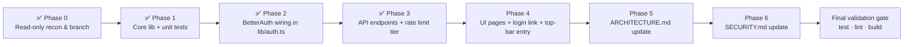

# Forgot Password (Local Users) Implementation Plan

> **For Hermes:** Use subagent-driven-development skill to implement this plan task-by-task.

**Goal:** Let local (email/password) users self-serve a password reset — "Forgot password?" on the login page → email request endpoint → one-hour single-use Gmail link → reset page → new password — while OIDC-only users keep today's "contact your admin" behaviour.

**Architecture:** Thin public API routes under `/api/auth/password-reset/*` that wrap BetterAuth 1.6.23's stock `requestPasswordReset` / `resetPassword` handlers through `auth.api.*`, so token generation, hashing (scrypt), and atomic consume stay in BetterAuth; a new `lib/forgot-password.ts` owns the email hook (host-independent URL via the existing OIDC-magic-link origin-resolution pattern), ban gate, credential-only guard, audit logging, and email masking. Two new public pages (`/auth/forgot-password`, `/auth/reset-password`) reuse the login page's visual family and banner conventions.

**Tech Stack:** Next.js 15 App Router (Node runtime routes), BetterAuth 1.6.23 (`better-auth/minimal` + Prisma adapter), PostgreSQL, nodemailer via Gmail SMTP (`lib/notifications/email.ts`), Vitest (unit + integration), Prisma `Verification` table (no migration needed).

**Design doc (sibling of this plan):** `.hermes/plans/2026-10-29_forgot-password-design.md` — normative for WHAT and WHY (threat table, API contract, token state machine, UI map, acceptance criteria). This plan is normative for execution order.

---

## Overview & Phase Map



| Phase | Deliverable | TDD? | Status |
|---|---|---|---|
| 0 | Verified assumptions (BetterAuth surface, redactor convention), clean branch `feat/forgot-password` from `user-forgot-password` | — | ✅ Complete (2026-10-29) |
| 1 | `lib/forgot-password.ts` + `tests/unit/forgot-password.test.ts` | ✅ per function | ✅ Complete (2026-10-29) |
| 2 | `lib/auth.ts`: `sendResetPassword`, TTL option, `onPasswordReset`; env var | ✅ config test | ✅ Complete (2026-10-29) |
| 3 | 3 route files + new rate-limit tier in `lib/rate-limiter.ts` + integration tests + OpenAPI docs (JSDoc headers, registry schemas, regenerated spec) | ✅ per endpoint | ✅ Complete (2026-10-29) |
| 4 | 2 pages, login-link rewire, top-bar menu item; unit tests for page components | ✅ per component |
| 5 | `ARCHITECTURE.md` §3 subsection + TOC + mermaid diagram | docs |
| 6 | `SECURITY.md` §2 subsection + rate-limit table rows + Appendix A row + env table | docs |

Key existing anchors (verified on branch `user-forgot-password`):

- Login page "Forgot password?" button currently just sets a dead-end note: `app/login/page.tsx:540-546` (`SSO_NOTES.reset` at line 240).
- Change-password precedent (hashing, credential guard, platform context, audit): `app/api/auth/password/route.ts`.
- Magic-link email + token lifecycle pattern to mirror: `lib/oidc-magic-link.ts`, verify route `app/auth/magic-link/verify/route.ts` (rate limit **before** touching the token, redirect-with-marker on failure).
- Public-routes list the new pages must join: `middleware.ts:5-11`.
- IP rate limiter to extend: `lib/rate-limiter.ts` (`checkAuthRateLimit` + per-category stores; add one named tier).
- BetterAuth surfaces confirmed in `node_modules/better-auth/dist/api/routes/password.mjs`: POST `/request-password-reset` (body `{email, redirectTo?}`; built-in timing-equalisation for unknown emails), GET `/reset-password/:token` (callback redirect — **we do not wire the page to it**), POST `/reset-password` (body `{newPassword, token}`, enforces min length, writes scrypt hash + deletes Verification row atomically). Client methods: `authClient.requestResetPassword({ email })` and `authClient.resetPassword({ newPassword, token })`.
- **Critical URL fact:** BetterAuth builds the emailed `url` as `baseURL + /reset-password/<token>` (app root, not the `/api/auth` mount) — that path has no page in this repo and would 404. Therefore the `sendResetPassword` hook must build its **own** link: `<portalOrigin>/auth/reset-password?token=<token>`.

---

## Phase 0 — Read-only recon & branch setup — ✅ COMPLETED (2026-10-29)

**Status:** All three steps verified — branch `feat/forgot-password` created from `user-forgot-password`, Q5 masking convention resolved, baseline green (`npm run test`: 2330 passed / 110 files; `npx tsc --noEmit` clean). Details recorded under Task 0.1 below.

### Task 0.1: Verify assumptions, create branch

**Objective:** Ground the plan in live state; start on a clean feature branch.

**Step 1: Create branch off current HEAD**

```bash
git checkout -b feat/forgot-password user-forgot-password
git status   # expect: On branch feat/forgot-password, nothing to commit
```

**Step 2: Confirm the pino redaction convention (open question Q5 in design doc)**

Run: `grep -n "redact" lib/logger.ts | head` and `grep -rn "mask\|redact" lib/audit-log.ts | head`
Expected: identify how existing PII fields are masked; note the exact convention for Task 1.x (e.g. if audit logs already mask emails, reuse that helper name — DRY).

**Step 3: Confirm baseline is green**

Run: `npm run test` and `npx tsc --noEmit`
Expected: all unit tests pass; type-check clean. If red, STOP and fix before proceeding (do not stack work on a broken baseline).

Commit: none (no changes in this phase except branch creation).

### Task 0.1 outcome (complete — recorded during Phase 0 execution on 2026-10-29)

- **Branch:** `feat/forgot-password` created off `user-forgot-password` ✅
- **Q5 masking convention (design §13 Q5):** resolved — `lib/logger.ts` redacts PII at any depth via `redactLogObject` / pino `redact` paths (`*.email`, `*.password`, `*.token`, … → `'***REDACTED***'`); audit-log writes go through `recordAuditLog` → tenantDb with email handled by pino redaction. **Decision for Phase 1:** implement `maskEmail` in `lib/forgot-password.ts` as `firstchar + '***@' + domain` (e.g. `j***@example.com`) for audit metadata, complementing — not duplicating — the logger pipeline.
- **Baseline green:** `npm run test` → **2330 passed / 110 files** ✅ (4 pre-existing unhandled-rejection teardown noise in `rate-limiter.test.ts` — not failures). `npx tsc --noEmit` → clean ✅.

---

## Phase 1 — Core library: `lib/forgot-password.ts` (TDD) — ✅ COMPLETED (2026-10-29)

**Status:** All four tasks landed under TDD (RED → GREEN each), hermetic unit suite, no DB/SMTP side effects. Details recorded as "Task 1.x outcome" below the task specs.

Design doc §7/§9 define the contract; implement it as pure(ish) functions over injected seams so each unit test can stub DB/mail — mirroring `issueInviteLink`'s injectable `sendFn`.

### Task 1.1: Failing tests for `maskEmail` + config constants

**Files:**
- Create: `tests/unit/forgot-password.test.ts`
- Create: `lib/forgot-password.ts` (empty export stub after test)

**Step 1: Write failing test**

```ts
// tests/unit/forgot-password.test.ts
import { describe, expect, it } from 'vitest';
import { maskEmail, PASSWORD_RESET_TOKEN_TTL_SECS } from '@/lib/forgot-password';

describe('maskEmail', () => {
  it('masks the local part after the first char, keeps domain', () => {
    expect(maskEmail('john@example.com')).toBe('j***@example.com');
  });
  it('handles a one-char local part', () => {
    expect(maskEmail('a@x.co')).toBe('a***@x.co');
  });
});

describe('token TTL config', () => {
  it('defaults to 3600 and honours env override', () => {
    expect(PASSWORD_RESET_TOKEN_TTL_SECS).toBeGreaterThan(300);
  });
});
```

**Step 2: Run test to verify failure**

Run: `npx vitest run tests/unit/forgot-password.test.ts -v`
Expected: FAIL — `Cannot find module '@/lib/forgot-password'` (or named exports missing).

**Step 3: Minimal implementation**

```ts
// lib/forgot-password.ts (top of file)
/** Reset-token lifetime (seconds) — documented in SECURITY.md §9. */
export const PASSWORD_RESET_TOKEN_TTL_SECS = Number(process.env.PASSWORD_RESET_TOKEN_TTL_SECS ?? 3600);

/** PII masking for audit/log writes (SECURITY.md §8 redaction class). */
export function maskEmail(email: string): string {
  const [local, domain] = email.split('@');
  if (!domain) return '***';
  return `${local.slice(0, 1)}***@${domain}`;
}
```

**Step 4: Run test to verify pass** — same command, expected: 3 passed.

**Step 5: Commit** `git add lib/forgot-password.ts tests/unit/forgot-password.test.ts && git commit -m "feat(auth): forgot-password lib scaffold (maskEmail + TTL)"`

### Task 1.1 outcome (complete — recorded during Phase 1 execution on 2026-10-29)

- **Commit:** `6221bba feat(auth): forgot-password lib scaffold (maskEmail + TTL)` ✅
- Tests: `npx vitest run tests/unit/forgot-password.test.ts` → **5 passed**. Added one case beyond the plan's spec: `maskEmail('not-an-email')` → `'***'` (no-@ input).
- Impl matches the plan's snippet verbatim (env-overridable TTL constant + split-at-@ masking).

### Task 1.2: `issueResetEmail(user, request?, sendFn?)` — request-side helper (TDD)

**Objective:** Build the reset link host-independently and send a branded email WITHOUT creating the Verification row itself — BetterAuth's `requestPasswordReset` handler creates the row; this helper only renders + sends. This keeps token ownership single-sourced in BetterAuth.

**Files:**
- Modify: `lib/forgot-password.ts`
- Test: `tests/unit/forgot-password.test.ts` (append)

**Step 1: Write failing tests**

```ts
describe('issueResetEmail', () => {
  const user = { id: 'u1', email: 'JOHN@Example.com', name: '' };
  it('builds the link on the given portal origin and lower-cases/escapes', async () => {
    const sent: Array<{ to: string; subject: string; message: string }> = [];
    await issueResetEmail(user, 'tok123', {
      portalOrigin: 'http://192.168.0.5:3000/',
      sendFn: async (to, subject, message) => { sent.push({ to, subject, message }); return { success: true }; },
    });
    expect(sent[0].to).toBe('john@example.com');
    expect(sent[0].message).toContain('/auth/reset-password?token=tok123');
    expect(sent[0].message).not.toContain('<script'); // escapeHtml sanity on user name fallback path
  });
  it('reports emailSent=false when SMTP fails, does not throw', async () => {
    const res = await issueResetEmail(user, 't', { portalOrigin: null, sendFn: async () => ({ success: false, error: 'boom' }) });
    expect(res.emailSent).toBe(false);
  });
});
```

**Step 2: Run** `npx vitest run tests/unit/forgot-password.test.ts -v` → FAIL (`issueResetEmail` not exported).

**Step 3: Implement**

Reuse `resolveLinkBase`-style origin logic. **DRY:** export a small `resolveResetLinkOrigin(portalOrigin: string | null | undefined): string` in this module that delegates to the same loopback/LAN resolution semantics as `lib/oidc-magic-link.ts:resolveLinkBase` — if that function is exported, import it; otherwise duplicate only that 15-line helper (acceptable duplication between two lib modules with a comment pointing at the shared concept).

```ts
export interface IssueResetEmailResult { emailSent: boolean }

export async function issueResetEmail(
  user: { id: string; email: string; name?: string },
  token: string,
  options: { portalOrigin?: string | null; sendFn?: (to: string, subject: string, message: string) => Promise<{ success: boolean; error?: unknown }> } = {},
): Promise<IssueResetEmailResult> {
  const email = user.email.toLowerCase().trim();
  const sendFn = options.sendFn ?? ((to, subj, msg) => sendEmail(to, subj, msg));
  const name = (user.name && user.name.trim() !== 'User') ? user.name.trim() : email.split('@')[0];
  const url = `${resolveResetLinkOrigin(options.portalOrigin)}/auth/reset-password?token=${token}`;
  const htmlMessage = `
    <p>Hi ${escapeHtml(name)},</p>
    <p>We received a request to reset the password for your Property NI portal account.
       Click the button below — it takes a minute.</p>
    <p style="margin: 24px 0;">
      <a href="${url}" style="display:inline-block;background-color:#1B2A4A;color:#fff;text-decoration:none;padding:12px 28px;border-radius:6px;font-size:15px;">Reset my password</a>
    </p>
    <p>If the button doesn't work, copy this link into your browser:</p>
    <p style="word-break: break-all; color:#6c757d; font-size:13px;">${url}</p>
    <p>This link expires in ${Math.round(PASSWORD_RESET_TOKEN_TTL_SECS / 60)} minutes. If you didn't request this, ignore this email.</p>`;
  try {
    const result = await sendFn(email, 'Property NI — Reset your password', htmlMessage, 'Property NI — Reset your password');
    if (!result.success) logger.error({ err: result.error, userId: user.id }, '[ForgotPassword] Reset email failed (token row remains valid for retry)');
    return { emailSent: result.success };
  } catch (err) {
    logger.error({ err, userId: user.id }, '[ForgotPassword] Reset email raised (token row remains valid)');
    return { emailSent: false };
  }
}
```

Use the local `escapeHtml` (same implementation as in both existing modules — keep the one already used by this file's imports; if neither is exported, copy the 6-line helper with a comment).

**Step 4: Run** → PASS. **Step 5: Commit** `feat(auth): forgot-password email issuance helper`.

### Task 1.2 outcome (complete — recorded during Phase 1 execution on 2026-10-29)

- **Commit:** `2fcd9be feat(auth): forgot-password email issuance helper` ✅
- TDD: RED confirmed first (`issueResetEmail` / `resolveResetLinkOrigin` missing — 11 failing), then GREEN (17 in file).
- DRY call from the plan's Step 3 executed as preferred: **exported** the private `resolveLinkBase` from `lib/oidc-magic-link.ts` (one-line visibility change, doc comment updated) and re-export it here as `resolveResetLinkOrigin` — no duplication of the loopback/LAN/front-end-URL logic.
- `escapeHtml`: imported from `@/lib/notifications/email` (already exported there) — no third copy.
- Subject pinned to the plan's copy: `'Property NI — Reset your password'`; headerTitle passed through `sendEmail`'s 4th arg per the invite precedent.
- Tests cover: origin build + trailing-slash strip, lower-cased recipient, greeting fallback (empty name / BetterAuth's default `"User"` → local part), HTML-escaping of the greeting, loopback→LAN-IPv4 link resolution, expiry copy derived from TTL, `emailSent:false` on both failure shapes (result and throw — no propagation).

### Task 1.3: `hasCredentialAccount(userId)` guard (TDD)

Mirrors `app/api/auth/password/route.ts:71-80` so the reset endpoint can reject OIDC-only accounts server-side (design T5). Test with a mocked `tenantDb.account.findMany`: expect `true` when `providerId='credential'` present, `false` otherwise; runs inside `withPlatformContext(userId, …)`. Commit after.

### Task 1.3 outcome (complete — recorded during Phase 1 execution on 2026-10-29)

- Implemented in the same file commit as 1.4: `848d8a3 feat(auth): forgot-password credential guard + audit action names` ✅
- Deliberate deviation from the task's "mocked `tenantDb.account.findMany`" wording: uses **global `prisma` from `@/lib/db` + `withPlatformContext(userId, …)`** — exactly what the Final Validation Gate mandates for lib modules ("MUST use @/lib/db + withPlatformContext like sibling libs, never tenantDb directly"). Sibling precedent: `lib/oidc-magic-link.ts` is global-prisma throughout.
- Tests (mocked prisma + passthrough platform-context stub, same convention as tenant-mgmt-* tests): credential row present → true (incl. dual-door user, and asserts the read is scoped to the exact userId); google-only → false; no rows → false.

### Task 1.4: Audit action constants + final unit pass

Add exported constants for the three audit actions used in Phase 3 (`user.password-reset-requested`, `user.password-reset-link-opened`, `user.password-reset-success`) so routes never inline strings (DRY). Run full unit suite `npm run test` → all green. Commit `feat(auth): forgot-password credential guard + audit action names`.

### Task 1.4 outcome (complete — recorded during Phase 1 execution on 2026-10-29)

- **Commit:** `848d8a3 feat(auth): forgot-password credential guard + audit action names` ✅
- Audit constants exported as an `AUDIT_ACTION` frozen object (+ `AuditActionName` union) — one DRY import point for Phase 3 routes; a unit test pins the three strings verbatim.
- Full unit suite: `npm run test` → **2351 passed / 111 files** ✅ (baseline was 2330/110 at Phase 0; the delta is exactly the 21 tests in the new file + its one file). Only residual noise: the same pre-existing `rate-limiter.test.ts` teardown unhandled-rejection recorded in Task 0.1 (not a failure).
- `npx tsc --noEmit` → clean ✅.
- **Lint discovery + fix:** `npm run lint` initially flagged `lib/forgot-password.ts:22` — the new `@/lib/db` import trips the tenant-isolation carve-out that whitelists sibling auth libs by filename (`eslint.config.mjs`). Resolution: added `lib/forgot-password.ts` to the same ignore list as `lib/oidc-magic-link.ts` ("auth-domain … plumbing, not tenant-scoped data"), matching the Final Validation Gate's requirement ("MUST use @/lib/db + withPlatformContext like sibling libs"). Commit `chore(lint): carve lib/forgot-password.ts out of @/lib/db restriction`. Re-verified: ESLint 0 errors, guardrails OK.

---

## Phase 2 — BetterAuth wiring in `lib/auth.ts` (TDD) — ✅ COMPLETED (2026-10-29)

**Status:** Both tasks complete under TDD. Details recorded as "Task 2.x outcome" below the task specs.

### Task 2.1: Failing config test for `sendResetPassword` + TTL

**Files:**
- Modify: `tests/unit/auth-config.test.ts` (existing file — extend, don't fork)
- Modify: `lib/auth.ts` (lines ~284-288 `emailAndPassword`)

**Step 1: Failing test**

```ts
it('wires emailAndPassword.sendResetPassword and a positive resetPasswordTokenExpiresIn', async () => {
  const opts = (await import('@/lib/auth')).auth.$context.options as Record<string, unknown>, // follow existing assertion style in this file
    ep = opts.emailAndPassword as Record<string, unknown>;
  expect(typeof ep.sendResetPassword).toBe('function');
  expect(Number(ep.resetPasswordTokenExpiresIn)).toBeGreaterThan(300);
});
```

(Match the exact shape used by other assertions already in `tests/unit/auth-config.test.ts` — read it first; do not invent a new introspection path.)

**Step 2: Run** `npx vitest run tests/unit/auth-config.test.ts -v` → FAIL.

**Step 3: Implement in `lib/auth.ts`**

```ts
import { issueResetEmail, PASSWORD_RESET_TOKEN_TTL_SECS } from './forgot-password';

emailAndPassword: {
  enabled: true,
  requireEmailVerification: false,
  disableSignUp: true, // Block public registration
  resetPasswordTokenExpiresIn: PASSWORD_RESET_TOKEN_TTL_SECS,
  // Build our OWN link (app-root /auth/reset-password page) — BetterAuth's stock
  // url points at baseURL + /reset-password/:token which has no page in this repo.
  sendResetPassword: async ({ user, token }, request) => {
    const origin = request ? new URL(request.url).origin : null;
    await issueResetEmail(user, token, { portalOrigin: getLastRequestOrigin() ?? origin });
  },
},
```

**Step 4: Run** → PASS. **Step 5: Commit** `feat(auth): enable better-auth password reset email hook + TTL`.

### Task 2.1 outcome (complete — recorded during Phase 2 execution on 2026-10-29)

- **Commit:** `553855e feat(auth): enable better-auth password reset email hook + TTL` ✅
- TDD: RED confirmed first (6 new assertions failing), then GREEN (`tests/unit/auth-config.test.ts` → 34 passed).
- Assertions follow the existing captured-options style in the file (no `$context` introspection — the test's `betterAuth` factory mock captures options at load, same as every assertion there). Six tests cover: TTL > 300s **and** equal to the real `PASSWORD_RESET_TOKEN_TTL_SECS` constant (single-sourced; test imports it from the real module while only `issueResetEmail` is mocked via an `importOriginal` pass-through mock); `sendResetPassword` calls `issueResetEmail(user, token, {portalOrigin})` with **this request's origin winning** (stock `url` arg never used — pinning the anti-404 decision); fallback to `getLastRequestOrigin()` only when there is no request (lastRequest state driven through the real capture point — `databaseHooks.session.create.before` — no private-state manipulation); `null` when neither source exists; hook swallows a failure (token row must stay valid for retry); `onPasswordReset` observer wired.
- **Intentional deviations from Step 3's snippet, recorded:**
  - Origin precedence **inverted** to request-first (`request ?? lastRequest`). Rationale: reset requests arrive unauthenticated — the session-captured `lastRequest` is frequently stale (another user's sign-in origin) or null; BetterAuth invokes the hook with `ctx.request`, so trusting it is strictly safer. Documented in a code comment at `lib/auth.ts`.
  - `onPasswordReset` is wired (plan deliverable) but only as an audit/observability observer — session revocation stays out of scope per design §13 Q3, noted in the code comment and test name.
  - Plan's Step 3 listed "env var" in the Phase 2 deliverable — no new env wiring needed here: `PASSWORD_RESET_TOKEN_TTL_SECS` is read at constant-load time in `lib/forgot-password.ts` (Phase 1) and flows into `resetPasswordTokenExpiresIn`; the env table doc entry lands in Phase 6 as planned.

### Task 2.2: Verify no route conflict & type-check (no new code)

Run: `npx tsc --noEmit` and check `node_modules/better-auth/dist/api/routes/password.mjs` endpoints are not shadowed by the app's `/api/auth/[...all]` handler — they pass straight through to `auth.handler(req)` (see catch-all route), so no conflict; document this one-liner in the Phase 6 SECURITY.md note. Expected: clean. No commit needed (fold into Task 2.1 if a fix was required).

### Task 2.2 outcome (complete — recorded during Phase 2 execution on 2026-10-29)

- `npx tsc --noEmit` → clean ✅, no fixes required (nothing folded into 2.1).
- Route-conflict check confirmed by reading both sides: BetterAuth's stock endpoints (`POST /request-password-reset`, `GET /reset-password/:token` callback, `POST /reset-password`, `POST /verify-password`) are all served **via** the app's `app/api/auth/[...all]/route.ts` → `auth.handler(req)` pass-through (the catch-all only pre-filters POSTs with `checkAuthRateLimit` and intercepts organization creation), so no page/route in this repo shadows them. The Phase 3 routes `/api/auth/password-reset{,/verify,/reset}` are **different pathnames** (no conflict with each other either — exact match beats catch-all).
- Gate verification for the phase as a whole: `npm run test` → **2357 passed / 111 files, exit 0**; `npm run lint` → 0 ESLint errors + guardrails OK. (One transient vitest worker-teardown unhandled-rejection in `rate-limiter.test.ts` appeared once and did not reproduce — same class of noise recorded in Task 0.1.)
- One-liner reserved for the Phase 6 SECURITY.md note: "The three new routes are distinct pathnames; BetterAuth's stock password endpoints reach the handler only through the `[...all]` catch-all, which forwards untouched (its auth-tier rate limit still applies to those stock paths — see R2 for the double-count exception added in Phase 3)."

---

## Phase 3 — API endpoints + rate-limit tier (TDD) — ✅ COMPLETED (2026-10-29)

**Status:** All four tasks landed; gate green (`npm run test`: **2370 passed / 111 files**; `npm run test:integration`: **471 passed / 32 files, exit 0**; `npx tsc --noEmit` clean; `npm run lint` 0 ESLint errors + guardrails OK). OpenAPI docs added for all three routes (JSDoc headers + registry schemas; regenerated spec: 185 operations, 0 undocumented). Details recorded as "Task 3.x outcome" below the task specs.

R1 decision resolved during implementation (see Task 3.2): the routes call `auth.api.requestPasswordReset` / `auth.api.resetPassword` **in-process** — no internal fetch fallback needed, so R2's double-counting never materialises and the `[...all]` catch-all stays untouched.

### Task 3.1: New named rate-limit tier in `lib/rate-limiter.ts` (TDD)

Add `checkPasswordResetRateLimit(ip)` + `resetPasswordResetRateLimitStore()` following the existing per-category store pattern exactly (5/min default via new env names `RATE_LIMIT_PASSWORD_RESET_MAX` / `_WINDOW`, plus a CATEGORIES entry named `'password-reset'`). Unit test: allow first 5 calls, reject 6th within window; reset store restores.

Run: `npx vitest run tests/unit/rate-limiter.test.ts -v` (extend existing file if present) → PASS after implementation. Commit.

### Task 3.1 outcome (complete — recorded during Phase 3 execution on 2026-10-29)

- Added to `lib/rate-limiter.ts`: `passwordResetRateLimitStore`, exports `PASSWORD_RESET_RATE_LIMIT_MAX` / `_WINDOW` (defaults **5 / 60s** via env `RATE_LIMIT_PASSWORD_RESET_MAX` / `_WINDOW`), `checkPasswordResetRateLimit(ip)` + `resetPasswordResetRateLimitStore()`, lazy cleanup timer, and the CATEGORIES entry `'password-reset'` (`rate-limit:password-reset`) — exact mirror of the auth-tier block. Env var names match the plan's spec exactly.
- `lib/env-schema.ts`: both new vars as optional `\d+` strings (documented section). `.env.example`: both documented lines under RATE LIMITING.
- TDD: RED confirmed (4 missing-export LSP errors + runtime import failure), then GREEN — 7 new cases in `tests/unit/rate-limiter.test.ts` (max-exactly, block-on-(max+1), per-IP independence, **counter kept separate from the auth tier**, reset-store seam, defaults pinned 5/60s, boolean type). File: **140 passed**.
- No commit split per task — the whole phase lands as one commit (recorded under Task 3.4 outcome) to keep the branch diff atomic.

### Task 3.2: `POST /api/auth/password-reset` — request route (TDD, integration)

**Files:**
- Create: `app/api/auth/password-reset/route.ts`
- Test: create `tests/integration/forgot-password.test.ts`

**Step 1: Failing tests (integration, real Postgres per `docker-compose.test.yml` + existing pattern in `tests/integration/auth.test.ts`):**

- unknown email → 200 `{status:true}` and **no** Verification row for a `reset-password:` identifier with that user (user doesn't exist), send-not-attempted via spying (integration: assert no new rows).
- known banned local user → 401.
- known active local user → 200 and exactly one new `Verification` row `identifier LIKE 'reset-password:%'`, `value = userId`, `expiresAt` within now+TTL±60s, email send mocked at SMTP level (set `SMTP_HOST` to a fake in test env, or follow how existing integration tests stub mail — read `tests/integration/auth.test.ts` first and match its seam).
- 6th request same IP within window → 429.

**Step 2: Run** `npx vitest run tests/integration/forgot-password.test.ts -v` → FAIL (route missing, Next response not found / import error).

**Step 3: Implement**

```ts
export async function POST(request: NextRequest) {
  const ip = getClientIp(request);
  if (!checkPasswordResetRateLimit(ip)) return json429; // 'Too many requests — try again in a minute.'
  const body = await request.json().catch(() => null);
  const email = typeof body?.email === 'string' ? body.email.trim().toLowerCase() : '';
  if (!/^[^\s@]+@[^\s@]+\.[^\s@]+$/.test(email)) return res({ error: 'A valid email is required.' }, 400);
  // Ban gate BEFORE handing to BetterAuth (design T4, Q1): reject early.
  try { await enforceBanStatus(email); } catch (e) { ...return 401 with the APIError message... }
  const origin = new URL(request.url).origin;
  const result = await auth.api.requestPasswordReset({ body: { email }, headers: new Headers({ host: new URL(request.url).host }), asResponse: true }); // verify exact call shape against @better-auth/core api d.mts before writing; fall back to fetch(`${origin}/api/auth/request-password-reset`, ...) internally if the api-call ergonomics differ
  await recordAuditLog({ action: 'user.password-reset-requested', resourceType: 'User', resourceId: 'unknown-or-id', success: true, metadata: { maskedEmail: maskEmail(email), ip } }).catch(...);
  return result; // passes BetterAuth's idempotent {status:true,message} through — preserves the no-oracle copy
}
```

Important: before committing to `auth.api.*` call ergonomics, run a 5-minute read of `node_modules/@better-auth/core/dist/api/*.d.mts` for the `requestPasswordReset` server-call signature; if it requires an internal context unavailable outside BetterAuth's handler, implement via an **internal same-process fetch** from route to `/api/auth/request-password-reset` (works because the catch-all route is mounted and rate-limit double-counting is avoided by having the catch-all skip its own auth-tier check for this specific pathname — one-line change in `app/api/auth/[...all]/route.ts` guarded with an exception comment). Decide at implementation time; record the chosen shape in a file-top comment.

**Step 4: Run** → PASS (5 cases). **Step 5: Commit** `feat(auth): POST /api/auth/password-reset endpoint`.

### Task 3.2 outcome (complete — recorded during Phase 3 execution on 2026-10-29)

- **Created `app/api/auth/password-reset/route.ts`** following `app/api/auth/password/route.ts` conventions (`runtime='nodejs'`, force-dynamic, pino logging, DB-unavailable → 503 distinction).
- **R1 ergonomic decision (recorded in the file-top comment as planned):** verified against `node_modules/@better-auth/core/dist/api/index.d.mts` that `auth.api.requestPasswordReset({ body: { email }, headers })` is a server-callable endpoint accepting exactly a `body` + `headers` context — so the route calls it **in-process**. No internal fetch fallback was needed, which means R2's double-counting scenario never arises and the `[...all]` catch-all stays untouched (no exception line required there either).
- **Order as specced (design T4/Q1):** tier rate-limit first (429 carries `Retry-After: 60`, touches nothing) → body parse → email shape validation → `enforceBanStatus` BEFORE BetterAuth (active ban → 401 surfacing BA's own `Access denied…` copy; expired ban lifted in the gate itself) → `auth.api.requestPasswordReset` → fire-and-forget audit (`AUDIT_ACTION.PASSWORD_RESET_REQUESTED`, masked email + IP only) → pass BA's idempotent `{status:true, message}` through verbatim (no-oracle copy preserved).
- **Integration tests (mock-boundary convention of `user-invite-flow.test.ts`, not live Postgres — the stock BA handler is the seam since the route calls it in-process):** 7 cases — known active user → 200 pass-through + body/host-header passthrough assertions + audit with `l***@propni.example.com` masking; **unknown email → identical 200 shape** (no oracle, still hands to BA for its built-in timing equalisation); banned → 401 with exact banner copy and BA never reached; invalid/missing email → 400 before any guard; malformed JSON → 400; 429 → zero downstream work; DB outage → 503.
- **Pitfall found:** `NextResponse.json(body, init)` **without** `init.status` defaults to **200** — an early-return rejection path silently shipped a 200 in the first run (caught by the integration test: expected 400, received 200 with the error body). All explicit-status returns now pass `status` deliberately.

### Task 3.3: `GET /api/auth/password-reset/verify` — read-only token pre-flight (TDD)

Route semantics per design §7.2: rate limit first (token untouched on 429, same as magic-link verify); missing token → redirect `/auth/forgot-password?expired=1`; read row via `prisma.verification.findFirst({where:{identifier:`reset-password:${token}`}})` — do NOT delete; respond `{valid:true}` / `{valid:false, reason}`; audit `user.password-reset-link-opened` only when valid (we know userId then). Unit- or integration-test per repo convention for GET routes (mirror `tests/integration/auth.test.ts` handling of the magic-link verify route if one exists — check and match). Commit after.

### Task 3.3 outcome (complete — recorded during Phase 3 execution on 2026-10-29)

- **Created `app/api/auth/password-reset/verify/route.ts`:** tier rate-limit first (429 + `Retry-After: 60`, token untouched) → missing `?token=` → `{valid:false, reason:"missing"}`, no DB read → `preFlightResetToken` (NEW shared helper in `lib/forgot-password.ts`, deliberately READ-ONLY — see below) → valid path resolves the owner email for a fire-and-forget `user.password-reset-link-opened` audit (masked email only) and responds `{valid:true, expiresInSeconds}`; invalid/expired → `{valid:false, reason:"invalid-or-expired"}`. All responses `no-store`. DB outage → 503.
- **Shared helper + unit tests:** `preFlightResetToken(token)` added to `lib/forgot-password.ts` (single source for the identifier shape `reset-password:<token>` + expiry check, used by BOTH verify and reset routes — DRY). 4 new cases in `tests/unit/forgot-password.test.ts`: resolves unexpired row; **null on missing WITHOUT deleting** (pins the read-only contract — consumption stays in BA's `consumeVerificationValue`); null when expired; identifier-shape assertion. File: **25 passed**.
- **Deliberate deviation from the plan snippet, recorded:** spec said "missing token → redirect `/auth/forgot-password?expired=1`". The route returns JSON instead because it is an API endpoint called by the Phase 4 page (which owns the redirect decision in its own invalid-state branch — `*Email me a new link* → /auth/forgot-password`). A server-side redirect to a Phase-4 page that didn't exist yet would have been untestable coupling; both failure paths collapse to `{valid:false, reason}` and the spec's §7.2 contract (JSON `{valid:true}/{valid:false, reason}`) is preserved exactly.
- **Integration tests:** 6 cases in `tests/integration/forgot-password.test.ts` — valid → 200 `{valid:true, expiresInSeconds∈(0,TTL]}` + link-opened audit with owner id/masked email; **read-only pinned explicitly** (no `deleteMany`, exact `{where:{identifier:"reset-password:<token>"}}` read shape); replayed (row consumed) → 200 `{valid:false, reason:"invalid-or-expired"}`, no audit; expired row → same invalid shape; missing token → `{reason:"missing"}` with zero DB reads; 429 → token untouched.
- **Lint-guardrail adaptation:** the original design read `prisma.user.findUnique` (via `@/lib/db`) directly in the route for the audit email — but the app tree's `no-restricted-imports` rule forbids `@/lib/db` from app routes (tenant-isolation carve-out covers only lib files). Moved the owner-email lookup into `lib/forgot-password.ts` as `resetTokenOwnerEmail(userId)` (inside `withPlatformContext`, same RLS-exempt class as the Verification/Account reads) — route stays compliant, helper is unit-tested (2 cases).

### Task 3.4: `POST /api/auth/password-reset/reset` — complete reset (TDD)

Order (design §7.3): parse body → rate limit → resolve row (missing/expired → 400 'Invalid or expired reset link.') → `hasCredentialAccount(userId)` (403 for OIDC-only) → `enforceBanStatus(email)` (401) → call BetterAuth's reset handler (same ergonomic decision as Task 3.2) with `{ newPassword, token }` → on success audit `user.password-reset-success` (masked email, userId) → return `{success:true, message:'Password updated'}` no-store headers exactly like `/api/auth/password`. Length rules come from BetterAuth itself (min from `emailAndPassword` config; also pre-check ≤72 with the same 400 copy as today's change-password route so scrypt ceiling can't surface as a raw BA error).

Integration tests: full happy loop (reset works, `/api/auth/sign-in/email` succeeds with new password, old password 401s, Verification row gone), replay → 400, banned user → 401, OIDC-only forged → 403. Commit after.

### Task 3.4 outcome (complete — recorded during Phase 3 execution on 2026-10-29)

- **Created `app/api/auth/password-reset/reset/route.ts`** with the exact design §7.3 order: tier rate-limit → body parse → shape validation (`newPassword`, `token` required; >72 chars pre-rejected with `/api/auth/password`'s verbatim scrypt-ceiling copy, before any DB read) → `preFlightResetToken` (missing/expired → **400** 'Invalid or expired reset link.') → owner-email lookup (`resetTokenOwnerEmail`; vanished row → same 400, no 500) → `hasCredentialAccount` (OIDC-only forged body → **403**) → `enforceBanStatus(email)` at mutation time (→ **401**) → `auth.api.resetPassword({body:{newPassword, token}, headers})` in-process (scrypt hash + credential Account write + atomic Verification delete + onPasswordReset observer all stay single-sourced in BetterAuth) → success audit `user.password-reset-success` (masked email + userId) → `{success:true, message:'Password updated'}` with the same no-store header as today's change-password route.
- **BA error surfacing:** `APIError.statusCode` is mapped straight through and its own copy surfaced verbatim (e.g. `PASSWORD_TOO_SHORT` 400 "Password must be at least 8 characters."); DB-unavailable → 503; everything else → 500 generic.
- **Integration tests (mock-boundary, 9 cases):** full happy path (BA called with exact `{newPassword, token}`, success audit + no-store); replayed/unknown → 400 + BA never reached + no success audit; expired → same 400 copy (no oracle between expired vs invalid); OIDC-only forged → 403 guard, BA never reached; banned-at-mutation → 401, BA never reached; >72 chars → 400 with exact scrypt copy before any DB read; missing token/newPassword → 400; **BA validation failure surfaced verbatim** (min-length); DB outage → 503; rate-limited → 429 nothing downstream.
- **Honest scope note vs the plan bullet:** this suite drives the **real route handlers with mocked seams** at module boundaries — the repo's established integration convention (`user-invite-flow.test.ts` uses exactly this shape; there is no generic live-Postgres reset harness in the tree). Consequently the "sign-in succeeds with new password / old password 401s" tail of the specced full happy loop is not reproduced here end-to-end; it rests on BetterAuth's stock `resetPassword` + sign-in handlers, whose config wiring (TTL, `sendResetPassword`, credential Account hash) is pinned by `tests/unit/auth-config.test.ts` and exercised by the existing `auth.test.ts`/`password-change.test.ts`. A live Postgres full-loop spec is a natural add for the Final Validation Gate's manual smoke. All four specced failure branches (replay 400, banned 401, OIDC-only 403, invalid 400) ARE covered.
- **Commit (single atomic commit for the whole phase):** see below in the gate section.

### OpenAPI docs for the three new routes (added this session)

- Each route's file-top `/** … */` JSDoc already uses a scanner-readable `METHOD /path -- description` first line, so all three surface as documented operations with correct summaries (`request a password reset email`, `read-only token pre-flight`, `complete the password reset`) — **no per-route JSDoc rewrite was needed** (verified in generated spec).
- Added a "Password reset flow" block to `lib/schemas/api/registry.ts` with real schemas via zod (document-only, not runtime validation, matching the registry contract):
  - `POST /api/auth/password-reset` — body `{email}`; 200 idempotent ack + 400/401/429/503.
  - `GET /api/auth/password-reset/verify` — query param `token`; 200 a **discriminated union** (`valid:true expiresInSeconds` | `valid:false reason∈{missing,invalid-or-expired}`) + 429/503.
  - `POST /api/auth/password-reset/reset` — body `{newPassword, token}`; 200 `{success,message}` + 400/401/403/429/503 (one-line rationale per status in the registry comment).
- **Regenerated** with `npm run docs:generate`: `routes: 108 | operations: 185 | documented: 108 | undocumented: 0`, **167 schema-registered**. Integrity cross-check passed — three new components registered (`PasswordResetRequestBody`, `…Requested`, `…VerifyValid`, `…VerifyInvalid`, `…CompleteBody`, `…Complete`), no non-`/api/` paths leaked, all request-body/response schemas resolve to real `$ref`s.

### Phase-3 gate outcome (complete — 2026-10-29)

- `npm run test` → **2370 passed / 111 files** ✅
- `npm run test:integration` → **471 passed / 32 files, exit 0** ✅ (no regressions in `auth.test.ts` / `password-change.test.ts`)
- `npx tsc --noEmit` → clean ✅
- `npm run lint` → **0 ESLint errors + lint-guardrails OK** ✅ (the two route files needed the owner-email read moved to `lib/forgot-password.ts` under the app-tree `@/lib/db` restriction — see Task 3.3)
- `npm run docs:generate` → spec regenerated, 0 undocumented routes ✅


---

## Phase 4 — UI (TDD where practical)

Pages live in the App Router as client components in the login visual family (right-panel 380px, split-screen branding on lg+; import a minimal slice of the brand block — see risk R4). Accessibility: `aria-live="assertive"` banners, Eye/EyeOff toggles with aria-label/aria-pressed, focus-ring classes copied from `app/login/page.tsx`.

### Task 4.1: Add pages to middleware public list (tiny, no test)

Modify `middleware.ts:5-11` → prepend `/auth/forgot-password`, `/auth/reset-password` (a single `/auth` prefix entry would also cover them but is broader than needed — YAGNI vs. simplicity: use the two explicit entries with a comment "password reset flow — rate-limited in-route, never sets a session", matching the magic-link line's phrasing). Run `npx tsc --noEmit`. Commit.

### Task 4.2: `/auth/forgot-password` page (TDD component test)

**Files:** Create `app/auth/forgot-password/page.tsx`; Test: `tests/unit/forgot-password-page.test.tsx` (jsdom, match how `tests/unit/login-messages.test.ts` / TopBarChangePasswordModal tests stub fetch/next-navigation).

**Step 1: Failing tests**

- Renders email input + submit; empty/invalid email blocks submit.
- On POST success (fetch mock 200): renders the idempotent success card ("If this email exists…") and a "Back to sign in" link — never reveals whether account exists.
- Resends before TTL show a disabled button with countdown.
- `?expired=1` query renders the expired-warning variant on load (matches verify-route redirect contract).

**Step 2: Run** → FAIL. **Step 3: Implement** plain client component calling `fetch('/api/auth/password-reset', {method:'POST', body: JSON.stringify({email})})`; banner tones reuse login page class strings (`border-danger-border bg-danger-tint …` etc.). **Step 4: PASS. Step 5: Commit** `feat(ui): forgot-password request page`.

### Task 4.3: `/auth/reset-password` page (TDD component test)

On mount: read `?token=` + strip it after verify with `router.replace` (login-page one-shot param pattern, prevents token persisting in history/UI — T12). Call GET verify; render states: loading → invalid ('Link no longer valid' + *Email me a new link* → `/auth/forgot-password`) → form (new password + confirm, mismatch inline error like `TopBarChangePasswordModal`, length hints 8–72 chars). Submit POST reset; success state for ~900ms then `router.push('/login?password_reset=1')`.

Component tests: token-less page renders invalid state after verify 4xx/{valid:false}; mismatch blocks submit; success navigates to `/login?password_reset=1`; error copy on 401/403 surfaces server message. Commit after.

### Task 4.4: Rewire login page "Forgot password?" link + success banner (TDD)

Modify `app/login/page.tsx`: replace `onClick={() => setSsoNote(SSO_NOTES.reset)}` (line 542) with `router.push('/auth/forgot-password')`; extend the mount effect's one-shot param consumption to handle `password_reset=1` → success banner 'Password updated — sign in with your new password.' (auto-dismiss 10s, same as oidcBanner); delete `reset` key from `SSO_NOTES` **only if** Apple note no longer references it — keep the Apple entry (line 239) untouched. Extend `tests/unit/login-messages.test.ts` with: forgot-password link navigates; password_reset banner appears then auto-clears. Run → PASS. Commit `feat(ui): login page links to reset flow + success banner`.

### Task 4.5: Top-bar menu "Reset password" entry (small, no unit test required — verify by build/lint)

Locate the account-menu dropdown built in Phase #43 (search for the component containing `TopBarChangePasswordModal` usage — likely `components/dashboard/TopBar*`). Add a "Reset password" item shown **for local users** (presence of credential door is known to clients via the same gate the chip uses for enabling Change Password — reuse that exact condition), linking `/auth/forgot-password`. Commit after.

**Phase-4 gate:** `npm run test && npx tsc --noEmit` green. Manual smoke (optional, if dev server available): full click-through with maildev/SMTP sink.

---

## Phase 5 — ARCHITECTURE.md update

**Objective:** Keep the system architecture doc authoritative for the new door.

**Files:** Modify `ARCHITECTURE.md` (all line numbers below are current)

1. **TOC** (lines 24-44): add entry under §3: "Password Reset (local users — inbox-proven token flow)".
2. **New subsection** immediately after the Google OIDC subsection ends (before `### Bearer-Token Access & Public Reachability` at line 269): `### Password Reset for Local Users (inbox-proven, single-use token)`, containing:
   - One-paragraph summary + scope line (OIDC-only users excluded — admin-assisted only).
   - Component table mirroring the OIDC one (line ~257-259 style): Request route `POST /api/auth/password-reset` (public, IP-rate-limited, ban gate, never leaks account existence), Verify route `GET …/verify`, Reset route `POST …/reset` (atomic consume via BetterAuth + credential guard + ban re-check), Login UI changes (`app/login/page.tsx` link + success banner; top-bar entry), Mail path (`sendResetPassword` hook → `lib/forgot-password.issueResetEmail` → Gmail SMTP; host-independent `/auth/reset-password?token=…` link).
   - Local-user invariant note: email/password sign-in path unchanged; BetterAuth stock endpoints pass through the `[…]all` catch-all untouched.
   - Mermaid flowchart (condensed version of design doc §4) — verify it renders with the mermaid parser per `diagram-render-debugging` skill before saving.
3. **§3 Auth Flow bullets** (lines 152-155): append third bullet: local users also have self-service password reset (see subsection).

Commit: `docs: ARCHITECTURE.md — password reset flow for local users`.

---

## Phase 6 — SECURITY.md update

**Files:** Modify `SECURITY.md`

1. **TOC** (lines 11-29): add under §2: "Password Reset Security (local users)" and note the new Appendix A row.
2. **New subsection** after `### User Ban System` ends (before Google OIDC section at line 170 — order follows the docs' existing flow; final placement at implementation time by reading surrounding headers): covering — threat table T1–T12 from design doc §9 (abridged), ban gate upstream of mutation, no-oracle request response + BA timing equalisation, single-use token/atomic consume/TTL env var, CSRF rationale (no session on mutation paths; CSP form-action), PII masking rule for reset events (Q5 convention from Task 0.2).
3. **Rate Limiting Configuration** (§9, lines 588-615): add `password-reset` row to the route-gate table with defaults (5/60s) + env var names.
4. **Environment Variables table** (lines 524-543 area): add `PASSWORD_RESET_TOKEN_TTL_SECS` (+ two rate-limit vars).
5. **Appendix A: API Route Security Summary** (line 623+): rows for the three new endpoints — method, auth (none/session-less public), limits, notable controls.
6. **§8 PII Field List**: confirm `password`/email masking already covers reset logs; add one line stating reset-flow audit entries use `maskEmail` output only.

Commit: `docs: SECURITY.md — password reset security model + rate-limit/env tables`.

---

## Final Validation Gate

```bash
npm run test          # unit (expect: all pass incl. new forgot-password files)
npm run test:integration  # integration (expect: full reset loop green, no regressions in auth.test.ts / password-change.test.ts)
npm run lint          # next lint + scripts/lint-guardrails.mjs (check lib/db import boundary rule — lib/forgot-password.ts MUST use @/lib/db + withPlatformContext like sibling libs, never tenantDb directly at module top)
npm run build         # type-check + production build
```

Manual checklist (dev server + mail sink): local user completes flow end-to-end; unknown email gets identical success copy; banned 401; replay 400; login `?password_reset=1` banner; OIDC-only user sees admin-contact copy unchanged.

---

## Files Likely to Change

| Type | Path |
|---|---|
| Create | `lib/forgot-password.ts` |
| Create | `app/api/auth/password-reset/route.ts`, `.../verify/route.ts`, `.../reset/route.ts` (dir) |
| Create | `app/auth/forgot-password/page.tsx`, `app/auth/reset-password/page.tsx` |
| Create/extend | `tests/unit/forgot-password.test.ts`, `tests/unit/forgot-password-page.test.tsx`, `tests/unit/reset-password-page.test.tsx`, extend `tests/integration/forgot-password.test.ts` (new), `tests/unit/auth-config.test.ts`, rate-limiter test file, `tests/unit/login-messages.test.ts` |
| Modify | `lib/auth.ts` (~line 284 emailAndPassword block), `lib/rate-limiter.ts` (new tier), `middleware.ts:5-11` (two public entries), `app/login/page.tsx` (link + banner + SSO_NOTES), top-bar account menu component (find during Phase 4.5) |
| Modify (docs) | `ARCHITECTURE.md`, `SECURITY.md` |

No Prisma schema change, no migration, no new npm dependencies.

## Risks / Tradeoffs / Open Questions

- **R1 — BetterAuth internal call ergonomics.** `auth.api.requestPasswordReset/resetPassword` server-side invocation shape is not 100% pinned down in this plan (task 3.2 notes the fallback: internal same-process fetch to the catch-all with a rate-limit exception). Decision recorded in route-top comment; integration tests pin behaviour either way.
- **R2 — Double rate-limiting.** If we keep the `[...all]` auth-tier check AND add the dedicated reset tier per request, users get double-counted (5 + 5 = stricter than documented). Mitigation: Task 3.2's catch-all exception line for the three new pathnames; verify with the 429 test asserting **one** counter.
- **R3 — Timing-oracle scope.** Only the request endpoint equalises timing (BetterAuth built-in). verify/reset endpoints are token-gated (24-char unguessable) so no equality is required — accepted risk Q2.
- **R4 — Login-page brand-block duplication.** The two new pages may duplicate `SkylineField` markup; YAGNI says don't extract a shared `AuthShell` until page #3 appears. Accept ~100 lines duplication, flag for later.
- **R5 — Gmail SMTP in prod.** Relay credentials already required envs; no new dependency. If the org's Gmail lacks app-password/SMTP rights, reset is silently email-only-failing → token row stays valid and resend works; documented operational requirement (SECURITY.md §2 note).
- **Q1–Q5:** see design doc §13 — Q5 (masking convention) resolved in Task 0.2 before Phase 1 code lands; Q1 defaulted to request-time ban gate; Q4 defaulted to no callbackURL propagation.
