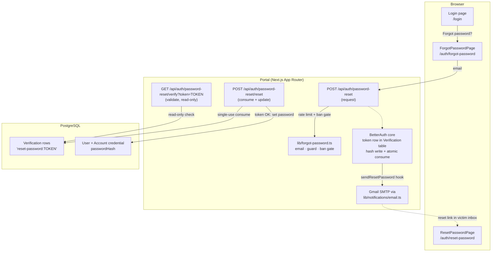
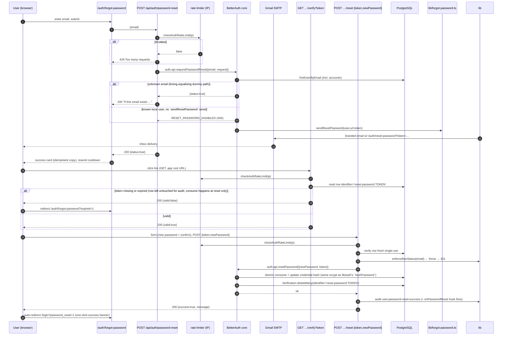
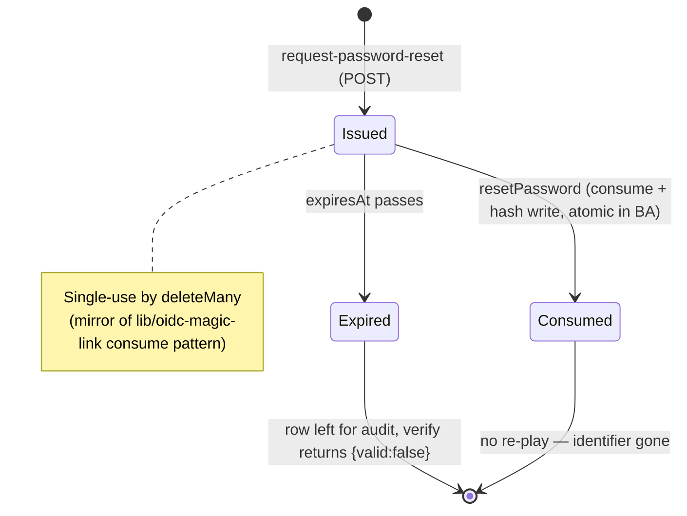
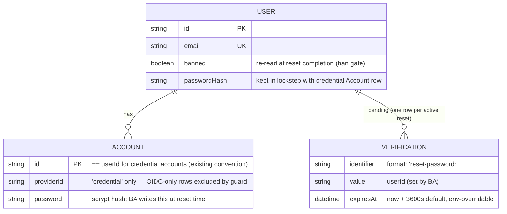
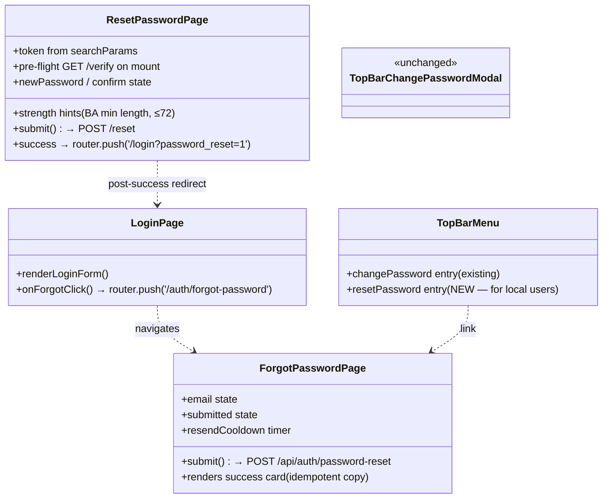

# Forgot Password (Local Users) — Detailed Design

Companion design document for the implementation plan in
`.hermes/plans/2026-10-29_155244-forgot-password-plan.md`. The plan is normative
for execution order; this file is normative for **what** gets built and **why**.

---

## 1. Goal & Scope

**Goal.** A local (email/password) user who cannot sign in can recover via a
self-service, inbox-proven password reset: click "Forgot password?" → enter email →
receive a one-hour single-use link → set a new password. OIDC-only users are out of
scope (they have no portal password); the UI tells them to contact their admin,
matching today's `SSO_NOTES.reset` copy.

**In scope.**

- New public API endpoints under `/api/auth/password-reset/…` (request, verify, reset).
- New library module owning reset tokens: issue/validate/consume semantics + ban check.
- Two new standalone UI pages (`/auth/forgot-password`, `/auth/reset-password`).
- Login-page "Forgot password?" link re-wired from a dead-end note to the request page.
- Account chip top-bar menu gains "Reset password" entry for local users.
- BetterAuth `lib/auth.ts` gains `sendResetPassword` + token-TTL via Gmail SMTP (existing `lib/notifications/email.ts`).
- Rate-limiting tier, ban enforcement on reset completion, audit log entries.
- Updated `ARCHITECTURE.md` §3 and `SECURITY.md` §2 (+ rate-limit + appendix tables).

**Out of scope.** Password-strength policy upgrade (reused as-is from BetterAuth),
localization, SMS fallback, OIDC user self-service reset, admin-side "reset by token" UI.

---

## 2. Non-Goals & Explicit Rationale

| Candidate | Decision | Why |
|---|---|---|
| Use `authClient.forgetPassword()` to hit BetterAuth's built-in `/api/auth/request-password-reset` directly | **No** | The emailed URL is `baseURL + /reset-password/:token`, where `baseURL` is the **app root** (our dynamic per-request base), not the `/api/auth` mount point — the link lands on a page that would 404. Our thin custom routes wrap BetterAuth's server-side handlers via `auth.api.requestPasswordReset(...)` / `auth.api.resetPassword(...)`, so all token logic lives in one place **and** we can issue/validate/consume from our own app-root URLs. The same reasoning is why the repo today wraps magic-link verification at `/auth/magic-link/verify` instead of BetterAuth's stock path. |
| Add `User.passwordResetTokenExpiresAt` column | **No** (YAGNI) | TTL is global in `lib/env`. Per-user override adds schema + migration surface for no product need. |
| Custom rate-limit store per endpoint | **Yes, shared auth tier** | Reuses the existing `checkAuthRateLimit` IP-keyed limiter (`lib/rate-limiter.ts`, 5/min default); new tier is config-only via env vars. Adds an audit-able CRITICAL log through the existing `reportThrottle`. |
| Revoke sessions of other users / cross-tenant | **No** | Reset only rewrites the target user's own credential hash inside one platform context (same invariant as `POST /api/auth/password`). |

---

## 3. Actors & User Stories

| Actor | Story |
|---|---|
| Local user | "I can reset my password from a browser I don't trust, without admin help." |
| Attacker with victim's email address | "Even if I guess the right email, I get no account-existence oracle and no token: the request endpoint always replies `200 {status:true}` with a non-distinguishing message (BetterAuth already simulates token generation + a dummy DB lookup for unknown emails to equalise timing — we inherit that)." |
| Attacker who intercepted the email in flight | "The link is single-use, one-hour TTL, and bound to no client state; once consumed it's gone. Reset completion while banned throws 401." |
| Portal admin | "I see `user.password-reset-*` entries in the audit log with masked user identity." |
| Banned local user | "Even with a valid reset link, the final POST is rejected at the ban gate (same `enforceBanStatus` choke point as sign-in)." |

---

## 4. System Context Flow

> Note on the "email link landing": `sendResetPassword` receives a BetterAuth-built
> `url = baseURL + /reset-password/<TOKEN>?callbackURL=...`. We **ignore** that URL's
> path and emit our own `<portalOrigin>/auth/reset-password?token=<TOKEN>` so the
> email is host-independent (same principle the OIDC invite magic link uses in
> `lib/oidc-magic-link.ts:resolveLinkBase`).

---

## 5. Detailed Sequence (happy + failure paths)

---

## 6. Token Lifecycle & State Machine

BetterAuth writes a `Verification` row with
`identifier = 'reset-password:<token>'`, `value = <userId>`,
`expiresAt = now + resetPasswordTokenExpiresIn` (default 3600 s, wired in `lib/auth.ts`).
**We do NOT consume inside `/verify`** — verification is read-only — so a user can
open the link on one device and complete it on another; consumption happens exactly
once at the final POST via BetterAuth's own endpoint.

### Invariants (must be preserved in code review)
1. **Uniqueness.** One `Verification` row per active reset request for a user; any prior pending row for the same user is not blocked (BetterAuth semantics) — the earlier link continues to work until its own expiry, exactly matching today's OIDC invite behaviour and matching what users expect (they may click whichever arrived last).
2. **Single-use.** Delete-then-update ordering inside BetterAuth; no re-play.
3. **No session minting at `/reset-password`.** The page is public in the middleware; only the final POST mutates data. Matches the OIDC magic-link design principle (ARCHITECTURE.md §3).
4. **Ban gate is upstream of mutation.** `enforceBanStatus` throws before BA's reset handler runs.

---

## 7. API Contract

All endpoints are public (no session required — that's the point), IP-rate-limited,
always same-origin, and return JSON shaped `{ status|success: boolean, message | error: string }`.
They sit under `/api/auth/…` so `middleware.ts`'s existing `PUBLIC_PATTERNS['/api/auth']`
already covers them — no middleware change needed for the API; only the two **pages**
need `/auth/*` added.

### 7.1 `POST /api/auth/password-reset` (request a reset)

| Field | Rule |
|---|---|
| Request body | `{ "email": string }` — zod `z.email()` minimum; server trims + lower-cases before lookup |
| Auth | **None** (public by design). Rate limit: shared auth tier (5/min per IP default), 429 on breach |
| User not found / no credential account | **Does NOT 404.** Always replies `200 {status:true, message:"If this email exists in our system, check your email for the reset link."}` — the anti-oracle rule. The `sendResetPassword` hook simply never runs, and a CRITICAL pino audit entry records an "unknown-email request" with **IP only** (no user) |
| Known local user | `200 {status:true}` + email queued; SMTP failure is logged (`logger.warn`) but the API still returns 200 — matching OIDC invite semantics in `lib/oidc-magic-link.issueInviteLink` |
| Existing banned user | `401 Access denied. <reason>` (ban gate up front — no link issued) |

### 7.2 `GET /api/auth/password-reset/verify?token=…` (token pre-flight for the page)

| Field | Rule |
|---|---|
| Query | `token: string` — required; missing → `{valid:false}` **redirect** to `/auth/forgot-password?expired=1` (matches how `/auth/magic-link/verify` handles a missing token today) |
| Unknown / expired token | `200 {valid:false, reason:'invalid' \| 'expired'}`; the page shows "Link no longer valid" and offers an *Email me a new link* CTA. The row is **not** deleted here — only the final POST consumes it |
| Fresh, un-consumed token | `200 {valid:true}` |

Purpose: this endpoint exists purely so the page can decide what to render on load and gives us an audit point for a "token viewed" event (we log `user.password-reset-link-opened` with userId + IP). It performs **no mutation**.

### 7.3 `POST /api/auth/password-reset/reset` (complete the reset)

| Field | Rule |
|---|---|
| Request body | `{ "token": string, "newPassword": string }` — zod; server-side checks: minimum length from `emailAndPassword.minPasswordLength` (default 8), ≤ 72 chars (scrypt ceiling, same as today's `/api/auth/password`) |
| Pre-checks order | rate limit → ban gate (`enforceBanStatus` on the user identified by token) → credential-only guard (reject OIDC-only accounts server-side even if a client forged a request — mirrors `app/api/auth/password/route.ts:71-80`) |
| Success | `200 {success:true, message:"Password updated"}`; BetterAuth's handler does the hash write **and** token delete atomically; we record audit `user.password-reset-success` (+ `onPasswordReset` hook fires for any future extensions) |
| Invalid/expired/replayed token | `400 {error:'Invalid or expired reset link.'}` (no user info disclosed) |
| Ban triggered mid-flow | `401 Access denied. <reason>` |

---

## 8. Data & State Changes

No schema migration required — all three models already exist and are used by the
existing magic-link flow. No RLS interaction: `User`, `Account`, and `Verification`
are the same RLS-exempt global models the existing `/api/auth/password` route uses,
accessed via `withPlatformContext(userId, …)` / `tenantDb` exactly like that route.

**Email template contract** (sent via `lib/notifications/email.sendEmail`, branded
NIPP template):

- **Subject:** `Property NI — Reset your password`
- **Body:** greeting (name fallback = email local part, same convention as OIDC invite), one sentence explaining why this email is here, primary CTA button `Reset my password` → `<portalOrigin>/auth/reset-password?token=<TOKEN>`, plain-text link below the button, expiry note ("This link expires in 60 minutes. If you didn't request this, ignore this email.").
- **No PII beyond name/email.** Masking rule: never include user's org, role, or other users' data.
- **Idempotent resend:** if the user hits "Resend" before the previous link expired, a second token is issued (BA semantics) and both links remain valid until their own expiries — documented behaviour, not a bug.

---

## 9. Security Model & Threat Table

| # | Threat | Control | Where |
|---|---|---|---|
| T1 | User-enumeration via request endpoint | Always-200 + non-distinguishing copy; BA already does dummy token generation + DB lookup for unknown emails to equalise timing (verified in `node_modules/better-auth/dist/api/routes/password.mjs` `requestPasswordReset`) | API #7.1, `lib/forgot-password.ts` |
| T2 | Brute-force of the request endpoint | Shared IP rate-limit tier (default 5/min), env-tunable, CRITICAL log + SSE alert via existing `reportThrottle` | `checkAuthRateLimit(ip)` in all three endpoints |
| T3 | Link interception / replay | Single-use token with atomic delete-on-consume; one-hour TTL (env-overridable); no client-state binding | BetterAuth internals, consumed at #7.3 |
| T4 | Banned-account self-service | `enforceBanStatus` throws before BA's reset handler runs — **the same choke point as both sign-in doors** (SECURITY.md §2) | `lib/forgot-password.ts:completeReset` |
| T5 | Forged client-side reset for an OIDC-only user with a token | Server-side credential guard mirrors `/api/auth/password`: no `providerId='credential'` row → 403 | API #7.3, `lib/forgot-password.ts:hasCredentialAccount` (DRY helper) |
| T6 | Email phishing using our brand | Same Gmail relay identity + domain as all existing NIPP mail; footer "automated notification from Property NI"; no credentials ever asked in email; link is same-origin only | `sendResetPassword` hook, email template §8 |
| T7 | CSRF on the reset POST | Public route with **no session cookie involvement** on mutation (the endpoint does not read a session); token itself is the auth factor. Same origin enforced by BetterAuth's built-in `originCheck` middleware on the stock endpoints we wrap, plus `middleware.ts`'s CSP `form-action 'self'` | API #7.3 + existing CSP |
| T8 | Audit-log PII leakage | Emails masked (`j***@…`) in every log/audit write for reset events; IP-only recording on unknown-email requests (no identifier at all) | `lib/forgot-password.ts:maskEmail`, audit calls; consistent with SECURITY.md §8 redaction list |
| T9 | Log injection via new password or email | Password is never logged (only length check runs); email value in logs goes through the existing pino redactor pipeline — no raw PII strings concatenated into log messages | Existing `logger` config, rule in code review checklist |
| T10 | Gmail SMTP relay failure mid-flow | `sendResetPassword` catch-and-log (never throws back to the request handler); token row remains so a retry / resend works; matches OIDC invite resilience design | `lib/forgot-password.ts:issue`, mirrors `oidc-magic-link.issueInviteLink` |
| T11 | Cross-tenant data exposure via reset | All DB access inside `withPlatformContext(userId, …)` on the **token-derived** userId only — no tenantId from request body can steer it; identical isolation class to `/api/auth/password` | API #7.3 |
| T12 | Token leakage into a referer header | Tokens appear only in email + the reset page URL; `Referer` header carries them on internal navigations, so the reset POST's response sets no cross-site-safe cookies and the page clears the token from `window.location` (via `router.replace` to `?=`) after successful reset — same one-shot parameter pattern the login page already uses for `?oidc=`, `?error=…` | ResetPasswordPage mount effect |

**Operational requirement:** Gmail SMTP credentials (`SMTP_HOST/PORT/USER/PASS/FROM`)
already required by `lib/env-schema.ts`; no new env vars for email. **New** env var:
`PASSWORD_RESET_TOKEN_TTL_SECS` (default 3600) read in `lib/auth.ts` and documented in
SECURITY.md §9 "Rate Limiting / Auth Configuration".

---

## 10. UI Component & Page Map

Both new pages share the **login-page visual family** (right-panel width 380 px,
split-screen on lg+, navy-950 branding block reuses `SkylineField` via a small shared
extract — YAGNI: keep the component extraction optional and only pull it out if the
third page in this family is built; today the two new pages can each import/login-inline
the minimal bits they need).

Accessibility contract (matches login page):
- `aria-live="assertive"` for error/success banners (login page uses this exact pattern at line 463).
- Password inputs with inline Eye/EyeOff toggle (`aria-label` + `aria-pressed`) — reuse the same input markup shape as `TopBarChangePasswordModal.PasswordInput`.
- Keyboard-focus visible via the login form's existing focus-ring classes.

---

## 11. Configuration & Environment Variables

| Var | Default | Purpose | Read by |
|---|---|---|---|
| `PASSWORD_RESET_TOKEN_TTL_SECS` | `3600` | Reset token lifetime (seconds); wired into `emailAndPassword.resetPasswordTokenExpiresIn` in `lib/auth.ts` and documented | `lib/auth.ts`, docs §9 |
| `RATE_LIMIT_PASSWORD_RESET_MAX` / `_WINDOW` | reuse `RATE_LIMIT_AUTH_*` (5/60) | Per-IP request reset endpoint limits; separate env names so ops can tune the reset tier independently from login brute-force without a code change | `lib/rate-limiter.ts` (tiny addition: new named tier, same store mechanics) |
| Existing SMTP vars | — | Gmail relay, unchanged | `lib/notifications/email.ts` |

No schema or seed changes. No migration script.

---

## 12. Test Matrix (design-level; the plan lists exact test files)

| Area | Case | Expected |
|---|---|---|
| Unit — issue | unknown email → sendResetPassword never called, returns idempotent `status:true` copy | ✅ matches T1 oracle rule |
| Unit — issue | banned user → `sendResetPassword` not called, 401 raised before BA call | ban gate upstream of mutation |
| Unit — verify | missing / malformed token → `{valid:false}` (no DB write) | read-only endpoint invariant |
| Unit — verify | expired token → `{valid:false, reason:'expired'}` | state machine edge |
| Unit — reset consume | valid token + OIDC-only account (forged request) → 403, credential guard fires | T5 |
| Unit — reset consume | valid token + banned user → 401 before BA call | T4 |
| Unit — email masking | `maskEmail('john@example.com')` → `j***@example.com` (or equivalent chosen convention) | T8 |
| Integration (Postgres, `tests/integration`) | POST request → token row exists in `Verification` with correct format + expiresAt ≈ now+TTL | DB-level proof the flow is wired through BA |
| Integration | Full loop: request → verify (valid) → reset → new password signs in via `/sign-in/email`, old one fails, token gone from DB | End-to-end contract |
| Regression | Existing `tests/integration/password-change.test.ts` + `auth.test.ts` + `login-messages.test.ts` pass unchanged | No behavioural drift on the existing doors |

Acceptance criteria (all must hold before merge):

1. Local user completes the full flow with no admin help, using only public endpoints.
2. The request endpoint leaks **no** information about whether an email is registered.
3. Banned users cannot reset (401 at completion, even with a valid live token).
4. OIDC-only accounts cannot reset via forged requests (403 server-side).
5. Token is single-use and expires per TTL; replays are refused.
6. All three endpoints log through the existing pino + audit pipeline; no raw email in logs.
7. `npm run test`, `npm run lint`, `npm run build` all green, and `ARCHITECTURE.md` /
   `SECURITY.md` both updated with the new subsections + Mermaid diagrams (Phase 5 & 6 of the plan).

---

## 13. Open Questions (answer before Phase 4 starts)

| # | Question | Proposed default if unanswered at plan time |
|---|---|---|
| Q1 | Should a **banned** user even be allowed to request a reset link (they'd be blocked at completion anyway)? Request-time ban check gives an earlier, clearer 401 — proposed above. | Keep the request-time ban gate (design §7.1). |
| Q2 | Is per-**user** rate limiting on the verify/reset endpoints needed, given tokens are unguessable (24 chars) and single-use? | No — IP tier is sufficient; document as an accepted risk (T3). |
| Q3 | Should `onPasswordReset` (BetterAuth hook) also be wired to **revoke other active sessions** for the user (defence-in-depth: "if I reset my password, kill all my other devices")? Not in scope today. | Out of scope; note as a future enhancement. |
| Q4 | Should the emailed link include `callbackURL` so the user lands back where they started (as BetterAuth's stock URL supports)? Login flow already honours `?callbackUrl=`. | Keep it simple: always land on `/auth/reset-password`; after success → `/login?password_reset=1`. No callbackURL propagation in v1. |
| Q5 | Exact email-privacy masking convention (`j***@…` vs `jo***n@…`)? Match existing audit-log redaction behaviour — need to confirm the current convention before Phase 3 code lands. | Check `lib/audit-log.ts` / `lib/logger.ts` redactor config and reuse whatever it does for other PII fields; do not invent a new scheme.
