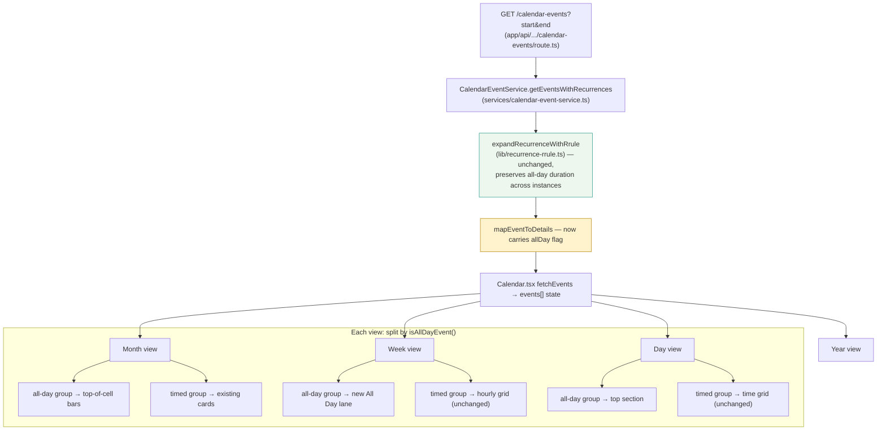

# All-Day Events — Design Document

**Feature:** "All day" events in the Property NI portal calendar.
**Status:** Proposed (design)
**Date:** 2026-11-05
**Branch:** `calendar-all-day-event`

---

## 1. Summary

Today every calendar event carries a start **time** and end **time** (`startDate`/`endDate` as local `DateTime`). There is no way to express an event that occupies whole days with no time-of-day — the closest workaround (a fixed 09:00–17:00 "working day" convention from an earlier repo) is a hack, not a real feature.

This design adds a genuine **All day** flag to events and renders them the way Google Calendar does:

- A single **"All day"** toggle in the create/edit modal that hides the time fields.
- A dedicated **all-day lane** at the top of Week and Day views (above the 00:00 hour), and a distinct treatment at the top of each Month cell.
- Correct multi-day spanning, recurring all-day series, drag-to-move-by-day, and consistent behaviour across Month / Week / Day / Year views, the Upcoming Events sidebar, and notifications.

The change is **additive**: one nullable `Boolean` column, a new render lane, and modal wiring. It reuses the existing rrule expansion engine, service layer, and tenant isolation without modifying their date conventions.

---

## 2. What "Google Calendar" means here (behaviour spec)

We match Google's **user-facing** semantics, not its internal storage:

| Behaviour | Google Calendar | This design |
|---|---|---|
| How you mark an event all-day | "All day" checkbox in the dialog | "All day" toggle in `CalendarEventModal` |
| Time fields when all-day | Hidden / disabled | Start Time & End Time inputs hidden; a single "All day" indicator shown |
| Multi-day | End date is selectable, event spans days | End Date input stays; event spans start→end inclusive |
| Month view | Solid bar at top of each day cell, visually separate from timed chips | Distinct filled bar rendered **above** the timed-event list in each cell |
| Week / Day view | A dedicated "All Day" row above the time grid, spanning columns with start/middle/end caps | New all-day lane pinned above the hourly grid; multi-day events get `▸ … ◂` caps |
| Recurring all-day | Supported (e.g. "every Monday, all day") | Supported via existing rrule engine (dtstart at midnight) |
| Drag to move | Moves by day, no time change | Date-only move; vertical drag delta ignored for all-day events |
| Time shown on the event | None ("All day" label instead) | "All day" label replaces `HH:mm – HH:mm` |

**Deliberate divergence — storage convention.** Google stores all-day end dates as *exclusive* (a single-day Mon event = start Mon, end Tue). This codebase stores **inclusive** end dates everywhere (`endDate` = 23:59:59.999 of the last day), and the rrule expansion engine preserves `durationMs = endDate − startDate` across occurrences. Introducing an exclusive convention *only* for all-day events would create two competing date rules in one codebase — a classic source of off-by-one bugs. So we keep **one** inclusive convention for all events and express "all day" purely as:

```
allDay = true
startDate = 00:00:00.000 (local) of the first day
endDate   = 23:59:59.999 (local) of the last day
```

The *rendering* is Google-faithful (dedicated lane, no times); only the *storage* stays consistent with the existing engine and views. This means **zero changes** to `expandRecurrenceWithRrule`, `recurrence-scopes.ts`, the service's range queries, or the SSE scheduler's date math — they all already handle inclusive multi-day spans.

---

## 3. Data model

### 3.1 Schema change

One additive column on `CalendarEvent` (`prisma/schema.prisma:667-686`):

```prisma
model CalendarEvent {
  // ... existing fields ...
  startDate   DateTime
  endDate     DateTime

  /** True when the event occupies whole days with no time-of-day.
   *  When true, startDate is local midnight of the first day and
   *  endDate is 23:59:59.999 of the last day (inclusive). */
  allDay      Boolean  @default(false)

  // ... rrule, exdates, relations, indexes unchanged ...
}
```

- **Migration:** `prisma migrate dev --name add_calendarevent_allday` — a nullable-by-default column; existing rows become `allDay = false`. No data backfill needed (no existing event is all-day).
- **RLS / tenant isolation:** `CalendarEvent` is already in `TENANT_SCOPED_MODELS` and has an `organizationId` RLS policy (`prisma/seed.ts:81`). The new column needs no policy change.

### 3.2 Type changes

| File | Change |
|---|---|
| `components/calendar/types.ts:35-59` | Add `allDay?: boolean;` to `CalendarEvent` |
| `services/calendar-event-service.ts:75-94` | Add `allDay?: boolean;` to `CalendarEventWithDetails` |
| `services/calendar-event-service.ts:26-44` | Add `allDay?: boolean;` to `CreateEventInput` |
| `services/calendar-event-service.ts:46-65` | Add `allDay?: boolean;` to `UpdateEventInput` |

### 3.3 Normalisation rule (single source of truth)

All date normalisation for all-day events happens in **one** place — a small pure helper the service calls on create and update:

```ts
// lib/all-day.ts  (new)
export function normalizeAllDayDates(
  startDate: Date, endDate: Date, allDay: boolean,
): { startDate: Date; endDate: Date } {
  if (!allDay) return { startDate, endDate };
  const s = new Date(startDate); s.setHours(0, 0, 0, 0);
  const e = new Date(endDate);   e.setHours(23, 59, 59, 999);
  // Guard: an all-day event may not end before it starts.
  if (e.getTime() < s.getTime()) { /* caller validates; keep as-is */ }
  return { startDate: s, endDate: e };
}

/** True when a stored event is all-day (defensive — also covers legacy rows). */
export function isAllDayEvent(e: { allDay?: boolean; startDate: Date; endDate: Date }): boolean {
  if (e.allDay) return true;
  // Legacy fallback: midnight→23:59:59.999 on the same day with no explicit flag.
  const s = e.startDate, en = e.endDate;
  return s.getHours() === 0 && s.getMinutes() === 0 &&
         en.getHours() === 23 && en.getMinutes() === 59 &&
         s.getDate() === en.getDate();
}
```

The client mirror (`components/calendar/calendar-utils.ts`) re-exports `isAllDayEvent` so views can branch on it without re-implementing the check.

---

## 4. UI / UX design

> Mode: **Operate** (per the impeccable skill) — this is app UI where scanability, consistency, and native expectations outrank expression. We add a lane users already know from Google Calendar; we do not invent a new visual language. Brand lives in precise detail (existing Navy `#1B2A4A` / Amber `#F5A623` tokens, existing type scale).

### 4.1 Create / Edit modal (`CalendarEventModal.tsx`)

Current layout order (per the modal contract): Title → Description → Event Type → **Date & Time 2×2 matrix** → Repeat Option → Number of times → Scope picker → footer.

The all-day toggle slots into the date/time region:

```
┌───────────────────────────────────────────────┐
│ [All day]  ☑   (checkbox, left-aligned)        │
├───────────────────────────────────────────────┤
│ Start Date        End Date                     │
│ [2026-11-05 ]    [2026-11-07 ]                │   ← both date inputs remain
│                                                 │
│  (Start Time / End Time hidden when All day)   │
└───────────────────────────────────────────────┘
```

- **Unchecked (timed):** today's exact 2×2 matrix — Start Date / Start Time / End Date / End Time. No change.
- **Checked (all-day):** the two **time** inputs are removed from layout; a single read-only "All day" pill spans where they were. Both **date** inputs remain so multi-day events work. The `min={startDate}` clamp on End Date is preserved.
- **State:** new `const [allDay, setAllDay] = useState(false)` in the modal; pre-filled from `event.allDay` (via `isAllDayEvent`) in the existing `useEffect([event])`.
- **Save payload:** when `allDay`, the modal sends `startDate`/`endDate` at the day boundaries and `allDay: true`; the service re-normalises defensively. When unchecking on an existing all-day event, the time inputs reappear defaulting to `09:00`–`17:00` (a sane working-day default) so the user has a starting point.
- **View mode:** shows "All day" in place of the `HH:mm – HH:mm` line; repeat label unchanged.

The toggle is a plain accessible checkbox (`<input type="checkbox">`) styled to match the existing field chrome — not a custom switch, to stay consistent with the form's native inputs.

### 4.2 Month view (`CalendarMonthView.tsx`)

Each day cell currently renders `dayEvents.slice(0, 3)` compact cards + an overflow indicator. We split each cell's events into **all-day** and **timed** groups:

```
┌─────────────┐
│          5   │  ← day number (top-right)
│ ▉ All-day ev│  ← all-day bar(s), solid fill, left accent, NO time
│ ● Timed 10a │  ← existing compact cards (unchanged)
│ +2 more     │
└─────────────┘
```

- All-day events render **above** the timed list, as a solid filled bar (`backgroundColor: color` at higher opacity than the `color30` chips, with a 2px left accent in the event colour). They show title + `↻` if recurring, no time.
- Multi-day all-day events keep the existing `start`/`middle`/`end` position logic (the cell already computes day spans); only the visual treatment differs from timed multi-day bars.
- Overflow: all-day bars count toward the cell's visible budget; when a cell is full, all-day events are prioritised for display (they carry no time, so they're the "headline" of the day).

### 4.3 Week view (`CalendarWeekView.tsx`)

The single scrollable grid currently has: sticky day-header row → time-label column + 7 hourly day columns. We insert an **All Day lane** directly under the header row and above the hour `0` line:

```
┌─────┬────────┬────────┬─────────┐
│GMT  │ Mon 5  │ Tue 6  │ Wed 7   │  ← sticky day headers (unchanged)
├─────┼────────┼────────┼─────────┤
│All  │▉Event A ▉Event A▸│ ▉Event B│  ← NEW all-day lane (one row, ~28px)
│day  │        │        │         │
├─────┼────────┼────────┼─────────┤
│     │ 0      │ 0      │ 0       │
│ 1am │ 1      │ 1      │ 1       │  ← hourly grid (unchanged)
│ ... │ ...    │ ...    │ ...     │
└─────┴────────┴────────┴─────────┘
```

- The lane is a new grid row spanning the same `grid-cols-[4rem_repeat(7,minmax(0,1fr))]` tracks, so its day columns line up exactly with the hourly columns below (the header already proves this track alignment works).
- The left `4rem` cell shows the label "All day" (muted, like the GMT cell).
- Each day column in the lane renders that day's all-day events as full-width bars; multi-day events get `▸`/`◂` caps and a continuous fill across columns (reusing the existing `position` start/middle/end logic).
- The lane is **not** part of the scrollable hour body height calc — it sits at the top inside the same scroll container so it scrolls away with the header, matching Google.

### 4.4 Day view (`CalendarDayView.tsx`)

Same treatment as Week: an "All day" section directly under the day header and above the time grid, listing that single day's all-day events as full-width bars (no column-spanning needed — one day). Timed events below are unchanged.

### 4.5 Year view (`CalendarYearView.tsx`)

No structural change. All-day events already overlap their days and appear as dots / monthly counts via `generateYearMonths` (`calendar-utils.ts:238-288`), which iterates day-by-day over `startDate→endDate`. Because all-day events store inclusive spans, they're already counted correctly. We only verify (test) that an all-day event registers on each day it spans.

### 4.6 Upcoming Events sidebar (`CalendarSidebar.tsx`)

All-day events appear in the sidebar with an "All day" label instead of a time. `getUpcomingEvents` already returns them (they have a `startDate`); we only change the *display* formatting to detect `isAllDayEvent` and render "All day".

---

## 5. Rendering data flow



The key point: **the expansion engine and service are untouched.** The `allDay` flag rides along on each instance (it's a plain field passed through `{ ...event }` in `expandRecurrenceWithRrule`). Views branch on it at render time.

---

## 6. Recurrence interaction

An all-day recurring event is just a recurring event whose base instance starts at midnight. The existing rrule engine handles it with no changes:

- `buildRruleJson` (`calendar-event-service.ts:168-189`) sets `dtstart = startDate` → midnight for all-day. ✓
- `expandRecurrenceWithRrule` preserves `durationMs` (e.g. 3 days) across every occurrence, so a "every Monday, 3-day, all-day" series expands to 3-day spans each week. ✓
- Edit scopes (`this` / `following` / `all`) in `lib/recurrence-scopes.ts` operate on dates and exdates — unaffected by the flag. A dragged/edited all-day instance creates an all-day override (the scope handlers copy the event's fields, so we ensure `allDay` is carried onto detached overrides — see plan Phase 4).
- The modal allows **both** "All day" and a repeat frequency simultaneously (e.g. All day + Weekly) — these are orthogonal.

```mermaid
sequenceDiagram
    participant U as User
    participant M as Modal
    participant S as Service
    participant R as rrule engine
    U->>M: check "All day", pick Weekly, save
    M->>S: POST { startDate: Mon 00:00, endDate: Mon 23:59:59.999, allDay: true, recurrence: WEEKLY }
    S->>S: normalizeAllDayDates (no-op, already at boundaries)
    S->>R: buildRruleJson(dtstart = Mon 00:00)
    Note over R: expands each Monday to a midnight→23:59:59.999 span
    R-->>S: instances (allDay carried through)
    S-->>M: saved; calendar re-fetches range
```

---

## 7. Drag-and-drop

All-day events move **by day only** — there is no time-of-day to change.

- **Month view:** already date-only (`handleDrop` with no `e` preserves the hour, but for all-day the hour is meaningless). We branch: if `isAllDayEvent(existing)`, set `newStart = midnight(date)`, `newEnd = 23:59:59.999 of (date + spanDays − 1)`. No vertical logic.
- **Week / Day views:** all-day events live in the top lane, not the hourly grid, so a drop onto a day column is inherently date-only. The existing vertical-delta block (`if (e)` in `handleDrop`, `Calendar.tsx:419-439`) must be **skipped** for all-day events.
- Recurring all-day instances use the same `editScope: "this"` detach flow as timed recurring events; the override is created all-day.

---

## 8. Notifications

### 8.1 SSE "due to start" (`lib/calendar-event-scheduler.ts`)

**Decision: exclude all-day events from the due-to-start scanner.** An all-day event has no meaningful start *time*; firing a "starts at 00:00" alert is noise. The scanner's two discovery queries (`findMany` at `calendar-event-scheduler.ts:153,176`) gain an `allDay: false` filter (or a code-level skip). This is the cleanest interpretation and matches user intuition — all-day events are "happening today", not "about to start".

> **Open question:** some teams want a single morning "you have N all-day events today" digest. That's a separate feature (see §12); out of scope here.

### 8.2 Email "today's events" (`services/calendar-notification-service.ts`)

**Verified: no query change needed.** `getTodayEvents` (and `getTodayEventsForUser`) already use an `OR` clause that captures events *spanning* today — `{ startDate: { lt: tomorrow }, endDate: { gte: today } }` (`calendar-notification-service.ts:100-111`). An all-day event stored as midnight→23:59:59.999 is therefore already returned for every day it spans, including multi-day ones.

Only two display changes are required:
1. Add `allDay?: boolean` to the `TodayEvent` interface and copy `e.allDay` in both `map()` calls (`calendar-notification-service.ts:113-121, 154-162`).
2. In `buildEmailHtml` (line ~214) and `buildTextMessage` (line ~276), render `All day` in place of `formatTime(start) – formatTime(end)` when `e.allDay`.

---

## 9. API contract changes

Additive only. Both routes already destructure their bodies; we add one field.

**POST `/api/organizations/[orgId]/calendar-events`** (`route.ts:118-161`)
```jsonc
{
  "title": "Site handover",
  "startDate": "2026-11-05T00:00",
  "endDate":   "2026-11-07T23:59:59.999",
  "allDay": true,                 // NEW (default false)
  "calendarId": "cls...",
  "eventType": "OTHER",
  "recurrence": null
}
```

**PATCH `/api/organizations/[orgId]/calendar-events/[id]`** (`route.ts:109-200`) — accepts `allDay`; when present, the service re-normalises dates. Toggling an event from timed→all-day (or back) is a normal in-place update.

**Response shape** — every event object now includes `allDay: boolean` (`mapEventToDetails`). Clients that ignore it are unaffected.

---

## 10. Edge cases

| Case | Handling |
|---|---|
| All-day, single day | start = midnight D, end = 23:59:59.999 D. Renders as one bar. |
| All-day, multi-day (3 days) | Spans 3 cells/columns with `▸ … ◂` caps in Week/Day; 3 bars in Month. |
| All-day + recurring | rrule dtstart at midnight; duration preserved per instance. |
| Timed → all-day toggle on save | Service normalises to day boundaries; flag set true. |
| All-day → timed toggle on save | Time inputs reappear (default 09:00–17:00); user sets real times; flag false. |
| All-day event ending before start | Rejected by existing `end <= start` validation (modal) + service `endDate < startDate` check. |
| Legacy row with no flag but midnight→23:59 same day | `isAllDayEvent` fallback treats it as all-day (defensive; no such rows exist today). |
| All-day event in a read-only (tenant viewer) session | Rendered like any event; drag/context-menu create affordances already suppressed by `readOnly`. |
| Year view count for multi-day all-day | Counted on each spanned day (already correct via day iteration). |

---

## 11. Accessibility

- The "All day" control is a real `<input type="checkbox">` with a visible label — keyboard focusable, screen-reader announced, `aria-checked` implicit.
- All-day bars in views keep the same click/context-menu/drag handlers as timed events (they're interactive), and remain reachable by tab order within the cell.
- The "All day" text label is used (not a colour-only indicator) so the all-day vs timed distinction survives for users with vision impairments; colour is reinforcement, not the sole signal.
- No new ARIA landmarks required; the Week/Day lane is a plain row inside the existing grid.

---

## 12. Risks & trade-offs

| Risk / trade-off | Mitigation |
|---|---|
| Two date conventions (inclusive here vs Google's exclusive) confusing future devs | Documented in §2; single normalisation helper is the only place boundaries are set; `isAllDayEvent` is the only reader. |
| New lane changes Week/Day layout — regression risk to timed-event positioning | Lane is a *separate* grid row above the hour body; timed grid math (`startHour * 64`) is untouched. Covered by existing view tests + new all-day tests. |
| `allDay` not carried onto detached recurring overrides | Scope handlers copy event fields; plan Phase 4 adds explicit carry + a test. |
| SSE scanner change alters notification behaviour | All-day excluded (documented decision); unit test asserts all-day rows are never scanned. |
| Modal time-input re-show on uncheck needs a sensible default | 09:00–17:00 working-day default; user-adjustable. |
| Bundle / perf | No new dependencies; one Boolean column; lane is static markup. Negligible. |

**Out of scope (future):** per-event reminders for all-day events, an "all-day today" morning digest email, ICS export (`VALUE=DATE`), timezone-aware all-day spans (the app is local-datetime only in v1).

---

## 13. Open questions

1. **Morning digest?** Should we add a single daily "you have N all-day events today" notification for all-day events (since they're excluded from due-to-start)? Recommended: defer — keep this feature focused.
2. **Default times on uncheck** — is 09:00–17:00 the right working-day default, or should we reuse the prior repo's convention? Proposed 09:00–17:00.
3. **All-day + property association** — any special rendering for all-day events tied to a `propertyId` (e.g. badge)? Proposed: none beyond the standard type icon/colour.

--- 