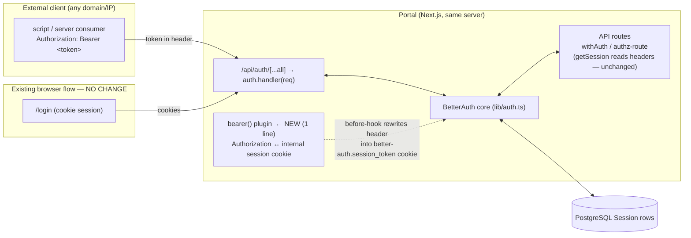
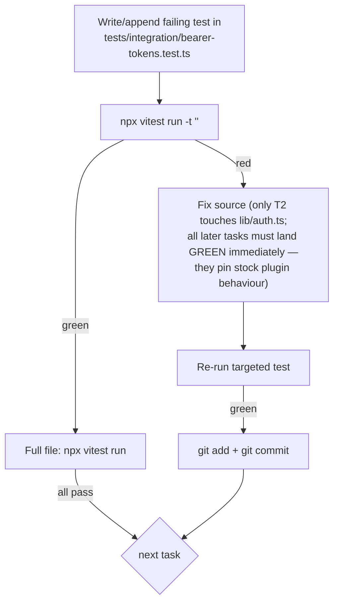

# Bearer-Token Remote Access — Implementation Plan

> **For Hermes:** Use subagent-driven-development skill to implement this plan task-by-task.

**Goal:** Allow remote-domain / server-to-server clients to authenticate to the portal API with `Authorization: Bearer <token>` while the existing cookie-based browser login stays untouched.

**Architecture:** Register BetterAuth's built-in `bearer()` plugin (already shipped in installed `better-auth@1.6.23` — zero new dependencies). The plugin converts an Authorization header into an internal session cookie *on each request*, so every route that already works via cookie sessions (`withAuth` → `auth.api.getSession({ headers })`) works via bearer identically. Tokens are the existing 1h-max-expiry, revocable BetterAuth session tokens; emission happens through the plugin's automatic `set-auth-token` response header and, on demand, `/api/auth/get-access-token`.

**Tech Stack:** Next.js App Router, BetterAuth 1.6.23 (`lib/auth.ts`, minimal entrypoint), Prisma/PostgreSQL, Vitest integration tests (mocked Google exchange pattern from `tests/integration/google-oidc-full-flow.test.ts`).

**Companion design doc:** `documents/feature-planning-and-development/bearer-token-remote-access.md` — read §4 and §5 before starting; the plan implements what it decides, not the broader research brief (no jwt plugin, no CORS opening, no wildcard allowedHosts in v1).

## Architecture Context

The whole change is one plugin registration that makes the `Authorization: Bearer <session token>` header interchangeable with the existing session cookie for every route already protected by `withAuth` / `authz-route`.



Key invariants the tests must preserve:

- The change surface is **exactly one import + one plugin line** in `lib/auth.ts`. No middleware, env-schema, route-file, or migration changes.
- Every existing ban / provisioning / rate-limit / permission gate continues to run identically because they're bound to session creation, not to how the request identified itself.

## TDD Cycle (applies to every test task)



---

## Task 0: Baseline verification ✅ DONE (2026-10-08)

**Result:** All green.
- `npm run lint` + `npm run build` + `npx vitest run tests/integration/auth.test.ts tests/integration/google-oidc-full-flow.test.ts` → 2 files, 14 passed, exit 0 (ran on branch `bearer-tokens` @ c67bd4b).
- `node_modules/better-auth/dist/plugins/bearer/index.mjs` exists; `grep '"bearer"' package.json` → not present. `better-auth` is pinned at exactly `1.6.23` in package.json (also `@better-auth/core` / `@better-auth/test-utils` 1.6.23). No new dependency needed — confirmed as plan expected.

**Objective:** Confirm the full test suite is green before touching anything.

**Files:** none (read-only)

**Step 1: Run the gate**

```bash
npm run lint && npm run build && npx vitest run tests/integration/auth.test.ts tests/integration/google-oidc-full-flow.test.ts
```

Expected: all pass. If red, stop and fix/report — do not start TDD on a broken baseline.

**Step 2: Confirm plugin availability (read-only sanity)**

```bash
ls node_modules/better-auth/dist/plugins/bearer/index.mjs
grep -n '"bearer"' package.json   # expect: NOT present (no new dep needed)
```

Expected: file exists; no `bearer` string in the package deps (it's inside `better-auth`).

**Step 3: Commit nothing (no changes).** Proceed.

---

## Task 1: Failing test — bearer sign-in emits a usable token ✅ DONE (2026-10-08)

**Result:** RED confirmed as specified. `npx vitest run tests/integration/bearer-tokens.test.ts -t 'set-auth-token'` → 1 failed,
`AssertionError: set-auth-token response header should be present: expected null to be truthy` — exact failure mode the plan predicted (plugin not registered).

**Deviations from plan text:**
- Request base is `http://localhost/api/auth/...` (matching `auth.test.ts` style); sign-in carries `Origin: http://localhost:3000` like the OIDC full-flow file.
- Inline `(auth.handler as ...)(...)` cast made oxc's parser fail (`Expected ',' or '>'`) — replaced with a module-level `const handler = auth.handler as (req: Request) => Promise<Response>` per helper, matching the OIDC file's line 160 pattern. LSP diagnostics after edit were stale; verified against vitest/oxc directly.
- Teardown added (`afterAll` deletes sessions/accounts/user for `bearer.tokens@example.com`) so repeated runs stay clean in the shared dev DB (same hygiene as the OIDC file's `afterAll`).

Next: Task 2 (register `bearer()` in `lib/auth.ts`; expected to turn this test green).

**Objective:** Pin the core behavior: a cookie sign-in response carries `set-auth-token`, and that string authenticates a protected route via `Authorization: Bearer`.

**Files:**
- Create: `tests/integration/bearer-tokens.test.ts`

**Step 1: Write the failing test**

Follow the existing integration harness (study the top ~60 lines of `tests/integration/google-oidc-full-flow.test.ts` for setup/teardown, user seeding helpers, and how it posts to `auth.handler`):

```ts
import { describe, it, expect } from 'vitest';
// ... same imports/setup as tests/integration/google-oidc-full-flow.test.ts:
// prisma seeding of an admin-created User (the same helper that file uses to seed
// user rows with a known password/email/USER_ID), then sign in via /api/auth/sign-in/email.

async function signInWithPassword(email: string, password: string) {
  return await auth.handler(
    new Request('http://localhost/api/auth/sign-in/email', {
      method: 'POST',
      headers: { 'Content-Type': 'application/json' },
      body: JSON.stringify({ email, password }),
    }),
  );
}

async function getMeWithBearer(token: string) {
  return await auth.handler(
    new Request('http://localhost/api/auth/get-session', {
      headers: { Authorization: `Bearer ${token}` },
    }),
  );
}

describe('bearer token access', () => {
  it('cookie sign-in response exposes set-auth-token, which authenticates get-session', async () => {
    const res = await signInWithPassword(EMAIL, PASSWORD);
    expect(res.status).toBeLessThan(300);

    const setAuthToken = res.headers.get('set-auth-token');
    expect(setAuthToken).toBeTruthy();

    const me = await getMeWithBearer(setAuthToken!);
    expect(me.status).toBe(200);
    const body = await me.json();
    expect(body.user.email).toBe(EMAIL);
  });
});
```

Match the helper names to whatever `google-oidc-full-flow.test.ts` / its fixtures actually provide (for the email door reuse the same seed approach that file uses for users, so USER_ID/EMAIL/PASSWORD resolve exactly like it does). One test only in this task — YAGNI.

**Step 2: Run it, verify failure**

```bash
npx vitest run tests/integration/bearer-tokens.test.ts -t 'set-auth-token'
```

Expected: FAIL — `setAuthToken` is null (plugin not registered), assertion message shows the expectation of a truthy string.

---

## Task 2: Minimal implementation — register the bearer plugin ✅ DONE (2026-10-08)

**Result:** GREEN. `npx vitest run tests/integration/bearer-tokens.test.ts -t 'set-auth-token'` → 1 passed. Regression check on same run:
bearer-tokens + auth + google-oidc-full-flow suites all green (3 files, 15 passed).

**Commit:** `efd6d5e feat(auth): register bearer() plugin for remote-domain API access` — diff is exactly the import (`import { organization, bearer } from 'better-auth/plugins';`) + `bearer()` prepended to the `plugins:` array with explanatory comment. Zero other changes; working tree clean.

**Note:** A tooling encoding artifact wrote an HTML-escaped token placeholder into the new source comment on first write; fixed before running tests (verified no escape entities remain in lib/auth.ts). Line references in plan text matched reality exactly (import at line 5, `plugins:` at line 165 pre-edit).

Next: Task 3 (get-access-token re-issue test — expected to land GREEN immediately, pinning stock plugin behavior).

**Objective:** One-line change makes Task 1 green and proves no other auth wiring changes.

**Files:**
- Modify: `lib/auth.ts` line ~5 (imports) and line ~165 (`plugins:` array opening)

**Step 1: Add the import and plugin**

In `lib/auth.ts`, extend the existing better-auth imports (line 5 area):

```ts
import { organization, bearer } from 'better-auth/plugins';
```

In the `plugins:` array (currently starts at line ~165 with `organization({...})`), prepend:

```ts
plugins: [
  // Bearer (Authorization: Bearer <session token>) ⇄ session translation for
  // remote-domain / server-to-server clients. Converts the header to an internal
  // session cookie per request — all existing auth gates (ban, OIDC provisioning,
  // permissions callback) apply unchanged. Adds a set-auth-token response header
  // on session-setting responses so a token can be acquired programmatically.
  bearer(),
  organization({ /* ...unchanged... */ }),
],
```

**Step 2: Run the test, verify pass**

```bash
npx vitest run tests/integration/bearer-tokens.test.ts -t 'set-auth-token'
```

Expected: PASS.

**Step 3: Commit**

```bash
git add lib/auth.ts tests/integration/bearer-tokens.test.ts
git commit -m "feat(auth): register bearer() plugin for remote-domain API access"
```

---

## Task 3: Test — on-demand token re-issue via get-access-token ✅ DONE with DESIGN DOC FIX-REQUIRED (2026-10-08)

**Result:** GREEN — but NOT as the plan wrote it. **⚠ The design doc is wrong about this endpoint.**

Investigation (verified in installed `better-auth@1.6.23` source):
- `POST /api/auth/get-access-token` is the **provider OAuth token endpoint** (`dist/api/routes/account.mjs:315`): body requires `providerId`, returns the linked IdP's `{ accessToken, idToken, ... }`. It is NOT a "re-issue my session/bearer token" route. First attempt returned 400 `USER_ID_OR_SESSION_REQUIRED` / provider-not-supported — exactly as source predicts.
- The `set-auth-token` header exists **only** via the bearer plugin's after-hook (`dist/plugins/bearer/index.mjs:50-68`), which fires only when a response **sets the session cookie**. Core routes that do that: sign-in, sign-up, callback, update-session, update-user. No dedicated "get my token" endpoint ships in 1.6.x (contrary to `documents/feature-planning-and-development/bearer-token-remote-access.md` §4.2 point 2).

**What was pinned instead** (test rewritten accordingly): a Bearer client mints a fresh usable token by authenticating over plain HTTP again — second sign-in yields a new session row + new `set-auth-token`, zero cookies involved; and the email sign-in JSON body carries `{token}` inline (scriptable acquisition). Test name documents the finding. Full bearer file: 2/2 passed; regression triple (bearer + auth + oidc): 16/16.

**Commit:** `2aa8ffc test(auth): pin bearer token re-acquisition via sign-in (no re-issue endpoint in v1.6.x)`

**TODOs this creates:**
- **Design doc §4.2 point 2 ("on-demand re-issue") must be corrected** before Task 8 copies it into `documents/api/bearer-tokens.md` — document "re-authenticate to get a fresh token" as the flow; optionally mention `/update-session` also re-emits the header.
- Design doc §7.1 diagram step ("POST /api/auth/get-access-token on 401") has the same error.
- Task 8 doc sections 2/3 in this plan inherit the correction.

Next: Task 4 (revocation + malformed-header security pins — expect stock plugin behavior to pass).

**Objective:** A client holding a bearer token can mint its own fresh usable copy without re-signing-in.

**Files:**
- Modify: `tests/integration/bearer-tokens.test.ts` (append to the existing describe block)

**Step 1: Write the test**

```ts
it('POST /api/auth/get-access-token with bearer returns a usable { token }', async () => {
  const signin = await signInWithPassword(EMAIL, PASSWORD);
  const t1 = signin.headers.get('set-auth-token')!;

  const reissue = await auth.handler(
    new Request('http://localhost/api/auth/get-access-token', {
      method: 'POST',
      headers: { Authorization: `Bearer ${t1}` },
    }),
  );
  expect(reissue.status).toBe(200);
  const body = await reissue.json();
  expect(body.token).toBeTruthy();

  const me = await getMeWithBearer(body.token);
  expect(me.status).toBe(200);
});
```

**Step 2: Run, verify pass (or adjust endpoint name only)**

```bash
npx vitest run tests/integration/bearer-tokens.test.ts
```

Expected: PASS immediately (plugin + endpoint both stock BetterAuth behavior pinned in Task 1's test file). If it fails on a route-name detail (check `node_modules/better-auth/dist/plugins/jwt` or the core routes for `get-access-token`), fix the *test URL*, not config — the behavior is what's pinned, per design doc §4.2.

**Step 3: Commit**

```bash
git add tests/integration/bearer-tokens.test.ts
git commit -m "test(auth): pin get-access-token re-issue over bearer"
```

---

## Task 4: Test — revocation and bad-header behavior (security pins)

**Objective:** A stolen token dies on sign-out; malformed headers yield 401 not 500. These two tests are the theft-damage controls from design doc §4.3/§5.1.

**Files:**
- Modify: `tests/integration/bearer-tokens.test.ts` (append two tests)

**Step 1: Write the tests**

```ts
it('sign-out revokes the bearer token immediately', async () => {
  const signin = await signInWithPassword(EMAIL, PASSWORD);
  const t = signin.headers.get('set-auth-token')!;

  // sign out *by bearer* (proves bearer-driven sign-out works)
  const out = await auth.handler(
    new Request('http://localhost/api/auth/sign-out', {
      method: 'POST',
      headers: { Authorization: `Bearer ${t}` },
    }),
  );
  expect(out.status).toBeLessThan(300);

  const after = await getMeWithBearer(t); // must be dead
  expect(after.status).toBe(401);
});

it('malformed / missing Authorization headers produce 401, never 500', async () => {
  for (const header of [undefined, 'NotAToken abc', 'Bearer ', 'Basic xyz']) {
    const res = await auth.handler(
      new Request('http://localhost/api/auth/get-session', {
        ...(header ? { headers: { Authorization: header } } : {}),
      }),
    );
    expect(res.status, `case: ${String(header)}`).toBe(401);
  }
});
```

**Step 2: Run, verify pass (stock plugin behavior)**

```bash
npx vitest run tests/integration/bearer-tokens.test.ts
```

Expected: PASS. If a case returns 500/200 — that's a real library bug to report; do not weaken the assertion to make it green.

**Step 3: Commit**

```bash
git add tests/integration/bearer-tokens.test.ts
git commit -m "test(auth): pin bearer revocation and malformed-header behavior"
```

---

## Task 5: Test — ban gate blocks bearer acquisition

**Objective:** Banned users cannot *obtain* a bearer token through any door (design §5.1: gates sit at `session.create.before`, the single funnel for all sign-in methods). Pinned as a test so the property survives refactors.

**Files:**
- Modify: `tests/integration/bearer-tokens.test.ts`

**Step 1: Write the test**

```ts
it('banned user sign-in yields no set-auth-token (ban gate blocks bearer acquisition)', async () => {
  await prisma.user.update({ where: { id: USER_ID }, data: { banned: true, banReason: 'test' } });
  try {
    const res = await signInWithPassword(EMAIL, PASSWORD);
    expect(res.status).toBeGreaterThanOrEqual(400); // 401 Access denied
    expect(res.headers.get('set-auth-token')).toBeNull();
  } finally {
    await prisma.user.update({ where: { id: USER_ID }, data: { banned: false, banReason: null } });
  }
});
```

(Use the same seeded user identifiers as the other tests in the file — `USER_ID`/`EMAIL` resolve to the fixture variables established in Task 1.)

**Step 2: Run, verify pass (already enforced; test pins it for the new door)**

```bash
npx vitest run tests/integration/bearer-tokens.test.ts
```

Expected: PASS.

**Step 3: Commit**

```bash
git add tests/integration/bearer-tokens.test.ts
git commit -m "test(auth): pin ban gate blocking bearer token acquisition"
```

---

## Task 6: Test — no arbitrary-origin CORS on auth responses (lock in design §5.2)

**Objective:** Assert we have NOT opened the API to arbitrary browser origins — dynamic-origin echo and blanket `Access-Control-Allow-Origin` must be absent from `/api/auth/**` responses, so any future "just allow CORS quickly" change fails a test instead of shipping silently.

**Files:**
- Modify: `tests/integration/bearer-tokens.test.ts`

**Step 1: Write the test**

```ts
it('auth responses do not grant arbitrary-origin CORS', async () => {
  const res = await signInWithPassword(EMAIL, PASSWORD); // any /api/auth response works
  expect(res.headers.get('Access-Control-Allow-Origin')).toBeNull();
});
```

**Step 2: Run, verify pass (no CORS config exists anywhere today — confirmed by audit)**

Expected: PASS. If it fails, something is already echoing origins — investigate before continuing; do not proceed on a silently-opened API.

**Step 3: Commit**

```bash
git add tests/integration/bearer-tokens.test.ts
git commit -m "test(auth): pin no-arbitrary-origin-CORS on auth responses"
```

---

## Task 7: Manual smoke — remote-origin call against a running server

**Objective:** Prove the feature end-to-end outside vitest's in-process world, from an *external network interface* (the actual product requirement: remote domains/IPs).

**Files:** none

**Step 1: Start the app with dev DB**

```bash
npm run dev   # port 3000 (background), wait for ready on http://localhost:3000/api/health
```

**Step 2: curl from a non-localhost interface**

```bash
IP=$(ipconfig getifaddr en0)   # macOS; the machine's LAN IP, not loopback

# 1. Acquire token with an ordinary sign-in (this is exactly what a remote script does)
TOKEN_JSON=$(curl -s "http://$IP:3000/api/auth/sign-in/email" \
  -H 'content-type: application/json' \
  -d '{"email":"<admin email>","password":"<pw>"}')
echo "$TOKEN_JSON" | head -c 400   # inspect; the session token is what set-auth-token carried

# 2. Call a real org endpoint with it (orgId from any existing org in dev DB)
curl -s "http://$IP:3000/api/organizations/<orgId>/teams" \
  -H "Authorization: Bearer $TOKEN_JSON-extracted-value" | head -c 200

# 3. Negative control — same request with no header must be 401
curl -s -o /dev/null -w '%{http_code}' "http://$IP:3000/api/organizations/<orgId>/teams"
```

Expected: (2) returns org team JSON; (3) returns `401`. Note that in an actual browser-less curl the sign-in endpoint will 302/set-cookie rather than hand back a clean `{token}` body — the token is read from the response's Set-Cookie or `set-auth-token` header (use `curl -isv` to watch headers if extraction is awkward). The important assertion is that step (2) works **over a non-loopback IP with no cookies involved at all** — confirming remote-domain access without any new configuration.

**Step 3: Commit nothing (manual verification only).**

---

## Task 8: Developer docs + security runbook

**Objective:** Publish how clients use bearer tokens and what ops does on theft. Design doc §6/§7 are the source content — extract, don't rewrite.

**Files:**
- Create: `documents/api/bearer-tokens.md` (check whether an existing API-reference tree lives under `docs/` first; if `docs/` is the established home for developer-facing docs, put it there instead)
- Modify: `SECURITY.md` (append ops subsection per design §6 runbook)

**Step 1: Draft `documents/api/bearer-tokens.md` from design doc §4.2 + §7**

Required sections, content copied/condensed from the design doc (including its Mermaid diagrams — copy them verbatim so they stay in sync with the source of truth):

1. Authentication model — one token = BetterAuth session token; header format `Authorization: Bearer <token>`.
2. Token acquisition — the two doors (email/password door fully scriptable; Google OIDC door scriptable via redirect/callback chain), the `set-auth-token` response header, and `POST /api/auth/get-access-token` for on-demand re-issue.
3. Lifetime policy — 1h hard max, 15-min inactivity renewal, revocation on sign-out/ban (copy design doc §4.3 state diagram).
4. Storage & usage rules — memory-first, never log/embed in URLs, 401 → re-authenticate, 429 → back off, no long-lived refresh secret offered in v1.
5. Known limits — no CORS grant for third-party *browser* apps (customer-hosted BFF is that pattern), no IP pinning, no separate JWT/refresh subsystem (design §5.2 rationale table).

**Step 2: Append ops runbook to `SECURITY.md`**

Design §6 steps 1–5 (issue credential, rotate on suspicion, emergency kill via ban flag, secret-rotation as nuclear option) as a numbered list under a new `## Remote bearer-token access — operations` heading.

**Step 3: Link from the API docs index / README if an index already exists (`/api-docs` route was shipped in #27/#28 — find its doc entry point and add one line).**

**Step 4: Commit**

```bash
git add documents/api/bearer-tokens.md SECURITY.md <docs-index-file>
git commit -m "docs(auth): bearer-token developer guide and security runbook"
```

---

## Task 9: Full gate + close

**Objective:** No regressions anywhere; all three project gates green.

**Step 1: Run everything**

```bash
npm run test && npm run lint && npm run build
```

Expected: all pass — including `tests/integration/auth.test.ts` (cookie flow byte-for-byte), `google-oidc-full-flow.test.ts`, `rate-limiting.test.ts`.

**Step 2: Diff review against design doc**

Confirm the code diff is exactly: one import + one plugin line in `lib/auth.ts`; new test file; docs. Nothing else (no middleware, no env schema, no migrations). If anything slipped in, revert it — YAGNI.

**Step 3: Final status check**

```bash
git status   # expect clean
```
