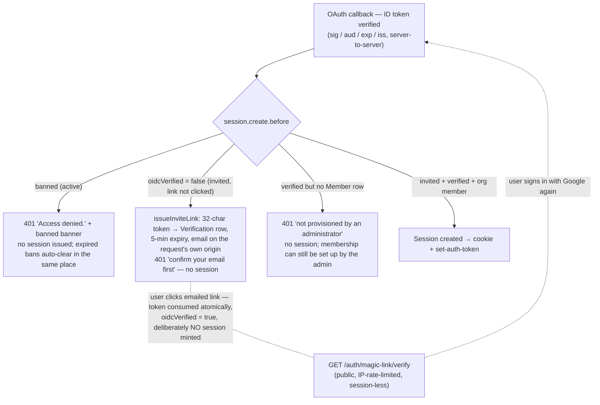

# Security Architecture & Policies

This document describes the security architecture, policies, and implementation details of the application. It covers multi-tenant isolation, authentication, authorization, data protection, content security policies, and logging.

The design follows three core principles:

- **Defense-in-depth**: Multiple independent security layers are applied so that a failure in one layer is caught by another.
- **Fail-closed**: When an error occurs, the system denies access rather than allowing it.
- **Least privilege**: Every operation is checked against the minimum permissions required for that action.

## Table of Contents

1. [Multi-Tenant Isolation](#1-multi-tenant-isolation)
2. [Authentication & Session Security](#2-authentication--session-security)
3. [Authorization & Access Control](#3-authorization--access-control)
4. [Teams & Sub-Organization Security](#4-teams--sub-organization-security)
5. [Calendar Security](#5-calendar-security)
6. [Data Protection](#6-data-protection)
7. [Content Security Policy](#7-content-security-policy)
8. [Logging & PII Redaction](#8-logging--pii-redaction)
9. [Security Configuration Reference](#9-security-configuration-reference)

### Appendices

- [A. API Route Security Summary](#appendix-a-api-route-security-summary)
- [B. Tenant-Scoped Model Inventory](#appendix-b-tenant-scoped-model-inventory)
- [C. Cross-References](#appendix-c-cross-references)

---

## 1. Multi-Tenant Isolation

### Two-Layer Strategy

Tenant isolation is enforced at two independent layers:

1. **Application level**: `lib/tenant-db.ts` (`tenantDb`) intercepts every
   operation on the 11 tenant-scoped models — `findUnique`, `findFirst`,
   `findMany`, `count`, `aggregate`, `groupBy`, `update`, `updateMany`,
   `delete`, `deleteMany`, `create`, `upsert` — and injects the verified org id
   (`organizationId`, `orgId` for BetterAuth models) into where/data. It fails
   closed when no verified tenant context is active: a context-less scoped query
   throws, it never silently widens. Verified platform-admin contexts pass
   through with the DB layer as authority (cross-tenant).

2. **Database level**: PostgreSQL Row-Level Security policies on all 18
   org-relevant tables (`prisma/migrations/20260919093000_rls_complete_policies`).
   The app connects as the NON-owner role `nipp_app`, so RLS applies to every
   query — including raw SQL and code paths the extension cannot intercept. The
   per-request context (`app.current_user_id` / `app.current_org_id` /
   `app.is_platform_admin` / `app.platform_org_id`) is set transaction-locally
   via `set_config(…, true)` by the single choke point
   `lib/rls-transaction.ts` on the SAME pinned interactive-transaction
   connection as the guarded query (verified: GUCs reset after commit, so
   pooling cannot leak context). Unwrapped queries reach Postgres with no GUCs
   and return zero rows — fail-closed by construction.

### Database-Level Isolation (PostgreSQL RLS)

Policies are audited by the ownership spec
(`tests/isolation/database/migrations-ownership.spec.ts`): it asserts no public
table is owned by `nipp_app` (a table owner bypasses its own policies), RLS is
enabled on exactly the 18 catalog tables, and the live `pg_policies` set hashes
to the committed golden file `tests/isolation/database/policy-catalog.golden` —
policy drift blocks merge.

### Tenant Context Propagation

Tenant context propagates via `AsyncLocalStorage` (`lib/tenant-context.ts`). It
is established at the route boundary from **server-verified inputs only**:

1. BetterAuth session → verified user id (`auth.api.getSession`)
2. Target org from the route, then access-checked: ordinary members → own org;
   platform-admin flag = ONE membership lookup in the platform org (fail-closed
   503 on lookup failure); everyone else → 403 before any query runs
3. `withRLSContext({userId, orgId, isPlatformAdmin}, op)` wraps the handler so
   ALS context and DB GUCs are bound for the same operation tree

### Tenant-Scoped Model Inventory (app layer + RLS)

| Model | Org column | App-layer ext | RLS policy | Notes |
|-------|-----------|---------------|------------|-------|
| Role | organizationId | ✓ | ✓ | per-tenant role definitions |
| RolePermission | organizationId | ✓ | ✓ | role ↔ permission grants |
| MemberRole | organizationId | ✓ | ✓ | user ↔ role assignments |
| Member | orgId | ✓ | ✓ | BetterAuth membership — authz-critical |
| Invitation | orgId | ✓ | ✓ | pending invitations |
| SentInvitation | orgId | ✓ | ✓ | invitation audit trail |
| Team | organizationId | ✓ | ✓ | sub-organizational groups |
| TeamMember | organizationId | ✓ | ✓ | team membership (+ PII linkage) |
| TeamRole | organizationId | ✓ | ✓ | role inheritance on teams |
| Calendar | organizationId | ✓ | ✓ | tenant calendars |
| CalendarEvent | organizationId | ✓ | ✓ | recurrence lives in JSON fields (rrule/exdates); there is no separate model |

### Tables Enforced by RLS Only

These tables have no app-layer org injection — their visibility rules are richer than a single-column filter:

| Table | Policy shape |
|-------|--------------|
| Organization | Per-command policies; UPDATE/DELETE = platform ops acting *on* the target org (prevents self-privilege edits) |
| AuditLog / NotificationLog | Append-only for `nipp_app` — no UPDATE/DELETE policy by design; NULL-org global rows visible cross-tenant |
| Notification | Org ∪ NULL-global reads; admin ack path on UPDATE; GLOBAL broadcasts stored with `organizationId = NULL` |
| JobDefinition / JobExecution | Platform only: `is_platform_admin` flag AND `app.platform_org_id` matching the row's `platformOrgId` |
| Permission | Global catalog — platform sees all, tenants see only permissions assigned to their org's roles via RolePermission. Writes additionally gated at the DB layer to verified platform admins (`rls_permission_platform_insert`/`_update`/`_delete`) — tenants have no catalog write path |

### Exempt Tables (no policy, documented)

| Table | Reason |
|-------|--------|
| User / Session / Account | BetterAuth auth models containing no tenant data |
| Resource / ResourceRole | Global feature catalog; the sensitive side — which roles can use a resource — sits on org-scoped Role rows which ARE policied. `ResourceRole` has no direct org column by design — re-evaluate before any route ever queries it directly |
| Contractor | Global shared directory of external contractors usable by all organizations; no org column, no RLS policy. Future CRUD routes must gate access at the app/route layer — the DB enforces nothing for this table |

All other models require a valid tenant context in the current request.

---

## 2. Authentication & Session Security

### BetterAuth Configuration

Authentication is handled by [BetterAuth](https://www.better-auth.com/), configured in `lib/auth.ts`. Key configuration:

- **Providers**: Email/password is fully live for admin-created users; Google OIDC behind the "Sign in with Google" button is also **live** — an invite-only door (see [below](#google-oidc-sign-in-invite-only-door--magic-link-verification)). Its credentials (`GOOGLE_CLIENT_ID` / `GOOGLE_CLIENT_SECRET`) are required by the env schema (`lib/env-schema.ts`). No other providers are configured.
- **Cookie settings**: The session cookie uses `Secure` flag (HTTPS only) and `SameSite=Lax` to prevent CSRF via cross-site navigation.
- **Rate limiting**: Request rate limits are enforced:
  - General requests: 10 requests per 15 minutes
  - Sign-in attempts: 5 requests per 15 minutes (stricter to prevent brute force)

### Session Lifecycle

Sessions are managed with the following constraints:

| Parameter | Value | Purpose |
|-----------|-------|---------|
| Absolute max duration | 1 hour | Sessions expire regardless of activity |
| Renewal interval | Every 15 minutes | Session is refreshed on active use within this window |
| Cache window | 30 seconds | Concurrent requests within this window share the same session state to avoid race conditions |
| Cross-tab invalidation | Enabled | Signing out in one tab invalidates sessions across all tabs |

The renewal interval ensures that long-lived browsing sessions are regularly refreshed without requiring re-authentication. The absolute maximum duration limits the window of compromise if a session token is stolen.

### Cross-Tab Session Invalidation

When a user signs out, the session is invalidated server-side and across all browser tabs. This is implemented by incrementing a session version counter in the database; each tab's client polls for this counter and signs out when it detects a change.

### Auto-Logout on Inactivity

Users are automatically logged out after a configurable period of inactivity (default **15 minutes**, set with `INACTIVITY_TIMEOUT_MINS`). The mechanism:

1. A client hook tracks mouse, keyboard, scroll, and touch activity
2. 30 seconds before expiry, a warning toast appears
3. If no activity follows, the session is deleted server-side and the browser is redirected to `/login` — any activity during the warning cancels it

### User Ban System

Users can be banned at any time. The `User` model includes three ban-related fields:

| Field | Type | Purpose |
|-------|------|---------|
| `banned` | Boolean | Whether the user is currently banned |
| `banReason` | String (nullable) | Reason for the ban, stored for audit purposes |
| `banExpires` | DateTime (nullable) | Optional expiry date; if set, the ban is temporary and auto-expires |

Ban enforcement happens in the authentication callback: when a user attempts to sign in or refresh their session, the system checks `banned` and `banExpires`. If a temporary ban has expired (`banExpires < now`), the ban is automatically cleared.

Ban enforcement is method-agnostic: every successful sign-in (email, Google, and any future method) funnels through `databaseHooks.session.create.before`, where `enforceBanStatus(email)` runs — the single check that no sign-in door can route around. The email login form fast-paths the same helper for an immediate 401 on the form; expired-ban auto-clearing happens in the same place for all doors. Behavior is pinned by `tests/integration/google-oidc.test.ts` (active ban rejected; expired ban lifts the flag).

### Google OIDC Sign-In (invite-only door + magic-link verification)

Google sign-in behind the login page's "Sign in with Google" button is **shipped** as an invite-only OAuth 2.0 door through BetterAuth's built-in `google` provider (`socialProviders.google`). Full design (linking semantics, phased delivery, test strategy): [documents/feature-planning-and-development/google-oidc-design.md](./documents/feature-planning-and-development/google-oidc-design.md); architectural shape: ARCHITECTURE.md §3.

**Security-relevant shape:**

- **No self-registration. Ever.** The provider config sets *both* `disableImplicitSignUp` and `disableSignUp`. Installed better-auth@1.6.23 evaluates `provider.disableImplicitSignUp && !requestSignUp || provider.options?.disableSignUp`, so the flag set refuses sign-up even when a client forges `requestSignUp: true` on the sign-in call (verified in dist; pinned by a forged-signup integration spec). An unknown Google identity is turned away at the callback **with zero rows written — no `User`, no `Account` — and no email**, redirected to `/login?error=signup_disabled` where the login page's banner classifier renders "not invited".
- **Invited identities are gated in one place.** `databaseHooks.session.create.before` is the single funnel every sign-in passes through (email, Google, future methods). Gate order: ban (`enforceBanStatus`) → provisioning (`enforceOidcProvisioning`). Outcomes for a Google-only identity whose rows were admin-created:



- **Membership reads are RLS-visible.** The app role is the non-owner `nipp_app`, so a GUC-less `Member` read returns zero rows for *every* user — including provisioned ones. The gate's authoritative membership query therefore runs `tenantDb.user.findUnique(… select members)` under the platform context (`withPlatformContextForDB` from `lib/rls-transaction.ts`), where the GUCs and the query share one pinned connection. A naive raw-Prisma read here produces false "not provisioned" denials (caught in production, 2026-10-11; integration tests connecting as owner never see it). The auto-org-assignment hook (`session.create.after`) uses the same pattern for its `Member` lookup.
- **State/CSRF.** A signed per-flow `state` nonce is stored in the Prisma `Verification` table and validated at callback time; a mismatched state redirects to `/login?error=state_mismatch` (via `onAPIError.errorURL: '/login'`, which replaces BetterAuth's default `/api/auth/error` — that URL has no route and used to 404).
- **Magic-link integrity.** The token is 192-bit random, consumed atomically on verify, expires in 5 minutes; the link host is the origin of the request that issued it (host-independent — LAN IP today, public domain tomorrow), not a pinned `FRONTEND_URL`. Worst case for interception: an attacker consumes the victim's token and the victim simply retries sign-in, which re-issues a fresh link.

**Threat controls (supersedes/extends the original table):**

| Threat | Control |
|--------|---------|
| Uninvited Google identity creating account rows (self-registration) | Provider double-sign-up-disable: zero rows + no email at the callback; stray legacy rows quarantined by the gate (removed best-effort, refused without an invitation) |
| Client-forged `requestSignUp: true` to bypass invite-only | Second flag term (`options?.disableSignUp`) refuses regardless of forged request body — pinned by integration spec |
| CSRF on OAuth callback | signed `state` nonce per flow (BetterAuth), verified against `Verification` |
| Magic-link interception / replay | 192-bit token; atomic consume; 5-min expiry; IP-rate-limited session-less verify route that never mints a session |
| Token enumeration | random tokens not enumerable |
| Open redirect via `callbackUrl` | same-origin guard on post-login navigation (login page); BetterAuth's callback-allowlist (`trustedOrigins`) applies to the OAuth callback itself |
| False "not provisioned" denial of valid members (RLS) | membership read under platform context through `tenantDb`; pinned by integration + live probes |
| Post-verification abuse / ban evasion | ban enforcement at session creation applies to both doors — no sign-in method can bypass it |

**Operational requirement:** the Google Cloud Console OAuth client must list the deployment's callback (`<origin>/api/auth/callback/google`) — `http://` LAN IPs are not acceptable to Google for production, so the public door assumes the Phase-C domain; until then the email/password door remains fully scriptable. Email forwarding for new OIDC users is a per-user external dependency (design doc §6).

### Remote Bearer-Token Access — Origin Policy & Operations

The portal exposes an `Authorization: Bearer <token>` door for programmatic and cross-domain clients (scripts, server-to-server consumers). A bearer token **is** a BetterAuth session token: one Session row backs both the browser cookie and the header, so every gate above (rate limits, ban enforcement, provisioning, permission resolution) applies identically. Full developer reference: [documents/api/bearer-tokens.md](./documents/api/bearer-tokens.md); design document with diagrams: [bearer-token-remote-access.md](./documents/feature-planning-and-development/bearer-token-remote-access.md).

**Origin policy (public access):** the base URL and trusted origins resolve **per-request from the incoming `Host` header** (`x-forwarded-host` when behind a proxy), validated against `BETTER_AUTH_ALLOWED_HOSTS` — env-driven, zero hardcoded hosts in `lib/auth.ts`. Consequences:

- **Browser cookie door:** same-origin only. Trusted origins are the per-request base origin (localhost, LAN IP, or the production HTTPS domain) plus any entries in `BETTER_AUTH_TRUSTED_ORIGINS` (comma-separated; intended for named partner frontends). A **global origin echo is intentionally not shipped**: echoing arbitrary origins would let any website submit cookie-bearing auth requests against our server from a victim's browser (cross-site sign-out, session fixation at login).
- **Bearer door:** CSRF-immune by construction — server-to-server requests send no `Origin`/cookie, and cross-origin browser JS cannot set `Authorization` nor read the `set-auth-token` response without an `Access-Control-Allow-Origin` grant we never issue. **No CORS headers are emitted by the auth layer** (pinned by test).
- **Least privilege per deployment:** local dev runs `BETTER_AUTH_ALLOWED_HOSTS=*`; production must set its real domain(s) (e.g. `portal.example.com,www.portal.example.com`). If a per-customer subdomain scheme ever lands, the value moves to `*.customer-domain.com` — config only.
- **CSRF/origin gate stays enabled** — neither `advanced.disableOriginCheck` nor `disableCSRFCheck` is set, and no top-level `trustedOrigins` echo exists (pinned by test).

**Operations — token acquisition & rotation:**

1. **Issue a developer credential:** existing admin user creation (password) or Google invite flow — no new admin surface.
2. **Client acquires the token once** via `POST /api/auth/sign-in/email` (`set-auth-token` response header + `{token}` in the JSON body). 1h absolute max; activity keeps it alive (~45 min idle = dead); on 401 the client re-authenticates (no refresh subsystem in v1).
3. **Rotate on suspicion:** user signs out — the Session row is deleted and the old bearer string fails its next lookup immediately — then re-authenticates for a fresh token.
4. **Emergency kill:** ban the user (`banned` flag) — per-request ban checks stop all their bearer traffic on the next call; session callback invalidation kills any live sessions. Worst case: an in-flight request finishing before the next one.
5. **Secret rotation (nuclear option):** changing `BETTER_AUTH_SECRET` invalidates every bearer token and cookie at once (they are HMACs over it) — last resort, not a routine control.

**Proxy header contract:** behind a TLS-terminating reverse proxy/edge the deployment must set `TRUSTED_PROXY_CIDRS` to the edge's CIDR(s) and keep `TRUSTED_PROXY_HEADERS=true` so BetterAuth reads `x-forwarded-host` / `x-forwarded-proto` (base URL + protocol + client IP all come from there). The proxy must send both headers on every request; untrusted `x-forwarded-for` hops beyond a trusted CIDR are ignored, which also protects the per-IP rate limits above from client-IP spoofing.

---

## 3. Authorization & Access Control

### Dual-Authorization Model

The system uses a dual-authorization model where access decisions consider both the user's global role and their tenant-specific role:

1. **User-level role** (`User.role`): A global role (e.g., "admin") that applies across all organizations the user belongs to. Admin users can access audit logs and perform cross-tenant operations.
2. **Tenant-level role** (`MemberRole`): A role within a specific tenant that defines what resources and actions the user is permitted to perform in that organization.

Both roles are checked for every protected operation:

```
isAuthorized(user.role, memberRole, action, resource) => boolean
```

The user-level role provides a baseline permission set; the tenant-level role refines or restricts those permissions within the specific organization context.

### Permission Resolution Flow

Permission resolution is implemented in `lib/permissions/resolver.ts` and uses a multi-level cache:

1. **L1 Cache (in-memory)**: Permission results are cached in a Map for the duration of the request. Subsequent checks within the same request hit this cache immediately.
2. **L2 Cache (Redis)**: Permission results are cached in Redis with a configurable TTL. This cache is shared across all instances of the application, ensuring consistency for concurrent requests from different servers.
3. **Database**: If neither cache hits, the resolver queries the database to compute permissions from the user's roles and the resource/permission definitions.

The resolver follows a top-down approach: it checks the user's global role first (faster path for admins), then falls back to tenant-level permission resolution.

### Domain-Specific Permission Modules

Permission logic is organized into domain-specific modules under `lib/permissions/`:

| Module | Purpose |
|--------|---------|
| `resolver.ts` | Core permission resolution engine with L1/L2 caching |
| `contractor.ts` | Contractor-specific permission rules (e.g., work order access) |
| `financial.ts` | Financial data permissions (invoices, payments, reports) |
| `maintenance.ts` | Maintenance task and work order permissions |
| `property.ts` | Property management permissions (listings, units) |
| `tenant.ts` | Tenant-specific permission rules |

Each module defines its own set of permission checks that are composed into the overall authorization decision. This separation keeps permission logic maintainable and allows domain experts to review their own rules.

### Role Validation Utilities

Role names are validated against a fixed allowlist defined in `lib/roles/validation.ts`:

| Function | Purpose |
|----------|---------|
| `isValidRoleName(name)` | Checks if a string is a valid role name |
| `getValidRoleNames()` | Returns the complete list of allowed role names |
| `assertValidRoleName(name)` | Throws if the name is not a valid role |

This prevents arbitrary role names from being used in authorization decisions and ensures consistency across the system.

### Resource-Based Feature Access Control

Beyond role-based access, the system supports feature-level access control through `Resource` and `ResourceRole` models:

- **Resource**: Represents a specific feature or resource within an organization (e.g., a tenant's access to the "financial module").
- **ResourceRole**: Binds an organization role (from `Role`) to a specific resource, defining what that role can do with that resource.

This allows organizations to enable or disable specific features for different roles without changing the core role definition. For example, an organization might grant "manager" access to the financial module for some users but not others.

---

## 4. Teams & Sub-Organization Security

### Teams Data Model

Teams provide sub-organization structure within a tenant:

| Model | Purpose |
|-------|---------|
| `Team` | A sub-group within a tenant (e.g., "Maintenance", "Finance") |
| `TeamMember` | Membership of a user in a team, with a team-specific role |
| `TeamRole` | Role definitions within a team (separate from tenant-level roles) |

A user can have different roles at the tenant level and within each team they belong to. Team membership is determined by `TeamMember` records linking users to teams with specific team roles.

### Team Tenant Isolation

All team-related models (`Team`, `TeamMember`, `TeamRole`) are tenant-scoped. The Prisma extension automatically injects the tenant filter when querying team data, ensuring that users cannot access teams from other organizations.

### Default Teams Bootstrapping

When a new tenant is created, default teams are automatically bootstrapped (e.g., "Maintenance", "Finance"). These defaults provide a starting structure that organizations can customize.

### API Endpoints

Team management is exposed through org-scoped routes, all tenant-isolated by the shared `resolveTenantAccess` gate:

| Pattern | Methods | Access |
|---------|---------|--------|
| `/api/organizations/[orgId]/teams` | GET, POST | Tenant-scoped; member of the org |
| `/api/organizations/[orgId]/teams/[teamId]` | GET, PATCH, DELETE | Tenant-scoped; tenant admin (mutations) |
| `/api/organizations/[orgId]/teams/[teamId]/members` | GET, POST, DELETE | Tenant-scoped; team membership management permissions |
| `/api/organizations/[orgId]/teams/[teamId]/roles` | GET, POST, DELETE | Tenant-scoped; team role management permissions |

---

## 5. Calendar Security

### Calendar Data Model

Calendar data is stored in three models:

| Model | Purpose |
|-------|---------|
| `Calendar` | A calendar belonging to a tenant (e.g., "Work Schedule") |
| `CalendarEvent` | An event within a calendar, with start/end times and recurrence rules |
| `CalendarRecurrence` | Recurring event patterns (daily, weekly, monthly, yearly) |

All three models are tenant-scoped. Each event belongs to a specific calendar, which in turn belongs to a specific tenant.

### Authorization Flow

Calendar access follows the dual-authorization model:

1. The user's tenant-level role is checked for calendar read/write permissions
2. If the user has admin privileges at the user level, they bypass tenant-level checks

Calendar events are not individually permissioned; access is determined at the calendar level. This means if a user can read a calendar, they can read all events within it.

### Calendar Tenant Isolation

Calendar data is isolated by tenant through the Prisma extension and RLS policies. The `organizationId` field on all calendar models ensures that queries from one tenant cannot access another tenant's calendars or events.

---

## 6. Data Protection

### PII At-Rest Encryption

PII (Personally Identifiable Information) stored in the database is encrypted at rest using AES-256-GCM. The implementation is in `lib/pii-crypto.ts`.

**Key management**: The encryption key is read from the `PII_ENCRYPTION_KEY` environment variable at startup. This key must be a valid hex-encoded 32-byte (256-bit) value.

**Encryption process**:
1. A random 12-byte nonce is generated for each encryption operation
2. The plaintext PII value is encrypted with AES-256-GCM using the key and nonce
3. The output format is: `nonce (hex) + ciphertext (hex) + auth tag (hex)`
4. The encrypted value is stored in the database as a single hex string

**Decryption process**:
1. The encrypted value is parsed into its nonce, ciphertext, and auth tag components
2. AES-256-GCM decryption is performed with the stored key
3. If authentication fails (tag mismatch), an error is thrown

**PII fields**: The following database columns are encrypted at rest:
- `User.firstName`, `User.lastName`
- `User.email` (when not used as auth identifier)
- `User.phone`, `User.address`
- `Organization.name` (when containing personal data)

PII encryption is applied at the application layer through Prisma middleware hooks and explicit encrypt/decrypt calls in route handlers.

### Data-in-Transit Payload Encryption

Payload encryption protects sensitive data transmitted between client and server. The implementation spans `lib/payload-key-server.ts`, `lib/payload-middleware.ts`, `lib/crypto-server.ts`, and `lib/crypto-client.ts`.

**Key lifecycle**:
1. **Generation**: A 32-byte symmetric key is generated for each payload using `generatePayloadKey()`
2. **Storage**: The key is stored in a `PayloadKeyStore` with the payload ID as the lookup key
3. **Encryption**: The client encrypts the payload data with this key using AES-256-GCM
4. **Transmission**: Only the encrypted data (not the key) is sent to the server
5. **Decryption**: The server retrieves the key from the store and decrypts the payload

**PayloadKeyStore interface**: The `PayloadKeyStore` interface defines how payload keys are stored and retrieved:

| Implementation | Use Case | Description |
|---------------|----------|-------------|
| In-memory store (default) | Single-instance deployments | Keys stored in a Map; keys are automatically cleaned up after TTL expiry |
| Redis-backed store | Multi-instance deployments | Keys stored in Redis with TTL; shared across all application instances |

The default in-memory store is sufficient for single-instance deployments. For multi-instance deployments (e.g., multiple server replicas behind a load balancer), the Redis-backed store ensures that any instance can retrieve the key generated by any other instance.

**Cleanup scheduler**: A background cleanup job (`startKeyCleanupScheduler()`) runs every 5 minutes to remove expired payload keys from the store. This prevents unbounded memory growth and ensures that old keys are not available for decryption after their intended lifetime.

**Replay protection**: To prevent replay attacks, the system uses a replay cache:
- Each payload is assigned a unique ID
- The first time a payload with a given ID is processed, it is recorded in the replay cache
- Subsequent requests with the same payload ID are rejected as replays

The replay cache supports two backends:
| Backend | Use Case | Description |
|---------|----------|-------------|
| In-memory (default) | Single-instance deployments | Replay entries stored in a Map with TTL expiry |
| Redis-backed | Multi-instance deployments | Replay entries shared across instances via Redis |

**Payload metrics**: The `lib/payload-metrics.ts` module tracks encryption/decryption performance and error rates, providing observability into the payload encryption system.

**PII routes**: The `lib/pii-routes.ts` module defines 9 route patterns for PII-specific operations (encrypt, decrypt, verify) with automatic encryption middleware applied to all requests.

### CSRF Protection

CSRF (Cross-Site Request Forgery) protection is implemented in `lib/csrf.ts`. The mechanism validates the origin of incoming requests to ensure they originate from trusted sources.

**Protection strategy**:
1. **Origin/Referer validation**: For state-changing requests (POST, PUT, DELETE), the `Origin` and `Referer` headers are validated against an allowlist of trusted domains
2. **Safe methods**: GET, HEAD, and OPTIONS requests are exempt from CSRF checks (they should not modify server state)
3. **Development relaxation**: In development mode, CSRF validation is relaxed to allow testing from arbitrary origins

**Implementation details**:
- Trusted domains are configured via the `TRUSTED_ORIGINS` environment variable (comma-separated list)
- The CSRF check is applied as middleware on all state-changing routes
- If validation fails, a 403 Forbidden response is returned

**Limitations**: CSRF protection in this implementation relies on header validation rather than token-based approaches. This is sufficient for same-origin applications but may need to be augmented with CSRF tokens if third-party integrations are introduced.

### Secrets Management

Secrets and configuration values are managed through environment variables:

- **Never committed**: No secrets, API keys, or credentials are committed to version control
- **Environment-specific**: Different environments (development, staging, production) use different secret values
- **Key rotation**: Encryption keys can be rotated by updating the relevant environment variable and re-encrypting affected data

---

## 7. Content Security Policy

### CSP Directives

Content Security Policy (CSP) headers are configured in `middleware.ts` to prevent XSS, clickjacking, and other code injection attacks. The policy differs between development and production:

| Directive | Development | Production |
|-----------|-------------|------------|
| `default-src` | `'self'` | `'self'` |
| `script-src` | `'self' 'unsafe-inline' 'unsafe-eval'` | `'self' <nonces>` |
| `style-src` | `'self' 'unsafe-inline'` | `'self' <nonces>` |
| `img-src` | `'self' data: blob:` | `'self' data: blob:` |
| `connect-src` | `'self' ws: wss:` | `'self' wss:` |
| `frame-ancestors` | `'none'` (relaxed in dev) | `'none'` |
| `base-uri` | `'self'` | `'self'` |
| `form-action` | `'self'` | `'self'` |

In production, inline scripts and styles are blocked by default; they must use nonces (see below) to be allowed.

### Nonce Generation & Propagation

CSP nonces are generated and managed in `lib/csp-nonce.ts`:

1. **Generation**: A cryptographically random nonce (32 bytes, base64-encoded) is generated for each request
2. **Header injection**: The nonce is added to the `Content-Security-Policy` header's `script-src` and `style-src` directives
3. **Client injection**: The nonce is made available to client-side code via a meta tag or global variable, so that dynamically created scripts can include the nonce attribute

This approach allows inline scripts to run without disabling CSP entirely. Each request gets a unique nonce, preventing replay attacks.

---

## 8. Logging & PII Redaction

### Pino Logger Configuration

The application uses [Pino](https://github.com/pinojs/pino) for structured logging, configured in `lib/logger.ts`. PII redaction is built into the logger configuration:

**Redaction paths**: Pino's `redact.paths` option is configured to automatically redact the following fields from all log output:

| Category | Fields |
|----------|--------|
| Authentication | `session.token`, `user.password`, `apiKey` |
| Personal data | `firstName`, `lastName`, `email`, `phone`, `address`, `ssn` |
| API credentials | `apiKey`, `apiSecret`, `accessToken`, `refreshToken` |
| Crypto material | `encryptionKey`, `privateKey`, `payloadKey` |

**Redaction behavior**: When any of these fields appear in a logged object, Pino replaces their values with `[REDACTED]` before writing to the log output. This ensures that PII never appears in log files, even if a developer accidentally logs a user object or request body.

### PII Field List

The complete list of fields that are redacted from logs includes:

- `session.token`, `user.password` — authentication credentials
- `firstName`, `lastName`, `email`, `phone`, `address`, `ssn` — personal identifiers
- `apiKey`, `apiSecret`, `accessToken`, `refreshToken` — API credentials
- `encryptionKey`, `privateKey`, `payloadKey` — cryptographic material

This list is maintained in the logger configuration and should be updated whenever new PII fields are added to the data model.

### Error Serialization Redaction

The `redactLogObject()` utility in `lib/logger.ts` provides additional redaction for error objects that may contain PII:

1. **Property filtering**: The utility iterates over an object's own properties and redacts any that match the PII field list
2. **Stack trace sanitization**: File paths in stack traces are redacted to remove local filesystem details (e.g., `/Users/john/...` is replaced with `[REDACTED]`)
3. **Recursive application**: The redaction is applied recursively to nested objects, ensuring that PII in deeply nested structures is also caught

This utility is used when logging error objects to ensure that stack traces and error context do not leak PII or internal file paths.

---

## 9. Security Configuration Reference

### Environment Variables

The following environment variables control security-relevant behavior:

| Variable | Purpose | Required |
|----------|---------|----------|
| `PII_ENCRYPTION_KEY` | AES-256 encryption key for PII at-rest (hex-encoded, 32 bytes) | Yes |
| `TRUSTED_ORIGINS` | Comma-separated list of trusted domains for CSRF validation | Yes |
| `TRUSTED_PROXY_CIDRS` | CIDR ranges of trusted reverse proxies for real client IP extraction | No (defaults to localhost) |
| `BETTER_AUTH_SECRET` | HMAC base for session/bearer tokens; changing it invalidates every token and cookie at once (nuclear-op rotation — see §2 bearer ops step 5) | Yes |
| `BETTER_AUTH_ALLOWED_HOSTS` | Comma-separated host patterns for BetterAuth's per-request base URL + trusted origins (default `*`; production must set real domain(s)) | Defaulted |
| `BETTER_AUTH_BASE_PROTOCOL` | Protocol for dynamic base-URL construction: `auto` (both http/https origins) \| `http` \| `https` — default `auto` | Defaulted |
| `TRUSTED_PROXY_HEADERS` | Read `x-forwarded-host` / `x-forwarded-proto` behind a proxy (`true`/`false`, default `true`) | Defaulted |
| `BETTER_AUTH_TRUSTED_ORIGINS` | Comma-separated extra trusted origins for cross-origin browser frontends (partner BFFs); cookieless bearer clients never need it | No |
| `GOOGLE_CLIENT_ID` | Google OIDC client id — required by the env schema (`lib/env-schema.ts`) | Yes |
| `GOOGLE_CLIENT_SECRET` | Google OIDC client secret (same requirement) | Yes |
| `DATABASE_URL` | PostgreSQL connection string (includes credentials) | Yes |
| `REDIS_URL` | Redis connection string for caching and replay cache (optional) | No |
| `NODE_ENV` | Environment mode (`development`, `production`) — affects CSP strictness and CSRF relaxation | Yes |

### Payload Encryption Variables

Tuning for the in-transit payload encryption feature (see [§6](#data-in-transit-payload-encryption); operational setup variables live in [`QUICK_START.md`](./QUICK_START.md#environment-variables)):

| Variable | Default | Purpose |
|----------|---------|---------|
| `PAYLOAD_ENCRYPTION_MODE` | `disabled` | `disabled` \| `permissive` \| `enforce` — feature flag |
| `PAYLOAD_ENCRYPTION_MAX_BYTES` | `65536` | Maximum encrypted request body size |
| `PAYLOAD_ENCRYPTION_KEY_TTL_SECONDS` | `300` | Payload key lifetime |
| `PAYLOAD_ENCRYPTION_REPLAY_WINDOW_SECONDS` | `30` | Replay-protection window |
| `PAYLOAD_ENCRYPTION_NONCE_TTL_SECONDS` | `60` | Nonce cache TTL |
| `PAYLOAD_ENCRYPTION_REPLAY_CACHE` | `redis` | `memory` \| `redis` replay-dedup backend |
| `PAYLOAD_ENCRYPTION_REQUIRE_REPLAY_CACHE` | `false` | Fail closed in enforce mode if the replay cache is unavailable |

### Rate Limiting Configuration

The application uses a unified rate limiting system with three distinct implementations, each configurable via environment variables with sensible defaults.

#### Route-Gate Limits (In-Memory)

Applied to security-critical route groups to prevent abuse of auth, admin, and cryptographic key operations:

| Variable | Purpose | Default |
|----------|---------|---------|
| `RATE_LIMIT_PAYLOAD_KEY_MAX` / `_WINDOW` | Payload-key issuance limit per session | 30 / 60s |
| `RATE_LIMIT_PAYLOAD_KEY_REVOKE_MAX` / `_WINDOW` | Payload-key revocation limit (stricter, prevents brute-force key destruction) | 5 / 60s |
| `RATE_LIMIT_AUTH_MAX` / `_WINDOW` | Auth-route limit per IP — applied in `/api/auth/*` | 5 / 60s |
| `RATE_LIMIT_ADMIN_MAX` / `_WINDOW` | Admin-write limit per session — `/api/admin/*`, `/api/dashboard/admin/*`, `/api/roles/*` mutations | 30 / 60s |
| `RATE_LIMIT_CALENDAR_MAX` / `_WINDOW` | Calendar/team mutation limit per session | 30 / 60s |

Stores are in-memory and cleaned up every 5 minutes (entries older than 2× the window).

#### Notification Rate Limiting (Redis-Backed)

Used by the notification dispatcher to prevent email flooding. Configurable via:

| Variable | Purpose | Default |
|----------|---------|---------|
| `RATE_LIMIT_NOTIFICATION_MAX` | Max notifications per event type/recipient/window | 5 |
| `RATE_LIMIT_NOTIFICATION_WINDOW_HOURS` | Window duration in hours for notifications | 24 |

The notification rate limiter uses Redis for cross-instance consistency (important in multi-server deployments). Each event type and recipient gets an independent counter, so a user can receive notifications for different event types without sharing the same quota.

#### Authentication Rate Limiting (BetterAuth)

BetterAuth provides built-in rate limiting for authentication endpoints:

| Endpoint Category | Limit | Window |
|-------------------|-------|--------|
| General requests | 10 requests | 15 minutes |
| Sign-in attempts | 5 requests | 15 minutes |

These limits are enforced per-IP address. The stricter limit on sign-in attempts is designed to prevent brute-force password attacks. In addition, every POST under `/api/auth/*` passes through the route-level IP rate limit (`checkAuthRateLimit`) in `app/api/auth/[...all]/route.ts`, so social sign-in (`/api/auth/sign-in/social`) and the magic-link verify endpoint inherit the same per-IP window as email login.

#### Rate Limiting Across API Routes

All security-relevant routes are rate limited through the unified limiter (`lib/rate-limiter.ts`):

| Route group | Gate | Default (tunable) |
|-------------|------|-------------------|
| `/api/auth/*` (all methods incl. social sign-in & magic-link verify) | `checkAuthRateLimit` + BetterAuth built-ins | 5 req/60s per IP (`RATE_LIMIT_AUTH_MAX/WINDOW`) |
| `/api/admin/*`, `/api/dashboard/admin/*`, `/api/roles/*` (mutations) | `checkAdminRateLimit` | 30 req/60s per session (`RATE_LIMIT_ADMIN_MAX/WINDOW`) |
| `/api/organizations/[orgId]/*` calendar & team routes (mutations) | `checkCalendarRateLimit` | 30 req/60s per session (`RATE_LIMIT_CALENDAR_MAX/WINDOW`) |
| `POST /api/security/payload-key` | `checkRateLimit` | 30 req/60s (`RATE_LIMIT_PAYLOAD_KEY_MAX/WINDOW`) |
| `POST /api/security/payload-key/revoke` | `checkRevokeRateLimit` | 5 req/60s (`RATE_LIMIT_PAYLOAD_KEY_REVOKE_MAX/WINDOW`) |
| Notification dispatcher (email sending) | Redis-backed per event-type/recipient | 5 per 24h (`RATE_LIMIT_NOTIFICATION_MAX/WINDOW_HOURS`) |

Not rate limited: `POST /api/csp-report` (report ingestion — flagged for protection). See [Unified Rate Limiting Design](./openspec/changes/unified-rate-limiter/design.md) for the architecture.

### Trusted Proxies

When the application runs behind a reverse proxy (e.g., nginx, Cloudflare), the real client IP is extracted from the `X-Forwarded-For` header. The `TRUSTED_PROXY_CIDRS` configuration specifies which IP ranges are trusted to provide this header.

Only requests from trusted proxy IPs will have their forwarded headers honored; requests claiming to be from a trusted proxy but arriving directly are ignored. This prevents IP spoofing by untrusted clients.

---

## Appendix A: API Route Security Summary

Route groups as they exist under `app/api/`:

| Route group | Access | Rate limiting |
|-------------|--------|---------------|
| `/api/auth/*` (sign-in, social sign-in, magic-link verify) | Public doors; ban + provisioning gates at session creation; origin/CSRF checks enabled, no CORS emitted | `checkAuthRateLimit` per IP + BetterAuth built-ins |
| `/api/admin/*`, `/api/dashboard/admin/*` | Verified platform admin only (app gate + RLS `is_platform_admin`) | `checkAdminRateLimit` per session on mutations |
| `/api/organizations/[orgId]/*` (teams, calendar, org chart, location) | Target-org membership via the shared tenant-access gate; mutations permission-checked; RLS-scoped | `checkCalendarRateLimit` per session on mutation routes |
| `/api/roles/*` | Member of the user's own organization with role-management permissions | `checkAdminRateLimit` per session |
| `/api/security/payload-key`, `/revoke` | Authenticated; keys never traversed in clear (see §6) | dedicated payload-key limits (30 / 5 req per 60s) |
| `/api/notifications/stream`, `/api/auth/me`, `/api/auth/*permissions*` | Authenticated — own data only | via the auth-route limit |
| `/api/health`, `/api/csp-report`, `/api/cache/metrics` | Public (status + report ingestion); `csp-report` not yet rate limited | — |

All authenticated routes require a valid session (cookie or bearer token). Tenant-scoped routes verify tenant context (`resolveTenantAccess`) before any query and run under the RLS transaction wrapper. PII at-rest encryption (§6) applies at the model layer, so it is orthogonal to route grouping.

---

## Appendix B: Tenant-Scoped Model Inventory

The complete inventory of tenant-scoped models (org column is `organizationId`;
recurrence is a JSON field on CalendarEvent, not a model):

| Model | Org column | App-layer (tenantDb) | RLS policy | Notes |
|-------|-----------|----------------------|------------|-------|
| Role | organizationId | ✓ | ✓ | Tenant-level role definitions |
| RolePermission | organizationId | ✓ | ✓ | Permission grants for roles |
| MemberRole | organizationId | ✓ | ✓ | User-to-role assignments within a tenant |
| Member | orgId | ✓ | ✓ | Tenant membership records (authz-critical) |
| Invitation | orgId | ✓ | ✓ | Pending tenant invitations |
| SentInvitation | orgId | ✓ | ✓ | Previously sent invitations (audit) |
| Team | organizationId | ✓ | ✓ | Sub-organization groups |
| TeamMember | organizationId | ✓ | ✓ | Team membership records |
| TeamRole | organizationId | ✓ | ✓ | Roles assigned to teams (inheritance) |
| Calendar | organizationId | ✓ | ✓ | Tenant calendars |
| CalendarEvent | organizationId | ✓ | ✓ | Events incl. recurrence JSON fields |

RLS-only tables and exempt tables (policy shapes, write gates, and the Contractor
caveat in detail): see [Tables Enforced by RLS Only](#tables-enforced-by-rls-only) and [Exempt Tables](#exempt-tables-no-policy-documented) in §1.

---

## Appendix C: Cross-References

This document covers security-specific details. For broader architectural context, see:

| Document | Description |
|----------|-------------|
| [ARCHITECTURE.md](./ARCHITECTURE.md) | Overall system architecture, data flow, and component interactions |
| [CACHING_ARCHITECTURE.md](./CACHING_ARCHITECTURE.md) | Caching strategy, Redis usage, and cache invalidation patterns |
| [QUICK_START.md](./QUICK_START.md) | Getting started guide for developers |
| [Google OIDC design doc](./documents/feature-planning-and-development/google-oidc-design.md) | Google sign-in flow, account-linking semantics, magic-link verification and its threat table (shipped) |
| [Bearer-token developer reference](./documents/api/bearer-tokens.md) | Token acquisition doors, lifetime & refresh policy, storage/usage rules (developer-facing) |
| [Bearer-token design doc](./documents/feature-planning-and-development/bearer-token-remote-access.md) | Bearer architecture decision, threat model, state diagram (source of truth for diagrams) |

---

*Last updated: 2026-10-16*
*Document owner: Engineering Team*
