# Bearer-Token API — Developer Reference

**Status:** Live on branch `bearer-tokens` (better-auth@1.6.23 `bearer()` plugin).
**Source of truth:** the design document —
`documents/feature-planning-and-development/bearer-token-remote-access.md`
(lifecycle state diagram in its §4.3 is imported verbatim below; diagrams stay synced there, not here).

Programmatic and cross-domain clients (developer scripts, server-to-server consumers) authenticate to the portal API with `Authorization: Bearer <token>` — no cookies, no CORS involvement. One token = one BetterAuth session row; every existing gate (rate limits, ban check, org/permission resolution) applies identically to bearer requests.

## Token acquisition

Two doors (design §4.2):

1. **Email/password door — fully scriptable.**
   `POST /api/auth/sign-in/email` with `{ email, password }`. The response carries the token in-band:
   - response header `set-auth-token: <token>`, and
   - JSON body field `{ "token": "<token>" }` (no header-parsing needed).
2. **Google OIDC door** — browser sign-in on the public domain; server-to-server scripting of the redirect/callback chain is possible but out of scope for v1 client guidance (design §5.2, known limit).

There is **no dedicated re-issue/refresh endpoint** in v1: `POST /api/auth/get-access-token` is the provider OAuth token endpoint (requires `providerId`, returns the linked IdP's access token), NOT a session-token re-issue. If you need a fresh token, authenticate again over plain HTTP — see lifecycle below.

## Token lifetime & refresh

Lifecycle facts (verified against installed better-auth@1.6.23; config in `lib/auth.ts`):

- **1h hard maximum.** Every session dies at `expiresIn = 3600s` absolute — no bearer client outlives it; the DB row is deleted by BetterAuth's cleanup.
- **Sliding renewal while active.** On each authenticated request, if activity lands in the final 15 minutes of the window (`updateAge = 900s`), BetterAuth renews the session in place to a fresh ~1h — same token string, no client action. Pinned by `tests/integration/bearer-tokens.test.ts` ("slides to a fresh 1h window").
- **Practical rule: ~45 minutes idle = dead.** A client polling at least every ~45 minutes keeps its token alive indefinitely (within the per-request renewal mechanics); one quiet gap after the updateAge threshold passes and the session stops renewing, then dies at its expiry.
- **Revocation is immediate — no grace period.** Sign-out, ban enforcement, or loss of provisioning deletes the Session row; the bearer string fails every subsequent lookup on the next request (the plugin re-verifies the DB-backed session each call). Stolen-token damage is bounded by: remaining window + instant server-side kill.
- **On 401 → re-authenticate. Never try to "refresh" an old token** — refresh tokens do not exist in v1. Re-sign-in mints a NEW Session row and a fresh `set-auth-token`; any still-valid prior sessions expire independently on their own clocks (design §5.2: no JWT/refresh subsystem).

State diagram (verbatim from design doc §4.3 — source of truth):

```mermaid
stateDiagram-v2
    [*] --> Active: sign-in succeeds<br/>(cookie + set-auth-token issued,<br/>Session row written)
    Active --> Active: valid bearer request<br/>inactivity < 15 min → renewal, max-age clock resets each time only while used
    Active --> ExpiredMax: 1h absolute max reached (session.expiresIn=3600)
    Active --> Revoked: user sign-out / ban enforced<br/>(Session row deleted — bearer and cookie die together)
    Active --> StaleDenied: inactivity > 15 min gap<br/>(renewal window missed; session no longer refreshed)
    ExpiredMax --> [*]
    StaleDenied --> [*]
    Revoked --> [*]
    note right of Active
        Same Session row as cookie sessions:
        one lifecycle, revocation is global
    end note
```

Client-side handling (design §7.2): keep the token in memory or a secure store — never logs, never URLs; treat 401 as "re-authenticate", 429 as "back off" (rate limits apply identically to bearer and cookie sign-ins).

## Public access (reachability)

The portal is reachable on its own origin (localhost / LAN IP in dev; a production domain behind a TLS-terminating edge, set via `BETTER_AUTH_ALLOWED_HOSTS` — env-driven, no code change per deploy). Two doors:

- **Bearer door (this document):** works over any reachable host/IP/domain by construction — cookieless requests skip BetterAuth's origin check entirely. This is the script/server-to-server path; it stays fully functional on LAN dev today and on the public domain tomorrow with zero client changes.
- **Browser OIDC/email door:** top-level navigation (no CORS involved); works once the production callback URI is registered in Google Cloud Console for the public domain.

The origin/CSRF policy, the deliberately-untaken "global origin echo" anti-pattern, and the proxy header contract (`x-forwarded-host` / `x-forwarded-proto`, `TRUSTED_PROXY_CIDRS`) are documented in [SECURITY.md — Remote Bearer-Token Access](../../SECURITY.md#remote-bearer-token-access--origin-policy--operations).
