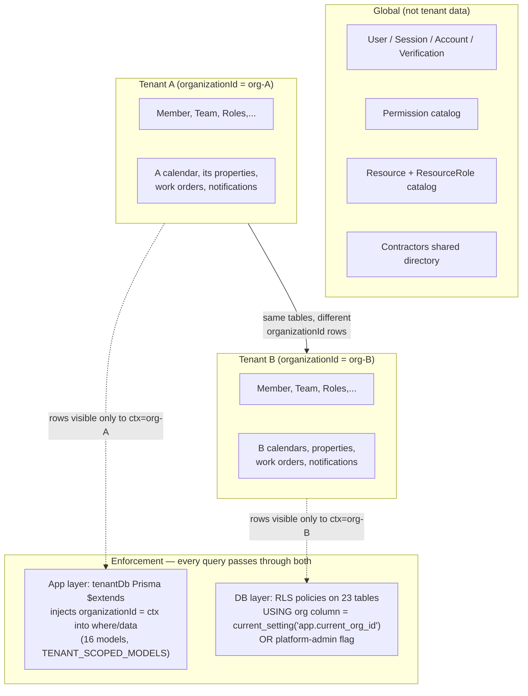
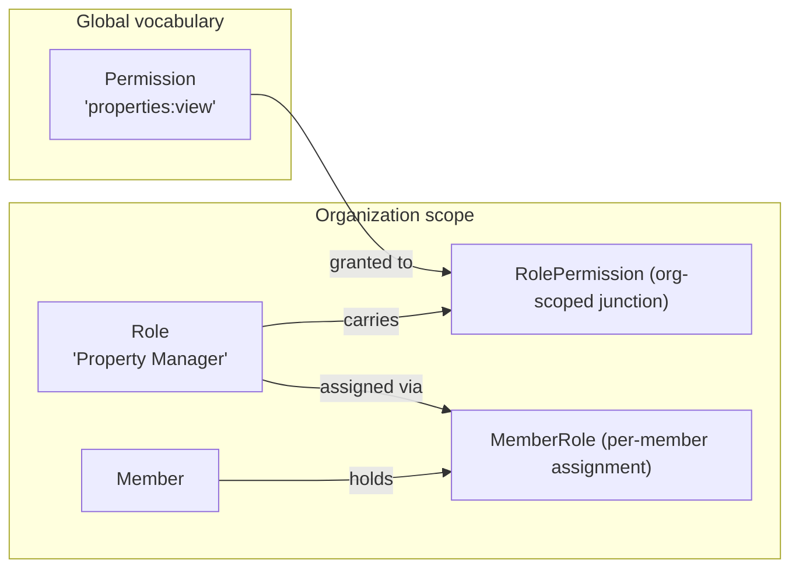
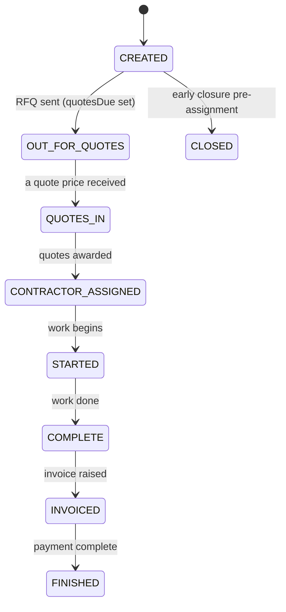
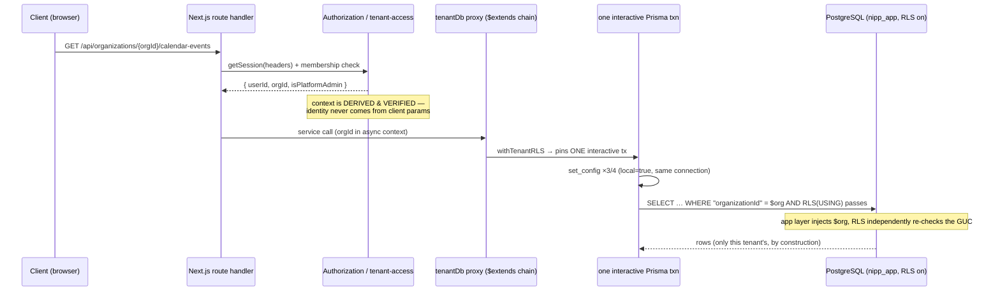

# Portal Data Model — Detailed Breakdown

*A comprehensive reference for the Prisma data models, their PostgreSQL table mappings, relationships, and the row-level security (RLS) strategy that isolates tenant data.*

**Source of truth:** `prisma/schema.prisma` (this document is generated from it), `prisma/migrations/*` (schema evolution + RLS policies), `lib/tenant-extension-core.ts` and `lib/rls-context.ts` (isolation plumbing). Where a model's behaviour depends on code, the responsible file is cited.

---

## Contents

1. [Introduction](#1-introduction)
2. [Data Model Diagrams](#2-data-model-diagrams)
   - [2.1 Entity Relationship Overview](#21-entity-relationship-overview)
   - [2.2 Table Map — Models, Keys and Isolation Columns](#22-table-map--models-keys-and-isolation-columns)
   - [2.3 Tenancy Architecture at a Glance](#23-tenancy-architecture-at-a-glance)
3. [Domain Overview](#3-domain-overview)
4. [Model Reference](#4-model-reference)
   - [4.1 Authentication Models](#41-authentication-models)
   - [4.2 Multi-Tenancy and Membership](#42-multi-tenancy-and-membership)
   - [4.3 Teams](#43-teams)
   - [4.4 RBAC — Roles and Permissions](#44-rbac--roles-and-permissions)
   - [4.5 Feature Catalog — Resources](#45-feature-catalog--resources)
   - [4.6 Audit and Notifications](#46-audit-and-notifications)
   - [4.7 Calendar](#47-calendar)
   - [4.8 Units (Properties)](#48-units-properties)
   - [4.9 Work Order Flow](#49-work-order-flow)
   - [4.10 Job Scheduler](#410-job-scheduler)
   - [4.11 Contractors Directory](#411-contractors-directory)
5. [Enumerated Types (Enums)](#5-enumerated-types-enums)
6. [Data Isolation — Row Level Security](#6-data-isolation--row-level-security)
   - [6.1 Defense in Depth — Two Independent Layers](#61-defense-in-depth--two-independent-layers)
   - [6.2 Database Roles and Privilege](#62-database-roles-and-privilege)
   - [6.3 Request Context GUCs](#63-request-context-gucs)
   - [6.4 Policy Shapes](#64-policy-shapes)
   - [6.5 Per-Table Coverage Matrix](#65-per-table-coverage-matrix)
   - [6.6 A Request Through Both Layers](#66-a-request-through-both-layers)
   - [6.7 Exempt Tables and Why They Are Safe](#67-exempt-tables-and-why-they-are-safe)
   - [6.8 Failure Modes](#68-failure-modes)
   - [6.9 Drift Detection](#69-drift-detection)
7. [Extending the Schema Safely](#7-extending-the-schema-safely)
8. [Appendix A — Glossary and Key Paths](#appendix-a--glossary-and-key-paths)

---

## 1. Introduction

This document describes the underlying data model of the portal — a **multi-tenant property-management platform**. Each customer organization ("tenant") manages its own portfolio of properties (units), staff (users, teams and roles), calendars (viewings, inspections, lease signings…), work (work orders, quotations, invoices) and relationships with external contractors. One shared PostgreSQL database holds every tenant's data; isolation between tenants is enforced by **two independent layers**: an application-layer Prisma extension that injects the tenant id into every query, and PostgreSQL **Row Level Security** policies checked by the database itself (Section 6).

The model currently comprises:

- **30 Prisma models**, each mapped 1:1 to a PostgreSQL table of the same name (no `@@map` overrides),
- **10 enums** used across those tables,
- **23 tables carrying RLS policies**, and **7 deliberately exempt global tables** (auth infrastructure, feature catalog, shared contractor directory).

How to read this document:

| Section | Answer the question… |
|---|---|
| 2 — Diagrams | What does the whole model look like? Which keys link which tables? |
| 3 — Domain overview | Where in the model is the concept I'm looking for? |
| 4 — Model reference | What exactly does table *X* store — fields, types, defaults, indexes, meaning? |
| 5 — Enums | What values can this status/type field take? |
| 6 — RLS | How is one tenant's data kept invisible to another at the database level? |
| 7 — Extending | I'm adding a model/column — what must I do for isolation not to break? |

Conventions used throughout:

- **PK / UK / FK** mark primary keys, unique keys and foreign keys in diagrams.
- Field tables list **type as written in `schema.prisma`**; `(?)` means nullable.
- `cuid()` = client-generated Crockford UUID string, the default strategy for every primary key.
- An *org column* (`organizationId`, or `orgId` for BetterAuth-owned models) is the column both isolation layers key on.

---

## 2. Data Model Diagrams

### 2.1 Entity Relationship Overview

The full model as three logical islands: **authentication** (global, owned by BetterAuth), **tenancy & RBAC** (membership + role/permission wiring), and **tenant business data** (calendars, units, work orders, jobs, notifications). Solid arrows are database-enforced foreign keys; dashed arrows are *logical* references that intentionally have no FK constraint (noted inline after the diagram).

```mermaid
erDiagram
    USER {
        string id PK
        string email UK
        string role
        bool oidcVerified
        string activeOrganizationId "logical org pointer, no FK"
    }
    SESSION {
        string id PK
        string token UK
        datetime expiresAt
        string userId FK
    }
    ACCOUNT {
        string id PK
        string providerId
        string accountId "UK with providerId"
        string accessToken
        string refreshToken
        string userId FK
    }
    VERIFICATION {
        string id PK
        string identifier "indexed"
        string value
        datetime expiresAt
    }

    ORGANIZATION {
        string id PK
        string slug UK
        string name
        string status "OrgStatus enum"
        float latitude
        float longitude
        float mapZoom
    }
    MEMBER {
        string id PK
        string userId FK "UK together with orgId"
        string orgId FK
        string role
        string teamId "optional"
    }
    INVITATION {
        string id PK
        string email
        string token UK
        string orgId FK
        string teamId "optional"
    }
    SENTINVITATION {
        string id PK
        string email
        string token UK
        string orgId FK
    }

    TEAM {
        string id PK
        string name
        string slug "UK with organizationId"
        string organizationId FK
    }
    TEAMMEMBER {
        string id PK
        string teamId FK
        string userId FK "UK together with teamId"
        string organizationId FK
    }
    TEAMROLE {
        string id PK
        string teamId FK "UK together with roleId"
        string roleId FK
        string organizationId FK
    }

    PERMISSION {
        string id PK
        string key UK "resource.action"
        string resource
        string action
        bool isDefault
    }
    ROLE {
        string id PK
        string name
        bool isDefault
        string organizationId FK
    }
    ROLEPERMISSION {
        string id PK
        string roleId FK "UK together with permissionId"
        string permissionId FK
        string organizationId FK
    }
    MEMBERROLE {
        string id PK
        string memberId FK "UK together with roleId"
        string roleId FK
        string organizationId FK
    }
    RESOURCE {
        string id PK
        string name UK
    }
    RESOURCEROLE {
        string id PK
        string resourceId FK "UK together with roleId"
        string roleId FK
    }

    AUDITLOG {
        string id PK
        string userId
        string action
        string resourceType
        string organizationId "nullable"
        bool success
    }
    NOTIFICATIONLOG {
        string id PK
        string recipientEmail
        string eventType
        string status "NotificationStatus"
        string organizationId "nullable"
    }
    NOTIFICATION {
        string id PK
        string title
        string priority "NotificationPriority"
        string scope "NotificationScope"
        string organizationId "nullable"
        bool acknowledged
    }

    CALENDAR {
        string id PK
        string name "UK together with organizationId"
        string color
        bool isDefault
        string organizationId FK
    }
    CALENDAREVENT {
        string id PK
        string title
        datetime startDate
        datetime endDate
        string eventType "CalendarEventType"
        string calendarId FK
        json rrule "optional RFC5545"
        string propertyId "logical link to Units, no FK"
        string organizationId FK
    }

    UNITS {
        string unitId PK
        string owner
        string address
        string postCode
        string email
        string phone
        bool rented
        string type "UnitType enum"
        string organizationId FK
    }

    WORKORDER {
        string workOrderId PK
        string description
        string openedBy "email of opener"
        string openedById "User.id, no FK constraint"
        string contractorId FK
        datetime quotesDue
        string state "WorkOrderState enum"
        string organizationId FK
    }
    WORKORDERNOTE {
        string workOrderNoteId PK
        string workOrderId FK
        string note
        string createdById "super-admin user id, no FK"
        string organizationId FK
    }
    QUOTATION {
        string quoteId PK
        string workOrderId FK
        string contractorId FK "UK together with workOrderId"
        decimal price
        datetime dueDate
        string state "QuotationState enum"
        string organizationId FK
    }
    INVOICE {
        string invoiceId PK
        datetime invoiceDate
        string workOrderId FK "unique, 1:1 with WorkOrder"
        string contractorId FK
        decimal price
        string organizationId FK
    }

    CONTRACTORS {
        string contractorId PK
        string companyName
        string name
        string email
        string phone
        string type "ContractorType enum"
    }

    JOBDEFINITION {
        string id PK
        string platformOrgId
        string name "UK with platformOrgId"
        string handlerKey
        json scheduleExpr "stored as String JSON"
        bool approved
        bool enabled
    }
    JOBEXECUTION {
        string id PK
        string jobDefinitionId FK
        string platformOrgId
        string status
        string trigger
        json resultJson
    }

    %% --- Authentication island ---
    USER ||--o{ SESSION : "has"
    USER ||--o{ ACCOUNT : "signs in via"
    %% --- Membership island ---
    USER ||--o{ MEMBER : "member of (via org)"
    ORGANIZATION ||--o{ MEMBER : "membership rows"
    ORGANIZATION ||--o{ INVITATION : "pending invites"
    ORGANIZATION ||--o{ SENTINVITATION : "sent invites"
    USER ||--o{ TEAMMEMBER : "team membership"
    %% --- Teams island ---
    ORGANIZATION ||--o{ TEAM : "owns"
    TEAM ||--o{ TEAMMEMBER : "contains"
    TEAM ||--o{ TEAMROLE : "role inheritance"
    ROLE ||--o{ TEAMROLE : "assigned to team"
    %% --- RBAC island ---
    MEMBER ||--o{ MEMBERROLE : "role assignments"
    ROLE ||--o{ MEMBERROLE : "granted to members"
    ORGANIZATION ||--o{ ROLE : "defines"
    ROLE ||--o{ ROLEPERMISSION : "carries permissions"
    PERMISSION ||--o{ ROLEPERMISSION : "granted (NoAction)"
    ORGANIZATION ||--o{ ROLEPERMISSION : "org-scoped junction"
    ORGANIZATION ||--o{ MEMBERROLE : "org-scoped junction"
    RESOURCE ||--o{ RESOURCEROLE : "feature catalog"
    ROLE ||--o{ RESOURCEROLE : "feature access"
    %% --- Audit / notifications ---
    ORGANIZATION |o--o{ AUDITLOG : "audit trail (SetNull)"
    ORGANIZATION |o--o{ NOTIFICATIONLOG : "email log (SetNull)"
    ORGANIZATION |o--o{ NOTIFICATION : "in-app notices (SetNull)"
    %% --- Calendar ---
    ORGANIZATION ||--o{ CALENDAR : "owns"
    ORGANIZATION ||--o{ CALENDAREVENT : "events (denorm org col)"
    CALENDAR ||--o{ CALENDAREVENT : "contains"
    %% --- Units / work orders ---
    ORGANIZATION ||--o{ UNITS : "manages properties"
    ORGANIZATION ||--o{ WORKORDER : "tracks work"
    ORGANIZATION ||--o{ WORKORDERNOTE : "WO notes (denorm org col)"
    ORGANIZATION ||--o{ QUOTATION : "quotes (denorm org col)"
    ORGANIZATION ||--o{ INVOICE : "invoices (denorm org col)"
    WORKORDER ||--o{ WORKORDERNOTE : "notes"
    WORKORDER ||--o{ QUOTATION : "quotes received"
    WORKORDER ||--|| INVOICE : "single invoice 1:1"
    CONTRACTORS ||--o{ WORKORDER : "assigned to"
    CONTRACTORS ||--o{ QUOTATION : "submits quote"
    CONTRACTORS ||--o{ INVOICE : "raises invoice"
    %% --- Jobs (platform-only) ---
    JOBDEFINITION ||--o{ JOBEXECUTION : "runs"
```



Relationship notes that the ER diagram cannot express:

1. **`User.activeOrganizationId`** is a *logical* pointer to `Organization.id` — there is no Prisma relation and no FK constraint; membership truth lives in `Member`.
2. **`CalendarEvent.propertyId`** is a *logical* link to `Units.unitId` (indexed, but unconstrained) so general events that have no property can also exist.
3. **`WorkOrder.openedById` / `WorkOrderNote.createdById`** reference `User.id` values for actor integrity but are deliberately not FK-constrained (super admins may open work on behalf of orgs; users are global auth rows).
4. Every table in the *business-data* island redundantly carries its tenant's `organizationId` directly (not just via a parent relation). This denormalization is what makes RLS and app-layer scoping single-column predicates — it is required by the schema header comment, not an accident.

### 2.2 Table Map — Models, Keys and Isolation Columns

Complete mapping from Prisma model to database table. *App-layer* means the model appears in `TENANT_SCOPED_MODELS` (`lib/tenant-extension-core.ts:35`) and gets automatic `organizationId` injection into queries; *RLS policy* names are exactly as created in the migrations listed.

| # | Model (table) | Primary key | Org column | App-layer scoped | RLS policy name(s) |
|---|---|---|---|---|---|
| 1 | `User` | `id` | — (global) | no | none — exempt (auth) |
| 2 | `Session` | `id` | — | no | none — exempt (auth) |
| 3 | `Account` | `id` | — | no | none — exempt (auth) |
| 4 | `Verification` | `id` | — | no | none — exempt (auth) |
| 5 | `Organization` | `id` | self (`id`) | no (it is the anchor) | `rls_organization_select/insert/update/delete` |
| 6 | `Member` | `id` | `orgId` | yes | `rls_member_isolated` |
| 7 | `Invitation` | `id` | `orgId` | yes | `rls_invitation_isolated` |
| 8 | `SentInvitation` | `id` | `orgId` | yes | `rls_sentinvitation_isolated` |
| 9 | `Team` | `id` | `organizationId` | yes | `rls_team_isolated` |
| 10 | `TeamMember` | `id` | `organizationId` | yes | `rls_teammember_isolated` |
| 11 | `TeamRole` | `id` | `organizationId` | yes | `rls_teamrole_isolated` |
| 12 | `Permission` | `id` | — (global catalog) | no | `rls_permission_select`, `…_platform_insert/update/delete` |
| 13 | `Role` | `id` | `organizationId` | yes | `rls_role_isolated` |
| 14 | `RolePermission` | `id` | `organizationId` | yes | `rls_rolepermission_isolated` |
| 15 | `MemberRole` | `id` | `organizationId` | yes | `rls_memberrole_isolated` |
| 16 | `Resource` | `id` | — (global catalog) | no | none — exempt |
| 17 | `ResourceRole` | `id` | — (no org column) | no | none — exempt (reachable via policied `Role`) |
| 18 | `AuditLog` | `id` | `organizationId?` | no | `rls_auditlog_select/insert` (append-only) |
| 19 | `NotificationLog` | `id` | `organizationId?` | no | `rls_notificationlog_select/insert` (append-only) |
| 20 | `Notification` | `id` | `organizationId?` | no | `rls_notification_select/insert/update/delete` |
| 21 | `Calendar` | `id` | `organizationId` | yes | `rls_calendar_isolated` |
| 22 | `CalendarEvent` | `id` | `organizationId` | yes | `rls_calendarevent_isolated` |
| 23 | `Units` | `unitId` | `organizationId` | yes | `rls_units_isolated` |
| 24 | `WorkOrder` | `workOrderId` | `organizationId` | yes | `rls_work_orders_isolated` |
| 25 | `WorkOrderNote` | `workOrderNoteId` | `organizationId` | yes | `rls_work_order_notes_isolated` |
| 26 | `Quotation` | `quoteId` | `organizationId` | yes | `rls_quotations_isolated` |
| 27 | `Invoice` | `invoiceId` | `organizationId` | yes | `rls_invoices_isolated` |
| 28 | `JobDefinition` | `id` | `platformOrgId` | no (platform-only) | `rls_jobdefinition_platform_only` (FOR ALL) |
| 29 | `JobExecution` | `id` | `platformOrgId` | no (platform-only) | `rls_jobexecution_platform_only` (FOR ALL) |
| 30 | `Contractors` | `contractorId` | — (shared by design) | no | none — exempt (SECURITY.md Appendix B) |

### 2.3 Tenancy Architecture at a Glance



The two enforcement boxes must always agree: the org-scoped models appear in **both** `TENANT_SCOPED_MODELS` **and** the RLS policy catalog, and CI hashes both lists against the schema so drift fails the build (Section 6.9).

---

## 3. Domain Overview

| Domain | Models | What it supports |
|---|---|---|
| Authentication | `User`, `Session`, `Account`, `Verification` | Local e-mail/password and OIDC (social) sign-in, active sessions, OAuth token storage, verification/PKCE state — all global, owned by the BetterAuth framework. |
| Multi-tenancy & membership | `Organization`, `Member`, `Invitation`, `SentInvitation` | The tenant root row, who belongs to which tenant at which built-in role, and the invite lifecycle (pending vs sent). |
| Teams | `Team`, `TeamMember`, `TeamRole` | Sub-organizational groupings with automatic **role inheritance**: joining a team grants that team's roles. |
| RBAC | `Role`, `Permission`, `RolePermission`, `MemberRole` + feature catalog `Resource`, `ResourceRole` | Org-scoped roles composed from a global `resource:action` permission catalog; per-member role assignment; per-feature access gating. |
| Audit & notifications | `AuditLog`, `NotificationLog`, `Notification` | Append-only security audit trail, e-mail delivery log, and in-app SSE notifications (ORG vs GLOBAL scope). |
| Calendar | `Calendar`, `CalendarEvent` | Org calendars (viewings, inspections, lease signings, maintenance…) with single-, multi- and recurring events. |
| Units (properties) | `Units` | The physical properties an organization manages: address, owner contact, rented status, type. |
| Work Order Flow | `WorkOrder`, `WorkOrderNote`, `Quotation`, `Invoice` | Lifecycle of a piece of work from request → quotations → contractor assignment → completion → invoice, tracked alongside the shared contractor directory. |
| Job Scheduler | `JobDefinition`, `JobExecution` | Platform-organization-only background job registry (Bree-backed) with an explicit approval gate before any job may run. |
| Contractors | `Contractors` | Global shared directory of external tradespeople usable by every organization. |

---

## 4. Model Reference

Every model maps to a PostgreSQL table of the **same name** (no `@@map` renames). Field order below mirrors `prisma/schema.prisma`.

### 4.1 Authentication Models

*Global, not tenant data — owned by the BetterAuth framework. These four tables have no org column and no RLS policy on purpose: they contain no tenant data, and the auth flow must work before any tenant context exists.*

#### 4.1.1 `User` → table `User`

The portal's human identity. A user is a single person whose membership in one or more organizations (via `Member`) determines what they can see. Authentication is pluggable: local e-mail/password (`passwordHash`, plus the derived `Account` rows) and OIDC/social providers — `oidcVerified` records that the user completed magic-link verification at least once (Google *asserts* e-mail on sign-up, which cannot be used for this distinction, per design §4.3).

| Field | Type | Null? | Default / constraint | Notes |
|---|---|---|---|---|
| `id` | String | — | PK, `cuid()` | Referenced by sessions, accounts, memberships. |
| `name` | String | — | | Display name. |
| `email` | String | — | UK | Unique across the whole platform (all tenants share one identity space). |
| `emailVerified` | Boolean | — | `false` | E-mail verification flag (BetterAuth standard). |
| `image` | String? | yes | | Avatar URL. |
| `passwordHash` | String | yes | | Set for local e-mail/password users; null for OIDC-only accounts. |
| `role` | String | — | `"member"` | Top-level platform role string (distinct from per-org roles). |
| `banned` | Boolean? | yes | `false` | BetterAuth ban flag. |
| `banReason` | String? | yes | | Free-text reason when banned. |
| `banExpires` | DateTime? | yes | | Ban expiry, if temporary. |
| `createdAt` / `updatedAt` | DateTime | — | `now()` / auto | Audit timestamps. |
| `activeOrganizationId` | String? | yes | column name as-is | *Logical* pointer to the org the user last selected; no FK — membership truth lives in `Member`. |
| `oidcVerified` | Boolean | — | `false` | True only after magic-link verification (see above). |

Indexes: PK on `id`, UK on `email`.

#### 4.1.2 `Session` → table `Session`

A signed-in session — the server-side record backing an authenticated request. Rows cascade-delete with their user.

| Field | Type | Null? | Default / constraint | Notes |
|---|---|---|---|---|
| `id` | String | — | PK, `cuid()` | |
| `expiresAt` | DateTime | — | | Session validity horizon. |
| `token` | String | — | UK | The session token presented by the client. |
| `createdAt` / `updatedAt` | DateTime | — | `now()` / auto | |
| `ipAddress` | String? | yes | | Captured at sign-in (device/trust context). |
| `userAgent` | String? | yes | | Browser/client string at sign-in. |
| `userId` | String | — | FK → `User.id`, ON DELETE CASCADE | |

Indexes: PK on `id`, UK on `token`, B-tree on `userId`.

#### 4.1.3 `Account` → table `Account`

Link between a `User` and an *external credential*: one row per (provider, provider-account) pair — e.g. a Google account OIDC sub, plus that OAuth token set (`accessToken`, `refreshToken`, expiry, scopes). Field names are **frozen**: they must match BetterAuth's canonical account schema because the prisma adapter passes them through verbatim; do not rename without re-pointing `better-auth/adapters/prisma`.

| Field | Type | Null? | Default / constraint | Notes |
|---|---|---|---|---|
| `id` | String | — | PK, `cuid()` | |
| `accountId` | String | — | **UK with `providerId`** | Provider-specific user id (e.g. OIDC `sub`). |
| `providerId` | String | — | UK pair | Provider name (`google-accounts`, etc.). |
| `password` | String? | yes | | Reserved by BetterAuth's account schema. |
| `refreshTokenExpiresAt` | DateTime? | yes | | |
| `idToken` | String? | yes | | Last id token. |
| `scope` | String? | yes | | Granted OAuth scopes. |
| `tokenType` | String? | yes | | e.g. `Bearer`. |
| `sessionState` | String? | yes | | PKCE session state. |
| `accessToken` | String? | yes | | Current access token. |
| `accessTokenExpiresAt` | DateTime? | yes | | |
| `refreshToken` | String? | yes | | |
| `createdAt` / `updatedAt` | DateTime | — | `now()` / auto | |
| `userId` | String | — | FK → `User.id`, ON DELETE CASCADE | |

Indexes: PK on `id`, UK on (`providerId`, `accountId`), B-tree on `userId`.

#### 4.1.4 `Verification` → table `Verification`

Transient OTP/verification records and OAuth state storage (PKCE state + nonce for the social-provider sign-in flow). Expected to be pruned by expiry; indexed on `identifier` for lookup.

| Field | Type | Null? | Default / constraint | Notes |
|---|---|---|---|---|
| `id` | String | — | PK, `cuid()` | |
| `identifier` | String | — | indexed | E-mail, phone, or OAuth state subject. |
| `value` | String | — | | Code/nonce value (hashed in practice). |
| `expiresAt` | DateTime | — | | Hard expiry of the record's usefulness. |
| `createdAt` / `updatedAt` | DateTime | — | `now()` / auto | |

Indexes: PK on `id`, B-tree on `identifier`.

### 4.2 Multi-Tenancy and Membership

*The tenancy anchor and its membership graph. Organization is the root of every tenant's data.*

#### 4.2.1 `Organization` → table `Organization`

**A customer of the platform** — one row per company (typically a housing association / property-management firm). It is the root of the tenant tree: everything an org manages — members, teams, roles, calendars, properties, work orders — hangs off this row by its `id`. Lifecycle is tracked in `status`; the optional lat/lng/zoom triple pins the org's Map page view (served via `GET /api/organizations/[orgId]/location`, zoom clamped to the display-percent formula).

| Field | Type | Null? | Default / constraint | Notes |
|---|---|---|---|---|
| `id` | String | — | PK, `cuid()` | This id is what every org column stores. |
| `slug` | String? | yes | UK | URL-friendly identity if one is set. |
| `name` | String | — | | Display name of the company. |
| `description` | String? | yes | | Free text. |
| `status` | OrgStatus | — | `PENDING` | `PENDING → ACTIVE`, or `SUSPENDED` / `ARCHIVED`. |
| `metadata` | Json? | yes | | Extension bag for per-org key/value data. |
| `latitude` / `longitude` | Float? | yes | | Map centre coordinates (see above). |
| `mapZoom` | Float? | yes | | Map zoom; clamped to `[MIN_ZOOM, MAX_ZOOM]` when applied. |
| `createdAt` / `updatedAt` | DateTime | — | `now()` / auto | |

Relationships: parent anchor for ~20 child collections (members, roles, calendars, units, work orders, … — full list in the ER diagram). RLS: per-command policies (platform-owned lifecycle) — see Section 6.5.

#### 4.2.2 `Member` → table `Member`

**Membership of a user in an organization** — the junction that makes the platform multi-tenant. One row per (user, org), holding the *built-in* BetterAuth role string for this membership (e.g. `owner`, `admin`, `member`) and an optional alignment slot for a team (`teamId`). Fine-grained RBAC sits in `MemberRole`; this table is the coarse membership fact that every authorization check — including the platform-admin derivation (Section 6.3) — bottoms out on.

| Field | Type | Null? | Default / constraint | Notes |
|---|---|---|---|---|
| `id` | String | — | PK, `cuid()` | |
| `role` | String | — | `"member"` | Built-in role for this membership. |
| `createdAt` / `updatedAt` | DateTime | — | `now()` / auto | |
| `userId` | String | — | FK → `User.id`, cascade; **UK with `orgId`** | One membership row per user per org. |
| `orgId` | String | — | FK → `Organization.id`, cascade; UK pair | *This is the BetterAuth naming; the same column other models call `organizationId`.* |
| `teamId` | String? | yes | map: `teamId` | Optional team alignment (BetterAuth teams mode). |

Indexes: PK, UK (`userId`, `orgId`). No dedicated B-tree — uniqueness covers lookups.

#### 4.2.3 `Invitation` → table `Invitation` and `SentInvitation` → table `SentInvitation`

**The invite lifecycle**: `Invitation` rows are *pending* invitations (an org admin has invited an e-mail address); once the invite actually goes out they are mirrored into `SentInvitation`. Both can carry a built-in role for the eventual member and, optionally, a specific team the invite targets directly.

| Field | Type | Null? | Default / constraint | Notes |
|---|---|---|---|---|
| `id` | String | — | PK, `cuid()` | |
| `email` | String | — | indexed | Invitee address (user may not exist yet). |
| `role` | String? | yes | | Built-in role to grant on acceptance. |
| `token` | String | — | UK | Single-use link token. |
| `expiresAt` | DateTime | — | | Invitation validity. |
| `createdAt` | DateTime | — | `now()` | |
| `orgId` | String | — | FK → `Organization.id`, cascade | Which org issued the invite. |
| `teamId` | String? (Invitation only) | yes | map: `teamId` | Optional direct team placement. |

Indexes: PK, UK on `token`, B-tree on `email`; plus (`userId`-free). Both tables are policy-isolated on `orgId`.

### 4.3 Teams

*Sub-organizational groupings. Teams exist to let an org divide staff (e.g. "Maintenance Team A", "Letting Agents") and inherit roles: the roles attached to a team via `TeamRole` are granted automatically to every member of it.*

#### 4.3.1 `Team` → table `Team`

| Field | Type | Null? | Default / constraint | Notes |
|---|---|---|---|---|
| `id` | String | — | PK, `cuid()` | |
| `name` | String | — | (max 100 chars in app layer) | Human-readable team name. |
| `slug` | String? | yes | **UK with `organizationId`** | URL-friendly; auto-generated from name if omitted. Also single-column indexed for resolution. |
| `description` | String? | yes | (max 500 chars in app layer) | |
| `createdAt` / `updatedAt` | DateTime | — | `now()` / auto | |
| `organizationId` | String | — | FK → `Organization.id`, cascade; UK pair | Org-scoping key. |

Indexes: PK, UK (`organizationId`, `slug`), B-tree (`organizationId`, `name`), B-tree (`slug`).

#### 4.3.2 `TeamMember` → table `TeamMember`

User-to-team membership within one org — a user may belong to several teams in the same organization (e.g. property manager *and* letting agent). Cascade on any of the three references; the denormalized org column keeps RLS single-column.

| Field | Type | Null? | Default / constraint | Notes |
|---|---|---|---|---|
| `id` | String | — | PK, `cuid()` | |
| `createdAt` | DateTime | — | `now()` | No `updatedAt` — membership rows aren't edited in place. |
| `teamId` | String | — | FK → `Team.id`, cascade; indexed | |
| `userId` | String | — | FK → `User.id`, cascade; **UK with `teamId`** | A user joins a team at most once. |
| `organizationId` | String | — | FK → `Organization.id`, cascade; indexed | Tenant-scoped queries / RLS key. |

Indexes: PK, UK (`userId`, `teamId`), B-tree on `organizationId`, B-tree on `teamId`.

#### 4.3.3 `TeamRole` → table `TeamRole`

**The role-inheritance glue**: links a team to an org-scoped role so that joining the team automatically confers that role (enforcement in app-layer bootstrap logic; this table is the declaration). A role can be attached to many teams; each attachment is unique.

| Field | Type | Null? | Default / constraint | Notes |
|---|---|---|---|---|
| `id` | String | — | PK, `cuid()` | |
| `createdAt` | DateTime | — | `now()` | |
| `teamId` | String | — | FK → `Team.id`, cascade; **UK with `roleId`** | |
| `roleId` | String | — | FK → `Role.id`, cascade; UK pair | The inherited role (org-scoped). |
| `organizationId` | String | — | FK → `Organization.id`, cascade; indexed | Consistency with the team's org is guaranteed by the two parent FKs; column exists for the isolation contract. |

Indexes: PK, UK (`teamId`, `roleId`), B-tree on `organizationId`.

### 4.4 RBAC — Roles and Permissions

*Authorization model in three parts: a global vocabulary of what can be done (`Permission` = `resource:action`), org-scoped bundles of those abilities (`Role` + `RolePermission`), and per-person assignment (`MemberRole`). Feature-level gating adds one more junction over a global feature catalog (Section 4.5).*



#### 4.4.1 `Permission` → table `Permission`

**Global catalog of everything the platform can do**, expressed as `resource:action` strings (`properties:view`, `tenants:create`…). Shared by all organizations so that role composition stays comparable across tenants and seeded consistently; the `isDefault` mark distinguishes bootstrapped entries from custom ones. Read access is restricted (Section 6.5): a tenant sees only permissions assigned to *their own org's roles*; full-catalog reads are platform-admin-only.

| Field | Type | Null? | Default / constraint | Notes |
|---|---|---|---|---|
| `id` | String | — | PK, `cuid()` | |
| `key` | String | — | UK | Canonical `resource:action` identifier (e.g. `properties:view`). |
| `resource` | String | — | | e.g. `properties`. |
| `action` | String | — | | e.g. `view`, `create`, `delete`. |
| `description` | String? | yes | | UI/helper text. |
| `isDefault` | Boolean | — | `true` | `true` = bootstrapped, `false` = custom. |
| `createdAt` / `updatedAt` | DateTime | — | `now()` / auto | |

Indexes: PK, UK on `key`.

#### 4.4.2 `Role` → table `Role`

**An org-scoped bundle of permissions** with a human name ("Property Manager", "Custom Viewer"). Roles are either bootstrapped (`isDefault`) or created by that org's admins — which is precisely why this table, not the permission catalog, is the sensitive side: it is fully tenant-isolated. `@@index([name])` exists to support prefix-search autocomplete in the UI.

| Field | Type | Null? | Default / constraint | Notes |
|---|---|---|---|---|
| `id` | String | — | PK, `cuid()` | |
| `name` | String | — | indexed | Display name; prefix-searchable. |
| `description` | String? | yes | | Free text. |
| `isDefault` | Boolean | — | `false` | Bootstrapped vs custom. |
| `createdAt` / `updatedAt` | DateTime | — | `now()` / auto | |
| `organizationId` | String | — | FK → `Organization.id`, cascade; indexed | Tenant isolation key (policy `rls_role_isolated`). |

#### 4.4.3 `RolePermission` → table `RolePermission`

Junction: which permissions a role carries. **Org-scoped by the schema contract** — the org column is redundant with `Role.organizationId`, but the isolation model keys on it so both layers can use one single-column predicate (the header comment in `schema.prisma` calls this out explicitly). Deletion of a permission does *not* cascade (FK is `NoAction`): catalog entries are deleted only after all grants are removed.

| Field | Type | Null? | Default / constraint | Notes |
|---|---|---|---|---|
| `id` | String | — | PK, `cuid()` | |
| `createdAt` | DateTime | — | `now()` | |
| `roleId` | String | — | FK → `Role.id`, cascade; **UK with `permissionId`** | |
| `permissionId` | String | — | FK → `Permission.id`, **NoAction**; UK pair | The granted permission. |
| `organizationId` | String | — | FK → `Organization.id`, cascade; indexed | Redundant-but-required org scoping. |

Indexes: PK, UK (`roleId`, `permissionId`), B-tree on `organizationId`.

#### 4.4.4 `MemberRole` → table `MemberRole`

Junction: which roles a member holds (within an org). A member can hold several roles; permissions are the union of all of them at authorization time. This table was absent from the schema historically while code already wrote to it (`org-bootstrap.ts`) — its absence was a tracked defect, now fixed and covered by policies.

| Field | Type | Null? | Default / constraint | Notes |
|---|---|---|---|---|
| `id` | String | — | PK, `cuid()` | |
| `createdAt` | DateTime | — | `now()` | |
| `memberId` | String | — | FK → `Member.id`, cascade; **UK with `roleId`** | The member (org membership row). |
| `roleId` | String | — | FK → `Role.id`, cascade; UK pair | The granted role. |
| `organizationId` | String | — | FK → `Organization.id`, cascade; indexed | Isolation key. |

Indexes: PK, UK (`memberId`, `roleId`), B-tree on `organizationId`.

### 4.5 Feature Catalog — Resources

*Feature-level access control: the platform exposes named feature modules ("Maintenance Requests", "Work Orders"…); a **role** must be explicitly attached to a resource for users holding that role to use the feature. The catalog itself is global and unsophisticated; the sensitive decision lives on the org-scoped `Role` side.*

#### 4.5.1 `Resource` → table `Resource`

| Field | Type | Null? | Default / constraint | Notes |
|---|---|---|---|---|
| `id` | String | — | PK, `cuid()` | |
| `name` | String | — | UK | Feature module name (unique globally). |
| `description` | String? | yes | | |
| `createdAt` / `updatedAt` | DateTime | — | `now()` / auto | |

#### 4.5.2 `ResourceRole` → table `ResourceRole`

Global junction `Resource ↔ Role` (no org column: the role it points at *is* tenant-scoped and fully policied, which is the intended access path). Unique per (resource, role). **RLS-exempt by documented design** (schema header + SECURITY.md Appendix B) — if a route ever queries this table directly, add an isolation check first.

| Field | Type | Null? | Default / constraint | Notes |
|---|---|---|---|---|
| `id` | String | — | PK, `cuid()` | |
| `createdAt` | DateTime | — | `now()` | |
| `resourceId` | String | — | FK → `Resource.id`, cascade; **UK with `roleId`** | |
| `roleId` | String | — | FK → `Role.id`, cascade; UK pair | The org-scoped role granted feature access. |

Indexes: PK, UK (`resourceId`, `roleId`).

### 4.6 Audit and Notifications

#### 4.6.1 `AuditLog` → table `AuditLog`

**Append-only security trail of admin actions** (org creation, role deletion, permission changes…). Rows carry the actor's id *and* a denormalized name snapshot (so the log survives identity deletions), the action in dotted notation (`organization.created`, `role.deleted`), target type/id, and request context (IP/UA). The org column is **nullable**: platform-level actions with no tenant get NULL. Intentionally a "global" model so Super Admins can query across tenants — RLS permits cross-tenant SELECT for verified platform admins only, and **no UPDATE/DELETE policy exists** (append-only at the DB level; only the owner role can alter it).

| Field | Type | Null? | Default / constraint | Notes |
|---|---|---|---|---|
| `id` | String | — | PK, `cuid()` | |
| `timestamp` | DateTime | — | `now()`, indexed | Sort key for the audit view. |
| `userId` | String? | yes | indexed | Actor (no FK — survives user deletion). |
| `userName` | String? | yes | | Denormalized snapshot of actor name. |
| `action` | String | — | | Dotted action name, e.g. `organization.created`. |
| `resourceType` | String | — | indexed | e.g. `Organization`, `Role`. |
| `resourceId` | String? | yes | | Target row id, if any. |
| `organizationId` | String? | yes | FK → `Organization.id`, **SetNull**; indexed | NULL = platform-level event. |
| `ipAddress` / `userAgent` | String? | yes | | Request context. |
| `success` | Boolean | — | `true` | Failed attempts are logged too (with `false`). |
| `metadata` | Json? | yes | | Arbitrary extra payload. |

Indexes: PK, B-trees on `userId`, `organizationId`, `timestamp`, `resourceType`.

#### 4.6.2 `NotificationLog` → table `NotificationLog`

**E-mail delivery ledger**: every notification the system sends gets a row recording recipient, event type, optional message body and outcome (`SENT`/`FAILED`). Used for operational visibility (who was told when, did it work). Append-only like `AuditLog` (no UPDATE/DELETE policy), org-nullable for platform e-mails.

| Field | Type | Null? | Default / constraint | Notes |
|---|---|---|---|---|
| `id` | String | — | PK, `cuid()` | |
| `timestamp` | DateTime | — | `now()`, indexed | |
| `recipientEmail` | String | — | | Destination address. |
| `eventType` | String | — | | e.g. an invite or verification event. |
| `message` | String? | yes | | Stored copy of the message. |
| `status` | NotificationStatus | — | `SENT` | `SENT` or `FAILED`. |
| `organizationId` | String? | yes | FK SetNull; indexed | NULL = platform-level mail. |

#### 4.6.3 `Notification` → table `Notification`

**In-app notifications**, pushed live over SSE and retained for an admin history log. Two scopes, driven by `scope` + nullable org column:

- **GLOBAL** — broadcast to every connected subscriber (all tenants + super admins); org id is NULL for pure broadcasts, but an admin acting *on behalf* of an org may stamp that org's id so the log can show who initiated.
- **ORG** — visible only to that organization's subscribers plus super admins (whose own subscriber context has no org).

Scope gates *live delivery*; super admins can always see everything historically. `priority` controls ticker behaviour: `INFO`/`WARNING` auto-dismiss, while `CRITICAL`, `CALENDAR` (upcoming-event reminders from the calendar scheduler) and `JOB` persist until manually dismissed; `CALENDAR` renders distinctively in bright green.

| Field | Type | Null? | Default / constraint | Notes |
|---|---|---|---|---|
| `id` | String | — | PK, `cuid()` | |
| `title` | String | — | | |
| `message` | String | — | | Body. |
| `priority` | NotificationPriority | — | `INFO` | See behaviour note above. |
| `scope` | NotificationScope | — | `ORG` | `ORG` vs `GLOBAL`. |
| `source` | String? | yes | | Machine origin, e.g. `health-check:database`, `admin:message`, `platform:certs`. |
| `organizationId` | String? | yes | FK SetNull; indexed | NULL = global broadcast. |
| `createdAt` / `updatedAt` | DateTime | — | `now()` / auto | Index on `createdAt`; (`scope`,`createdAt`) for admin log listing. |
| `acknowledged` | Boolean | — | `false` | Set true by the (RLS-gated) UPDATE path. |

Indexes: PK, B-tree `organizationId`, B-tree `createdAt`, B-tree (`scope`, `createdAt`).

---
### 4.7 Calendar

*Calendar events are a core operational surface: staff schedule viewings, inspections, maintenance visits and lease signings, optionally tied to a specific property.*

#### 4.7.1 `Calendar` → table `Calendar`

**A named event container within an organization.** Each org gets one default calendar at bootstrap (the `isDefault` flag; the app guarantees exactly one per org), with support for additional specialized calendars ("Maintenance Calendar", "Lettings Calendar"). The `color` is the calendar's theme default, which events may override.

| Field | Type | Null? | Default / constraint | Notes |
|---|---|---|---|---|
| `id` | String | — | PK, `cuid()` | |
| `name` | String | — | **UK with `organizationId`** | Human-readable; duplicate names within an org are rejected. |
| `description` | String? | yes | | |
| `color` | String | — | `"#1B2A4A"` | Calendar theme colour. |
| `isDefault` | Boolean | — | `false` | One default calendar per org (app-level invariant). |
| `createdAt` / `updatedAt` | DateTime | — | `now()` / auto | |
| `organizationId` | String | — | FK → `Organization.id`, cascade; indexed | Tenant isolation key. |

#### 4.7.2 `CalendarEvent` → table `CalendarEvent`

**A single schedulable occurrence**: one-day, multi-day (start ≤ end) or recurring events (`rrule`). Event kinds are typed (`eventType`) and match the property-management workflow — viewings, inspections, maintenance, lease signings/renewals, key exchanges — with `OTHER` for anything outside that vocabulary. Events may be attached to a property; the link is *logical* (indexed, no FK) so general org-wide events exist without one. Dates are stored as **local, timezone-naive** datetimes by v1 design. Recurrence follows RFC 5545: `rrule` stores the rule and `exdates` lists explicit exclusions (`YYYY-MM-DD` strings, default `[]`).

| Field | Type | Null? | Default / constraint | Notes |
|---|---|---|---|---|
| `id` | String | — | PK, `cuid()` | |
| `title` | String | — | | Event name. |
| `description` | String? | yes | | Free text. |
| `startDate` | DateTime | — | | Local datetime (v1: no timezone). Indexed with org for range queries. |
| `endDate` | DateTime | — | | |
| `eventType` | CalendarEventType | — | `OTHER` | See Section 5. |
| `color` | String? | yes | | Per-event override of the calendar colour. |
| `calendarId` | String | — | FK → `Calendar.id`, cascade | Owning calendar. |
| `rrule` | Json? | yes | | RFC 5545 recurrence rule (`RRULE:FREQ=…`). |
| `exdates` | Json | — | `"[]"` (`@db.Json`) | Excluded dates from expansion. |
| `propertyId` | String? | yes | indexed | Logical link to `Units.unitId`; nullable for general events. |
| `organizationId` | String | — | FK cascade; indexed (with `startDate`) | Denormalized tenant key. |
| `createdAt` / `updatedAt` | DateTime | — | `now()` / auto | |

Indexes: PK, B-tree (`organizationId`, `startDate`), B-tree on `propertyId`.

### 4.8 Units (Properties)

#### 4.8.1 `Units` → table `Units`

**A physical property managed by the organization.** A unit is one address with an owner and contact details, plus its letting status (`rented`) and kind (`type`). This is the master record everything else hangs off: calendar events can point at it (logical link), and work on a property is tracked via work orders. The model name is `Units` (plural) — table included — which matches how the portal refers to "a unit".

| Field | Type | Null? | Default / constraint | Notes |
|---|---|---|---|---|
| `unitId` | String | — | PK, `cuid()` | Note: named `unitId`, not `id`. |
| `organizationId` | String | — | FK → `Organization.id`, cascade; indexed | Tenant isolation key (policy `rls_units_isolated`). |
| `owner` | String | — | | Name of the unit's owner. |
| `address` | String | — | | Street address of the unit. |
| `postCode` | String | — | | Postal code. |
| `email` | String | — | | Owner contact e-mail. |
| `phone` | String | — | | Owner contact phone. |
| `rented` | Boolean | — | `false` | Currently let/occupied? |
| `type` | UnitType | — | `APARTMENT` | Property kind (see Section 5). |
| `createdAt` / `updatedAt` | DateTime | — | `now()` / auto | |

Indexes: PK, B-tree on `organizationId`.

### 4.9 Work Order Flow

*The operational flow for a piece of work at a property: it is opened, quotes are requested from the shared contractor directory, one contractor is assigned, the job runs to completion, is invoiced and finished. State transitions live in `state` (and per-quote state); the design document is `documents/feature-planning-and-development/work-order-flow.md`.*



#### 4.9.1 `WorkOrder` → table `WorkOrder`

| Field | Type | Null? | Default / constraint | Notes |
|---|---|---|---|---|
| `workOrderId` | String | — | PK, `cuid()` | Named `workOrderId`, not `id`. |
| `description` | String | — | | What work is required and where. |
| `openedBy` | String | — | | E-mail of the person/super-admin who opened it (brief requirement). |
| `openedById` | String? | yes | *Logical User.id, no FK* | Actor-integrity id; nullable because super admins may open on behalf of orgs. |
| `contractorId` | String? | yes | FK → `Contractors.contractorId` (no cascade); null until `CONTRACTOR_ASSIGNED` | The awarded contractor. |
| `quotesDue` | DateTime? | yes | indexed with org | RFQ deadline — set when the request goes out; default +7 days, configurable at send time. Drives the overdue-alarm job (see `deadlineAlertAt`). |
| `deadlineAlertAt` | DateTime? | yes | Set when the overdue alert fired | **Idempotency marker** so the recurring deadline job fires at most once per work order. |
| `state` | WorkOrderState | — | `CREATED`; indexed with org | Lifecycle (Section 5); `CLOSED` = early closure before assignment/funding. |
| `organizationId` | String | — | FK cascade; indexed (with `state` and with `quotesDue`) | Tenant isolation key (policy `rls_work_orders_isolated`). |
| `createdAt` / `updatedAt` | DateTime | — | `now()` / auto | |

Indexes: PK, B-tree (`organizationId`, `state`), B-tree (`organizationId`, `quotesDue`).

#### 4.9.2 `WorkOrderNote` → table `WorkOrderNote`

Running notes on a work order. Notes are **super-admin managed** (the `createdById` column stores the admin's user id, unconstrained); they cascade-delete with their work order.

| Field | Type | Null? | Default / constraint | Notes |
|---|---|---|---|---|
| `workOrderNoteId` | String | — | PK, `cuid()` | |
| `workOrderId` | String | — | FK → `WorkOrder.workOrderId`, cascade; indexed | Parent work order. |
| `note` | String | — | | The note text. |
| `createdById` | String? | yes | *Super-admin User.id, no FK* | Who wrote it. |
| `organizationId` | String | — | FK cascade | Denormalized tenant key. |
| `createdAt` / `updatedAt` | DateTime | — | `now()` / auto | |

#### 4.9.3 `Quotation` → table `Quotation`

**A contractor's quote against a work order**, one row per (work order, contractor) — the UK enforces exactly one quotation per bidder per job. The financial/attachment fields stay null until the quote is actually received; recording a `price` automatically advances the parent to `QUOTES_IN`. The bid's own state tracks acceptance/rejection.

| Field | Type | Null? | Default / constraint | Notes |
|---|---|---|---|---|
| `quoteId` | String | — | PK, `cuid()` | |
| `workOrderId` | String | — | FK cascade; **UK with `contractorId`** | Parent work order. |
| `contractorId` | String | — | FK → `Contractors.contractorId`; UK pair | The bidding contractor. |
| `quoteLink` | String? | yes | Null until received | Remote link to the quotation document. |
| `description` | String? | yes | Null until received | Breakdown of the quoted work. |
| `price` | Decimal(12,2)? | yes | Null until received (auto-advances WO to `QUOTES_IN`) | Quoted amount. |
| `dueDate` | DateTime | — | | Bid validity deadline. |
| `state` | QuotationState | — | `OPENED` | `OPENED → ACCEPTED / REJECTED`, then `CLOSED`. |
| `organizationId` | String | — | FK cascade; indexed | Denormalized tenant key. |
| `createdAt` / `updatedAt` | DateTime | — | `now()` / auto | |

Indexes: PK, UK (`workOrderId`, `contractorId`), B-tree on `organizationId`.

#### 4.9.4 `Invoice` → table `Invoice`

**The final bill for a work order** — strictly 1:1 with its work order (enforced by the unique FK). One invoice per completed job, raised by the awarded contractor; payment completion drives the work order to `FINISHED`.

| Field | Type | Null? | Default / constraint | Notes |
|---|---|---|---|---|
| `invoiceId` | String | — | PK, `cuid()` | |
| `invoiceDate` | DateTime | — | | Date the invoice was raised. |
| `workOrderId` | String | — | FK → `WorkOrder.workOrderId`, **unique (1:1)** | The job being billed. |
| `contractorId` | String | — | FK → `Contractors.contractorId` | Invoicing contractor. |
| `invoiceLink` | String? | yes | Remote link to the invoice document | |
| `price` | Decimal(12,2) | — | | Invoiced amount. |
| `dueDate` | DateTime | — | | Payment due date. |
| `organizationId` | String | — | FK cascade; indexed | Denormalized tenant key. |
| `createdAt` / `updatedAt` | DateTime | — | `now()` / auto | |

Indexes: PK, UK on `workOrderId`, B-tree on `organizationId`.

### 4.10 Job Scheduler

*Platform-infrastructure tables (not tenant data): the platform organisation's background job registry. Each job forks a Bree worker at run time; operator code (`code`) is materialized to a temp file and loaded by path — never eval'd. These are the strongest-protected tables in the model: platform-admin flag **and** matching platform-org id required for every operation (Section 6.4, shape D).*

#### 4.10.1 `JobDefinition` → table `JobDefinition`

| Field | Type | Null? | Default / constraint | Notes |
|---|---|---|---|---|
| `id` | String | — | PK, `cuid()` | |
| `platformOrgId` | String | — | UK with `name`; indexed (with `enabled`, `lastRunAt`, `approved`) | **Owner = the platform organization only** (not an app FK column). |
| `name` | String | — | UK pair | Job name, unique per platform org. |
| `description` | String? | yes | | What the script does. |
| `handlerKey` | String | — | | Registry key → built-in handler (Phase 1) or stored script (Phase 2). |
| `code` | String? | yes | Null for built-ins; materialized to a tmp file at exec, loaded by path, never eval'd | Operator-authored source. |
| `scheduleExpr` | String | — | JSON: `{ "kind": "cron" \| "interval" \| "oneshot", … }` | When the job fires. |
| `timezone` | String? | yes | IANA zone; defaults from `JOB_SCHEDULER_TIMEZONE` | |
| `timeoutMs` | Int? | yes | Defaults from `JOB_SCHEDULER_DEFAULT_TIMEOUT_MS` | Per-job wall-clock cap. |
| `concurrencyLimit` | Int | — | `1` (default env `JOB_SCHEDULER_DEFAULT_CONCURRENCY`) | Overlap policy. |
| `enabled` | Boolean | — | `false` | Scheduled runs only when enabled *and approved*. |
| `approved` | Boolean | — | `false`; indexed with org | **Approval gate**: no enable/trigger/run before a platform admin approves (Phase 1 guardrail — including for future operator code). |
| `approvedBy` | String? | yes | Platform-admin User.id | Who approved. |
| `approvedAt` | DateTime? | yes | When approved | |
| `approvalNote` | String? | yes | Note recorded on approval/rejection | |
| `lastRunAt` | DateTime? | yes | indexed with org | **Idempotency marker** *and* the claim gate for overlapping/restart runs. |
| `lastRunStatus` | String? | yes | `SUCCEEDED` \| `FAILED` \| `CANCELLED` | Latest outcome. |
| `createdBy` | String? | yes | Platform-admin User.id who created it | |
| `createdAt` / `updatedAt` | DateTime | — | `now()` / auto | |

Indexes: PK, UK (`platformOrgId`, `name`), B-trees on (`platformOrgId`, `enabled`), (`platformOrgId`, `lastRunAt`), (`platformOrgId`, `approved`).

#### 4.10.2 `JobExecution` → table `JobExecution`

One row per run: when it started/finished, status, how it was triggered (schedule vs manual — with the triggering admin on manual runs), any error, and a JSON result blob. Rows cascade-delete with their definition.

| Field | Type | Null? | Default / constraint | Notes |
|---|---|---|---|---|
| `id` | String | — | PK, `cuid()` | |
| `jobDefinitionId` | String | — | FK → `JobDefinition.id`, cascade; indexed (with `startedAt`) | Parent job. |
| `platformOrgId` | String | — | indexed (with `status`) | Denormalized platform-org key (policy column). |
| `startedAt` | DateTime | — | `now()` | |
| `finishedAt` | DateTime? | yes | Set on completion | |
| `status` | String | — | `PENDING` \| `RUNNING` \| `SUCCEEDED` \| `FAILED` \| `CANCELLED` | Run state. |
| `trigger` | String | — | `SCHEDULE` \| `MANUAL` | How it was kicked off. |
| `actorId` | String? | yes | The platform admin, for manual runs | |
| `error` | String? | yes | Failure detail | |
| `resultJson` | Json? | yes | Structured run output | |
| `source` | String | — | Always `'job-scheduler:execution'` | Origin discriminator. |
| `createdAt` | DateTime | — | `now()` | |

Indexes: PK, B-tree (`jobDefinitionId`, `startedAt`), B-tree (`platformOrgId`, `status`).

### 4.11 Contractors Directory

#### 4.11.1 `Contractors` → table `Contractors`

**The global shared directory of external tradespeople** — every organization can use any contractor, which is why this table has no org column and is deliberately RLS-exempt (documented in SECURITY.md Appendix B; do not add an org column or policy without a proposal). Records are simple contact/business data: name(s), reachability, business address and trade. The `description` clarifies the trade when `type = OTHER`.

| Field | Type | Null? | Default / constraint | Notes |
|---|---|---|---|---|
| `contractorId` | String | — | PK, `cuid()` | Named `contractorId`, not `id`. |
| `companyName` | String | — | | Trading name. |
| `name` | String | — | | Contact person's name. |
| `email` | String | — | | Contact e-mail. |
| `phone` | String | — | | Contact phone. |
| `address` | String | — | | Business address. |
| `postCode` | String | — | | Postal code. |
| `type` | ContractorType | — | `OTHER` | Trade (Section 5). |
| `description` | String? | yes | Primarily used for `OTHER`; usable by all types | Free text. |
| `createdAt` / `updatedAt` | DateTime | — | `now()` / auto | |

Indexes: PK only. Referenced by `WorkOrder`, `Quotation`, `Invoice`.

---

## 5. Enumerated Types (Enums)

All enums are stored as PostgreSQL `ENUM` types of the same name.

| Enum | Values | Used by | Semantics |
|---|---|---|---|
| `OrgStatus` | `PENDING`, `ACTIVE`, `SUSPENDED`, `ARCHIVED` | `Organization.status` | Tenant lifecycle. New orgs are created `PENDING`; the platform promotes to `ACTIVE`. `SUSPENDED` pauses access; `ARCHIVED` is end-of-life (data retained). |
| `NotificationStatus` | `SENT`, `FAILED` | `NotificationLog.status` | Delivery outcome of a sent e-mail. |
| `CalendarEventType` | `VIEWING`, `INSPECTION`, `MAINTENANCE`, `LEASE_SIGNING`, `LEASE_RENEWAL`, `KEY_EXCHANGE`, `OTHER` | `CalendarEvent.eventType` | Operational event kinds of the property-management workflow; default `OTHER`. |
| `CalendarRecurrenceFrequency` | `DAILY`, `WEEKLY`, `MONTHLY`, `QUARTERLY`, `SEMI_ANNUALLY`, `ANNUALLY` | (display-layer) | Frontend recurrence selector; persistence is via the RFC 5545 `rrule` JSON — there is **no** dedicated recurrence table. |
| `UnitType` | `HOUSE`, `APARTMENT`, `OTHER` | `Units.type` | Property kind; default `APARTMENT`. |
| `NotificationScope` | `GLOBAL`, `ORG` | `Notification.scope` | Who receives it: broadcast-to-all vs tenant-targeted (see 4.6.3). |
| `NotificationPriority` | `INFO`, `WARNING`, `ERROR`, `CRITICAL`, `CALENDAR`, `JOB` | `Notification.priority` | Ticker behaviour: `INFO`/`WARNING` auto-dismiss; `CRITICAL`/`CALENDAR`/`JOB` persist until dismissed. `CALENDAR` = "event due to start" SSE reminders from the calendar scheduler, rendered bright green; default `INFO`. |
| `ContractorType` | `PAINTER`, `ELECTRICIAN`, `PLUMBER`, `GAS_ENGINEER`, `LIFT_MAINTENANCE`, `GARDENER`, `ACCOUNTANT`, `FIRE_ALARMS`, `SOLICITOR`, `ROOFER`, `WINDOW_CLEANER`, `OTHER` | `Contractors.type` | Trade of the listed contractor; `OTHER` clarified by `description`. |
| `WorkOrderState` | `CREATED`, `OUT_FOR_QUOTES`, `QUOTES_IN`, `CONTRACTOR_ASSIGNED`, `STARTED`, `COMPLETE`, `INVOICED`, `FINISHED`, `CLOSED` | `WorkOrder.state` | Work-order lifecycle; `CLOSED` = early closure pre-assignment. |
| `QuotationState` | `OPENED`, `ACCEPTED`, `REJECTED`, `CLOSED` | `Quotation.state` | Per-bid state within a work order. |

---
## 6. Data Isolation — Row Level Security

This portal serves many tenants from one database, so keeping tenant A's rows invisible to tenant B is a security property of the *system*, not a convention of one code path. It is implemented as **two independent layers that must agree**: an application layer that scopes every query to the active tenant, and a PostgreSQL Row Level Security (RLS) policy on every table that carries tenant data. This section explains both, how they are wired, and why each alone would not suffice.

### 6.1 Defense in Depth — Two Independent Layers

| Layer | Where | What it does | Fails… |
|---|---|---|---|
| **App layer** (first line) | `lib/tenant-db.ts` + `lib/tenant-extension-core.ts` (`TENANT_SCOPED_MODELS`) | A Prisma `$extends` proxy rewrites every scoped model operation, injecting the active tenant's `organizationId` into `where`/`data`. Resolved from async-localStorage tenant context. **Fail-closed** — a scoped query with no active context throws. | if a model is renamed out of the list (drift-guarded by tests), or a code path bypasses the proxy. |
| **DB layer** (backstop) | RLS policies in `prisma/migrations/*rls*` on **23 tables**, enforced because app traffic runs as the non-owner role `nipp_app`. | Each row is visible only if its org column matches the request's verified context GUC, or the caller is a verified platform admin. A query that slips past the app layer still cannot return foreign rows. | if the policy set drifts (hash-checked in CI). |

The two layers express the **same predicate** (`organizationId = ctx.orgId`). That duplication is deliberate: a regression in one is *caught* by the other, and each is testable independently of the code that feeds it. There is **no unscoped client**: the historical `globalDb` escape hatch (a full-bypass Prisma wrapper guarded only by a TypeScript runtime flag) was removed during Phase 3 — every query now flows through the context-aware proxy or an explicit platform-admin transaction.

### 6.2 Database Roles and Privilege

RLS only has teeth if the app is not the table owner (Postgres silently lets owners bypass their own policies). The trust model therefore splits duties across two roles:

| Role | Purpose | RLS relationship |
|---|---|---|
| `nipp_app` | All application + test traffic (`DATABASE_URL`). `NOSUPERUSER`, **does not own** any table, cannot `BYPASSRLS`. | **Subject to every policy.** This is what makes the enforcement live. |
| `postgres` / `nipp_svc` (owner) | Schema DDL only — used by `prisma migrate` and seed scripts via `DIRECT_DATABASE_URL`. No app traffic. | Legitimately bypasses RLS; that is exactly what migrations need to create data in fresh, empty tables. |

Because grants are also managed with `ALTER DEFAULT PRIVILEGES`, newly-created tables (e.g. the added contractor/work-order tables) get their `nipp_app` privileges automatically. A CI ownership test asserts every table's owner is **not** `nipp_app`, so an ops mistake that re-points the app to an owner cannot silently disable RLS.

### 6.3 Request Context GUCs

Policies read four session settings (GUCs), set **transaction-locally** (`set_config(…, local=true)`) at the start of a Prisma interactive transaction, on the *same* connection the guarded query runs on. Transaction-locality is what makes this safe under a connection pool (PgBouncer): each GUC is bound to its transaction and cannot leak into another request's connection.

| GUC | Set to | Source |
|---|---|---|
| `app.current_user_id` | Verified BetterAuth user id | `auth.api.getSession()` — **never** client input. |
| `app.current_org_id` | The target organization for this request | Route's org, then *confirmed*: a member → own org; a platform admin → any org they're acting on; anyone else → 403 before a query runs. |
| `app.is_platform_admin` | `'1'` / `'0'` | A single verified `Member(userId, platformOrgId)` lookup per request (memoized in the Redis user cache). **Fails closed** — if the lookup fails, flag = 0. |
| `app.platform_org_id` | Platform org id | Set **only** by the platform-admin job-scheduler path; ordinary tenant requests never set it (left unset → no policy reads it). |

The GUCs are composed in exactly one place — `lib/rls-context.ts::buildRLSContextQueries()` — which emits a single `SELECT set_config(...), set_config(...), …` statement. A route/service importing that module directly is forbidden by an ESLint rule; the only legal caller is the transaction wrapper (Phase 4 guardrails). There is also a transaction-local *org rebind* (`buildOrgRebindQuery`) for platform bootstrap flows that create a tenant and its child rows in one operation: after the `Organization` INSERT, the context org must become the new tenant so the org-scoped `WITH CHECK` policies accept the bootstrapped `Team`/`Calendar`/`Member` rows.

### 6.4 Policy Shapes

Every policy is a single-GUC comparison (or an `EXISTS` for the global catalog), which Postgres evaluates cheaply per row (`current_setting(…, true)` is a cached GUC read). The catalogue falls into four shapes:

**Shape A — default org-scoped table** (*14 tables*: Team, TeamMember, TeamRole, Calendar, CalendarEvent, Role, RolePermission, MemberRole, plus the `orgId`-named Member/Invitation/SentInvitation; and Units, WorkOrder, WorkOrderNote, Quotation, Invoice). Read is own-org rows **or** platform-admin; write is **bound to the context org** so a platform admin writes *as* the target tenant, never with a wildcard:

```sql
CREATE POLICY rls_<table>_isolated ON <table>
  USING ("organizationId"::text = current_setting('app.current_org_id', true)
         OR NULLIF(current_setting('app.is_platform_admin', true), '')::int = 1)
  WITH CHECK ("organizationId"::text = current_setting('app.current_org_id', true));
```

**Shape B — platform-admin-only, with platform-org pinning** (*JobDefinition, JobExecution*): the strongest stance in the model, because these tables carry *executable operator code*. Both the verified-admin flag **and** a matching `platformOrgId` are required for **every** command (single `FOR ALL` policy). Tenant-context requests can never touch them:

```sql
CREATE POLICY rls_jobdefinition_platform_only ON "JobDefinition"
  FOR ALL
  USING (NULLIF(current_setting('app.is_platform_admin', true), '')::int = 1
         AND "platformOrgId"::text = current_setting('app.platform_org_id', true))
  WITH CHECK (…same…);
```

**Shape C — per-command** (*Organization, AuditLog, NotificationLog, Notification*): these have richer, asymmetric rules. `Organization` is the clearest example — a tenant can *read* its own row, but only platform ops can create/update/delete one (which prevents self-privilege edits via a tenant context). Audit/notification logs are **append-only** at the DB level: they get SELECT and INSERT policies deliberately, and because no UPDATE/DELETE policy exists, those commands are denied to `nipp_app` — only the owner role can alter the trail.

```sql
-- Organization: per-command split (select / insert / update / delete)
CREATE POLICY rls_organization_select ON "Organization" FOR SELECT
  USING (id::text = current_setting('app.current_org_id', true)
         OR NULLIF(current_setting('app.is_platform_admin', true), '')::int = 1);
CREATE POLICY rls_organization_update ON "Organization" FOR UPDATE
  USING (id::text = current_setting('app.current_org_id', true)
      AND NULLIF(current_setting('app.is_platform_admin', true), '')::int = 1);  -- admin required
```

**Shape D — global catalog with restricted read** (*Permission*): platform admins see the full `resource:action` vocabulary; a tenant sees **only** the permissions assigned to *its own* org's roles (computed with a correlated `EXISTS` over `RolePermission`). Mutations are platform-admin-only (separate INSERT/UPDATE/DELETE policies added in Phase 3 so the admin dashboard keeps working); tenants keep no write path.

### 6.5 Per-Table Coverage Matrix

| Table | Org column | Policy shape(s) | Notable rule |
|---|---|---|---|
| `Team` `TeamMember` `TeamRole` | `organizationId` | A | Standard tenant isolation. |
| `Calendar` `CalendarEvent` | `organizationId` | A | Core tenant business data. |
| `Role` `RolePermission` `MemberRole` | `organizationId` | A | The sensitive side of RBAC — fully isolated. |
| `Member` `Invitation` `SentInvitation` | `orgId` (BetterAuth naming) | A | Read own-org ∪ platform; write bound to ctx org. `Member` is the anchor every cross-tenant check bottoms out on. |
| `Units` | `organizationId` | A | Properties portfolio (`rls_units_isolated`). |
| `WorkOrder` `WorkOrderNote` `Quotation` `Invoice` | `organizationId` | A | Full work-order flow isolated. |
| `Organization` | self (`id`) | C (per-command) | Tenant can read its own row; **only platform ops create/update/delete**. |
| `AuditLog` | `organizationId?` | C (append-only) | SELECT: own ∪ NULL ∪ platform. **No UPDATE/DELETE policy** — trail is immutable to the app role. |
| `NotificationLog` | `organizationId?` | C (append-only) | Write-once delivery tracking; same append-only posture. |
| `Notification` | `organizationId?` | C | Matches SSE scope semantics: GLOBAL rows have NULL org and are visible to all; ORG rows tenant ∪ platform. DELETE is platform-only (ack/retention). |
| `JobDefinition` `JobExecution` | `platformOrgId` | B (FOR ALL) | Admin flag **and** matching platform org. Never in a tenant path. |
| `Permission` | — (global) | D | Platform sees all; tenant sees only its org's granted permissions. Writes platform-only. |

### 6.6 A Request Through Both Layers



Both lines of defence sit on the **same physical connection**: the proxy resolves each model to the *interactive-transaction* client with extensions applied, so the GUC sets, the app-layer injection, and Postgres's policy evaluation all evaluate together — verified live (a fresh nested transaction would open a new pooled connection where the GUCs are not visible, so `$transaction` reuses the pinned one).

### 6.7 Exempt Tables and Why They Are Safe

Seven tables carry **no** RLS policy by design. Each exemption is documented in `SECURITY.md` Appendix B and called out in the `schema.prisma` header; none should be treated as a gap:

| Table | Why no policy | What keeps it safe |
|---|---|---|
| `User` `Session` `Account` | Global BetterAuth auth models — no tenant data. Auth must flow *before* any tenant context exists. | No cross-tenant identifiers beyond `User.activeOrganizationId`, which the app layer resolves against `Member`. |
| `Verification` | Transient OTP/OAuth-state records (PKCE nonce/state). | Short-lived, token-scoped, pruned by expiry. |
| `Resource` `ResourceRole` | Global feature *catalog* (names/descriptions only). The sensitive decision — which **roles** can use a feature — sits on the org-scoped `Role` side, which **is** policied; reads go through `Role`. No org column for a row-level predicate to test. | Reachable only via policied `Role`; if a route ever queries it directly, add an isolation check and RLS-expectation first. |
| `Contractors` | Global shared directory usable by **all** organizations — no org column on purpose (no tenant owns a contractor). | Non-sensitive contact data; granting to `nipp_app` is the entire access surface. Do not add an org column/policy without a proposal. |

### 6.8 Failure Modes

Behaviour is now deterministic:

| Incident | Result |
|---|---|
| Scoped query runs with **no** tenant context (app layer) | The proxy **throws** — it does not return unscoped rows. |
| GUCs never set (e.g. a raw SQL path as `nipp_app`) | `current_setting(…, true)` returns NULL; NULL in the predicate matches **no row** — every policy denies an empty context (fail-closed). |
| Code path bypasses the app-layer proxy | Query still runs under the verified GUC context; RLS returns at most the caller's own tenant's rows. Cross-tenant data is unreachable. |
| Platform admin removed from platform org mid-shift | Next request: membership lookup fails → **fail closed** (flag = 0) → RLS denies. Effective immediately, per row — no cache-staleness window for DB-level access. |
| App accidentally re-points to the owner role | CI ownership test (`pg_class` owner ≠ `nipp_app`) + empty-context probe catch it; with the owner role policies are bypassed, which is exactly why the app must never own tables. |
| New org-scoped model added without a policy / absent from `TENANT_SCOPED_MODELS` | Two CI checks fail: the schema-parsing unit test cross-references models against `TENANT_SCOPED_MODELS`, and the policy-catalog hash (golden file) detects drift. Build breaks before merge. |

### 6.9 Drift Detection

Isolation is only as strong as the *agreement* between the app's model list, the policy catalogue, and the schema. That agreement is enforced in three places:

1. **Schema header contract** (`schema.prisma`): a top-of-file comment mandates `organizationId` + `@@index([organizationId])` on every org-scoped model and documents the exempt list — the human-readable spec both layers must satisfy.
2. **App-layer unit test** (`tests/unit/tenant-db-hardening.test.ts`): parses `schema.prisma` directly and asserts `TENANT_SCOPED_MODELS` matches exactly the models carrying an org column. A renamed model or a new org-scoped model fails the suite (release-blocking).
3. **Policy-catalog hash** (`tests/isolation/database/policy-catalog.golden`, checked in CI): the live `pg_policies` set is hashed and compared to a golden file, so dropping or editing a policy without updating the golden file breaks CI — the same discipline Prisma applies to its own schema checks.

Together these make "forgetting to isolate a new table" a **build failure**, not a silent data leak.

---

## 7. Extending the Schema Safely

When adding a model or column, preserve isolation by construction:

- **New org-scoped model:** add `organizationId String` + the `Organization @relation(... onDelete: Cascade)` + `@@index([organizationId])`; add the model to `TENANT_SCOPED_MODELS`; author an RLS policy (default Shape A) in a migration; update the coverage matrix (§6.5) and, if it changes the shape set, the policy-catalog golden file. The unit test + hash check will tell you if anything is missing.
- **New global model (no tenant data):** decide *explicitly* whether it is exempt (and record it in SECURITY.md Appendix B + the schema header), or give it an org column after all — "unintentionally global" is how isolation gaps are born.
- **New enum:** add near its models; note storage as a Postgres `ENUM` of the same name, and keep any display-layer enums (like `CalendarRecurrenceFrequency`, which maps to a JSON field) clearly separated from persisted ones.
- **Never** rename an org column off `organizationId`/`orgId` — it is the shared key for both isolation layers and several policies.

---

## Appendix A — Glossary and Key Paths

| Term | Meaning |
|---|---|
| **Tenant / Organization** | A customer of the platform; a row in `Organization`. Its `id` is stored in every org column. |
| **Org column** | `organizationId` (or `orgId` for BetterAuth-owned models) — the single column both isolation layers key on. |
| **GUC** | A PostgreSQL session setting (`SET`/`set_config`). Here: `app.current_user_id`, `app.current_org_id`, `app.is_platform_admin`, `app.platform_org_id`. |
| **nipp_app / nipp_svc** | The non-owner app role (RLS-bound) and the owner DDL role (migrations/seed). |
| **Platform admin / Super Admin** | A user who is a verified member of the platform organization; gets `app.is_platform_admin = '1'`. |
| **Fail-closed** | If context is missing/unverified, no rows are returned and no mutations happen. |
| **RLS policy (USING / WITH CHECK)** | `USING` gates SELECT/UPDATE/DELETE visibility; `WITH CHECK` gates INSERT/UPDATE row validity. |

Key paths:

- `prisma/schema.prisma` — model definitions + the isolation contract header.
- `lib/tenant-db.ts`, `lib/tenant-extension-core.ts` — app-layer scoping proxy and `TENANT_SCOPED_MODELS`.
- `lib/rls-context.ts` — GUC composer (single choke point).
- `lib/rls-transaction.ts` (`withTenantRLS`/`withPlatformContext`) + `lib/db-context.ts` — transaction binding so GUCs and queries share a connection.
- `prisma/migrations/20260919093000_rls_complete_policies/`, `…_units_rls_policy/`, `…_work_orders_rls_policy/` + the two `_platform_*` follow-ups — the full live policy set.
- `tests/unit/tenant-db-hardening.test.ts`, `tests/isolation/database/policy-catalog.golden` — drift guards.

---

*Generated from `prisma/schema.prisma` and the live migration/RLS code as of this revision. If a model, column, policy, or GUC changes, regenerate the affected section(s) and re-run `node validate-diagram-blocks.js` against this file.*
