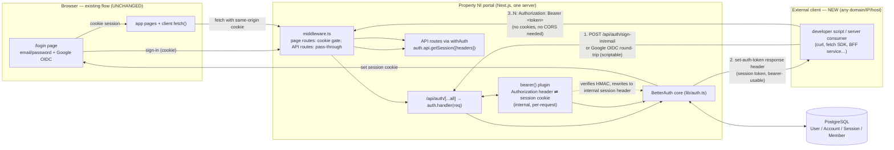
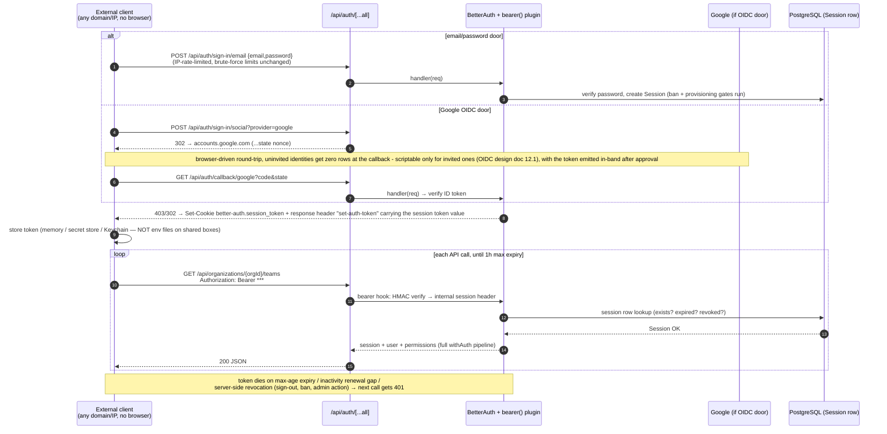
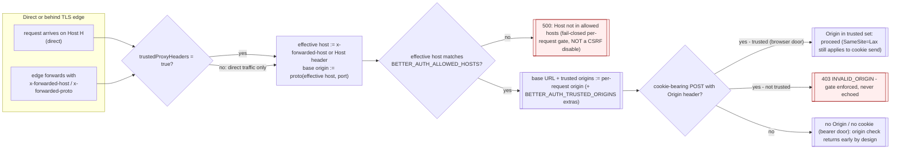
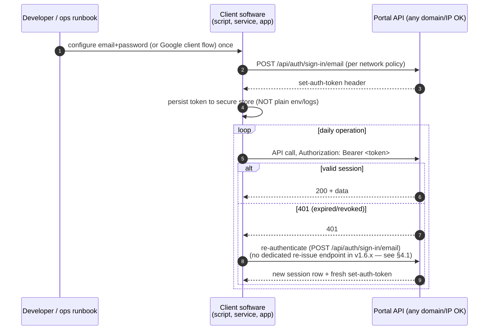

# Bearer-Token Access for Remote Domains — Design Document

**Date:** 2026-10-08 (updated **2026-10-11: shipped + public-access config, §5.4 & §11**)
**Status:** **Shipped** (Phases 1–3 plus the Phase A–H plan of `.hermes/plans/20261008_155856-public-internet-bearer-access.md`)
**Branch:** `bearer-tokens`
**Related plan:** `.hermes/plans/20261008_105030-bearer-token-remote-access.md` (feature phases) and `.hermes/plans/20261008_155856-public-internet-bearer-access.md` (public-internet follow-up, Phases A–H)
**Builds on:** `documents/feature-planning-and-development/google-oidc-design.md` (shipped; see its §12 for the 2026-10-11 invite-only door updates)

> **Superseded in two places — read first.** (1) The v1 "keep a fixed portal origin" decision
> in §5.2 row 1 was reversed by the public-access plan: base URL + trusted origins now resolve
> **per-request** from the incoming `Host`/`x-forwarded-host`, env-tunable, zero hardcoded hosts
> (§5.4 below). (2) The Google OIDC "door" section of this design assumed uninvited identities
> could register rows; since 2026-10-11 that is impossible — the provider refuses sign-up with
> zero rows written (OIDC design doc §12). The token model (§4), lifetime policy (§4.3), threat
> controls (§5.1) and no-CORS stance are unchanged and live exactly as designed.

---

## Table of Contents

- [1. Goal](#1-goal)
- [2. Current State](#2-current-state)
- [3. Architecture Decision](#3-architecture-decision)
  - [3.1 Component Diagram (target)](#31-component-diagram-target)
  - [3.2 What changes, what does not](#32-what-changes-what-does-not)
- [4. Token Model & Lifecycle](#4-token-model--lifecycle)
  - [4.1 Token Anatomy](#41-token-anatomy)
  - [4.2 Token Emission Sequence (external developer client)](#42-token-emission-sequence-external-developer-client)
  - [4.3 Token Lifetime & Revocation State Diagram](#43-token-lifetime--revocation-state-diagram)
- [5. Security Design](#5-security-design)
  - [5.1 Threat Model & Controls](#51-threat-model--controls)
  - [5.2 What we deliberately do NOT change](#52-what-we-deliberately-do-not-change)
  - [5.4 Public-Access Configuration (shipped)](#54-public-access-configuration-shipped-flips-52-row-1)
- [6. Configuration & Runbook](#6-configuration--runbook)
- [7. Client Guidance (developer-facing)](#7-client-guidance-developer-facing)
  - [7.1 Reference integration sequence diagram](#71-reference-integration-sequence-diagram)
- [8. Phased Delivery](#8-phased-delivery)
- [9. Test Strategy](#9-test-strategy)
- [10. Risks, Tradeoffs & Open Questions](#10-risks-tradeoffs--open-questions)
- [11. Shipped Status & Post-Delivery Verification (2026-10-11)](#11-shipped-status--post-delivery-verification-2026-10-11)

---

## 1. Goal

Allow programmatic and cross-domain clients (developer scripts, server-to-server consumers, apps on arbitrary domains/IPs) to use the portal API with **header-based Bearer authentication**, while the existing browser login (email/password and Google OIDC, cookie sessions) continues to work byte-for-byte unchanged from `http://localhost` and the production origin.

Concretely:

1. A user authenticates through an existing door — email/password **or** Google OIDC.
2. The server issues a bearer-usable token (no new identity system).
3. Any client, from any domain/IP, calls `/api/**` with `Authorization: Bearer <token>`.
4. Token theft damage is bounded by expiry + server-side revocation (§5.1).

## 2. Current State

Audited against the working tree at design time (branch `bearer-tokens`, commit c67bd4b); **shipped state since then** noted per row:

| Area | File(s) | Finding |
|---|---|---|
| Auth core | `lib/auth.ts` | `betterAuth` v1.6.23 (`minimal` entrypoint), Prisma adapter, `socialProviders.google`, org plugin, `session: { expiresIn: 3600, updateAge: 900 }`, ban + provisioning gates at `session.create.before`. **Then:** `bearer()` registered; env-driven per-request `baseURL` + proxy-header wiring added (§5.4); invite-only Google door (OIDC design doc §12). |
| Session resolution | `lib/middleware/auth.ts:25` (`withAuth`) and `lib/authz-route.ts` | Every protected API route resolves auth via `auth.api.getSession({ headers: await headers() })` — a pure header lookup. This is the single reason bearer support was a config change, not a per-route change, and it stayed that way through shipping. |
| Browser gate | `middleware.ts:63-73` | Page routes (HTML) require a session *cookie*; without one they redirect to `/login`. API routes are unaffected by this cookie check. |
| Auth endpoints | `app/api/auth/[...all]/route.ts` | Catch-all → `auth.handler(req)`; all POSTs IP-rate-limited via `checkAuthRateLimit`. `/api/auth/**` is already in `PUBLIC_PATTERNS` (`middleware.ts:7`). |
| Login doors | `lib/auth-client.ts`, `app/login/page.tsx` | Cookie-based browser flow only; no token surfaced to the client. |
| Plugins available | `node_modules/better-auth/dist/plugins/{bearer,jwt}/` | Both ship with installed 1.6.23 — **no new dependency needed.** |

**Conclusion:** bearer support is ~a one-line plugin registration plus tests + docs. The entire existing session/permissions/ban/RLS machinery applies to bearer requests unchanged because BetterAuth's `bearer` plugin converts the Authorization header into a standard session cookie *internally* before any endpoint logic runs.

## 3. Architecture Decision

We keep **one session system** (BetterAuth cookies/sessions in PostgreSQL) and expose its session token as a bearer token over HTTP. We do **not** introduce the BFF proxy pattern or a parallel JWT/refresh-token subsystem from the reference research — see §5.2 for why, per YAGNI.

### 3.1 Component Diagram (target)



Key points:

- **One server, two doors into the same engine.** Browser and external requests converge on `auth.api.getSession({ headers })`. The bearer plugin is a request-level translation layer; there is no second session store, no parallel JWT.
- **External clients need no cookies at all** — after token acquisition every call is an opaque string in a header. No `SameSite`, no cross-domain cookie scope, no BFF proxy required: server-to-server HTTP has no browser, so CORS never applies.
- **CSRF stays fully enforced for the web flow.** We do *not* set `disableCSRFCheck` (the reference doc's claim that "bearer is immune to CSRF" is true of Authorization-header requests only — cross-origin `fetch` from a browser cannot read our `set-auth-token` response header without an `Access-Control-Allow-Origin` grant, which we intentionally never issue).

### 3.2 What changes, what does not

| Aspect | Change? | Detail |
|---|---|---|
| `lib/auth.ts` | **Yes (1 plugin line)** | Register `bearer()` from `better-auth/plugins`. Nothing else moves. |
| All API routes (`withAuth`, `authz-route`) | No | Already header-based session resolution; bearer works for free. |
| Ban gate / OIDC provisioning gate / org bootstrap hooks | No | Live at `session.create.before` — funnel point for *every* sign-in, bearer included. |
| Session lifetime policy | No | 1h max / 15-min inactivity renewal applies to bearer tokens identically (same `Session` row). |
| `middleware.ts` page-route cookie check | No | Pages remain cookie-only HTML; token auth is an API story. |
| CORS headers | **No global CORS added** (§5.2) | External server-to-server clients don't need it; browser third-party apps get same-origin via the portal or a customer-hosted BFF of their own choosing — out of scope. |
| Rate limiting | No change needed | `checkAuthRateLimit` already covers all POSTs under `/api/auth/**`, including sign-in endpoints used to obtain tokens. |
| Docs / developer guide | **Yes** | New runbook + API doc section (Phase 3, plan T7–T8). |

## 4. Token Model & Lifecycle

### 4.1 Token Anatomy

- The bearer token **is the BetterAuth session token** — a signed value (`HMAC-SHA256` over `BETTER_AUTH_SECRET`) carried in the `Session` row's `token` column.
- Verification is stateless + DB-backed: the bearer plugin verifies the HMAC signature on each request, then the normal session lookup confirms the row exists (expiry, revocation).
- There is exactly **one token per sign-in** — no separate long-lived second secret in v1.

Token emission has exactly ONE in-band path in v1; there is no dedicated "get my token" endpoint (verified against installed better-auth 1.6.23 source):

1. **`set-auth-token` response header** — automatically added by the `bearer` plugin's after-hook on *any* `/api/auth/**` response that sets a session cookie (verified in installed source, `node_modules/better-auth/dist/plugins/bearer/index.mjs`: it parses `Set-Cookie`, and when a non-zero-max-age session cookie is present it sets `set-auth-token: <value>` plus extends `Access-Control-Expose-Headers`). A web login that also carries an `Authorization` header (or a programmatic sign-in) therefore yields the token in-band. The email/password sign-in JSON body additionally carries `{token}` inline — scriptable acquisition without header parsing.
2. **Re-acquisition is re-authentication** — a client needing a fresh token (after expiry/revocation, 401) simply authenticates again over plain HTTP (no cookies involved): email/password or the OAuth callback door mints a new Session row and a new `set-auth-token`. Note: `POST /api/auth/get-access-token` is NOT a session-token endpoint — in installed 1.6.23 it is the provider OAuth token endpoint (`dist/api/routes/account.mjs`), requiring a `providerId` body field and returning the linked IdP's `{ accessToken, ... }`. (An early draft of this doc misidentified it as an on-demand re-issue mechanism; corrected 2026-10-08 against source.)

### 4.2 Token Emission Sequence (external developer client)



### 4.3 Token Lifetime & Revocation State Diagram

```mermaid
stateDiagram-v2
    [*] --> Active: sign-in succeeds<br/>(cookie + set-auth-token issued,<br/>Session row written)
    Active --> Active: valid bearer request<br/>inactivity < 15 min → renewal, max-age clock resets each time only while used
    Active --> ExpiredMax: 1h absolute max reached (session.expiresIn=3600)
    Active --> Revoked: user sign-out / ban enforced<br/>(Session row deleted — bearer and cookie die together)
    Active --> StaleDenied: inactivity > 15 min gap<br/>(renewal window missed; session no longer refreshed)
    ExpiredMax --> [*]
    StaleDenied --> [*]
    Revoked --> [*]
    note right of Active
        Same Session row as cookie sessions:
        one lifecycle, revocation is global
    end note
```



**Revocation is the theft control:** `sign-out` deletes the `Session` row; the bearer string then fails every subsequent lookup. A thief has at most (a) the remaining inactivity window and (b) up to 1h absolute — and zero access after the victim signs out or an admin bans them.

## 5. Security Design

### 5.1 Threat Model & Controls

| Threat | Control | Status |
|---|---|---|
| Token theft via XSS in a *browser* client | Portal pages never surface the bearer token (no change to browser flow); external clients are server-side/SDK and follow §7.2 storage rules | design, docs task |
| Stolen bearer token replay by attacker | 15-min inactivity renewal + **1h hard max** + instant revocation on sign-out/ban (§4.3). No long-lived refresh secret exists that an attacker could compound | implemented by existing session policy; T4 test pins it |
| CSRF via injected Authorization-header requests | N/A — cross-origin JS cannot set `Authorization` and cannot read our response without CORS grants we never issue; web flow keeps full BetterAuth cookie/CSRF protection (`disableCSRFCheck` deliberately NOT set) | verified by design (T4 negative tests + no-CORS assertion T5) |
| Brute force on token acquisition | Existing per-IP rate limits: 10 POSTs/15 min general, 5/15 min on `/sign-in/email` (`app/api/auth/[...all]/route.ts` + BetterAuth limiter in `lib/auth.ts`) — unchanged | no gap (T4 pins bearer sign-in response) |
| Ban/provisioning bypass via bearer door | Gates run at `databaseHooks.session.create.before` — the single funnel for **all** sign-in methods, so a banned user or unprovisioned Google identity cannot *obtain* a bearer token at all; existing session-callback ban re-check invalidates live sessions | unchanged (google-oidc design §5.1) |
| Token enumeration | 256-bit HMAC-signed token value from `BETTER_AUTH_SECRET` — infeasible to guess; additionally each request requires a live Session row | library-provided |
| Cross-origin cookie bleed / third-party cookies | Not applicable to bearer (header-only); web cookie attributes unchanged (`SameSite=Lax`, `Secure` in prod, httpOnly) | unchanged |
| Open-ended origin trust | We do NOT open CORS to `*`; origins that need browser-side access deploy their own BFF server-to-server (§10 open question 1) | decision |

### 5.2 What we deliberately do NOT change (YAGNI / risk containment)

| Reference-idea (from the research brief) | Decision | Rationale |
|---|---|---|
| `baseURL: { allowedHosts: ["*"] }` (a fixed origin for the portal) | **Superseded — flipped 2026-10-11, see §5.4** | The v1 "fixed origins" posture assumed localhost + one prod domain. Remote clients over a LAN IP/tunnel/domain broke against a static `BETTER_AUTH_URL` base (Phase A: trusted origins frozen to the pinned host → remote browsers got 403 `INVALID_ORIGIN`). Public access forced per-request base resolution — env-driven `allowedHosts` (dev `*`, prod real domains), no hardcoded hosts. |
| `trustedOrigins` dynamic echo + `disableCSRFCheck: true` | **Rejected** | Only justifiable when tokens are the *only* auth; we keep cookie sessions for the web, so CSRF check must stay on. Echoing any origin is strictly more dangerous than fixed origins. |
| Separate 15-min JWT access token + 7-day refresh token (jwt plugin) | **Deferred (post-GA)** | Session tokens already satisfy "short-lived + revocable" with server-side destruction the jwt plugin cannot beat. Adding a second token family doubles issuance/verification surface for a benefit we don't need until a customer requires stateless verification. The `jwt` plugin stays available in node_modules if/when that requirement appears. |
| BFF proxy route handler on the portal (reference Part 2) | **Rejected for the portal** | A BFF's job is hiding tokens from *browsers on a third-party domain*. External server-to-server clients have no browser — direct bearer calls are simpler and expose less code. Customers who want browser apps on their own domains can run that BFF themselves against the now-public bearer API; we will document it in §7 as guidance, not ship it here. |
| IP pinning of tokens | **Deferred** | Works only for fixed server-to-server callers; kills mobile/roaming clients; adds per-request lookup complexity. Revisit if abuse demands it (open question 2). |

### 5.4 Public-Access Configuration (shipped — flips §5.2 row 1)

Remote access in practice broke against a static base: with `BETTER_AUTH_URL=http://localhost:3000`, the better-auth context froze trusted origins to localhost and every browser on a LAN IP got 403 `INVALID_ORIGIN` at sign-in (bearer/curl traffic was unaffected — no Origin header — which is exactly why only the cookie door looked broken). The shipped config makes host trust **per-request, env-driven, zero hardcoded** (Phase B of the public-access plan; commit line in `lib/auth.ts`):

```ts
baseURL: {
  allowedHosts: env.BETTER_AUTH_ALLOWED_HOSTS.split(',').map(s => s.trim()).filter(Boolean), // dev: "*"; prod: portal.example.com,www.portal.example.com
  protocol: env.BETTER_AUTH_BASE_PROTOCOL, // "auto" — emits both http://* and https://* trusted patterns; follows x-forwarded-proto behind a proxy
  fallback: env.FRONTEND_URL,              // only reached for a Host that matches no allowedHosts entry
},
advanced: {
  trustedProxyHeaders: env.TRUSTED_PROXY_HEADERS === 'true',   // default true — required explicitly in 1.6.x dynamic mode
  ipAddress: { /* trustedProxies from TRUSTED_PROXY_CIDRS when set */ },
},
```

How a request flows through it (the security-relevant part):



Properties pinned by test (`tests/integration/bearer-tokens.test.ts` Phase E pins + `tests/unit/auth-config.test.ts`):

- **CSRF/origin gate stays fully enabled** — neither `advanced.disableOriginCheck` nor `disableCSRFCheck` is set and no top-level `trustedOrigins` override exists. A cross-site page POSTing to the portal with a foreign Origin still gets 403 in production; dev-mode relaxation in `lib/csrf.ts` is the only bypass and it is NODE_ENV-gated.
- **The per-request Host gate is NOT "trust anyone":** matching validates against `BETTER_AUTH_ALLOWED_HOSTS`; with the dev value `*`, any reachable host works (deliberate — dev affordance); production sets real domain(s) and everything else 500s at base resolution before auth logic runs.
- **`protocol: 'auto'`** is what makes http LAN + future https public both work from one config (the docs' canonical `protocol: "https"` example would have left the http LAN origin untrusted — verified against installed dist behavior).
- **Cookie transport reality:** with `Secure` + `SameSite=Lax`, browser cookie sessions do not function cross-domain on HTTPS — by design. Public access above same-origin is bearer-first; do *not* set `crossSubDomainCookies` (it scopes cookie domain only; it cannot make Lax work across unrelated origins).
- **Client IP:** with `TRUSTED_PROXY_CIDRS` = the edge's CIDR(s), BetterAuth walks `x-forwarded-for` right-to-left skipping trusted hops — untrusted spoofed values are ignored, so per-IP rate limits and audit logs see the true client.

**Deployment contract (prod):** set `BETTER_AUTH_ALLOWED_HOSTS` to real domain(s); keep `TRUSTED_PROXY_HEADERS=true` and set `TRUSTED_PROXY_CIDRS` to the edge; `protocol=auto` covers both schemes; register the public callback in Google Cloud Console (OIDC door). No code change on redeploy — this is the whole point of the flip.

## 6. Configuration & Runbook

Shipped env surface (all declared in `lib/env-schema.ts`, documented in `.env.example`; `BETTER_AUTH_URL` is deliberately *not* set — a static base freezes trusted origins, see §5.4):

| Variable | Default | Meaning |
|---|---|---|
| `BETTER_AUTH_ALLOWED_HOSTS` | `*` | comma-separated host patterns for per-request base URL + trusted origins; prod = real domain(s) |
| `BETTER_AUTH_BASE_PROTOCOL` | `auto` | `auto` (both http/https) \| `http` \| `https` |
| `TRUSTED_PROXY_HEADERS` | `true` | read `x-forwarded-host` / `x-forwarded-proto` behind an edge |
| `BETTER_AUTH_TRUSTED_ORIGINS` | — | extra trusted origins for named partner browser frontends (cookieless bearer clients never need this) |
| `TRUSTED_PROXY_CIDRS` | — | edge CIDR(s) for real client-IP extraction (§5.4) |

Operational runbook (live in `SECURITY.md`, "Remote Bearer-Token Access — Origin Policy & Operations"):

1. **Issue a developer credential:** existing admin user creation (password) or Google invite flow — no new admin surface in v1.
2. **Client acquires the token** exactly once via §4.2 sequence; store it per §7.2.
3. **Rotate on suspicion:** user signs out (token+session die instantly) and re-authenticates → new token string; old one 401s immediately.
4. **Emergency kill:** ban the user (`banned` flag) — `withAuth`'s existing per-request ban check plus session-callback invalidation stops all their bearer traffic on the next call (worst case: in-flight renewal before next request).
5. **Secret rotation:** `BETTER_AUTH_SECRET` change invalidates every bearer token and cookie at once (HMAC base gone) — nuclear option, document as such.

## 7. Client Guidance (developer-facing)

### 7.1 Reference integration sequence diagram



### 7.2 Storage & usage rules (published with the API docs)

- **Memory-first:** keep the token in process memory; reload from a secure store per run. No localStorage, no `localStorage` equivalents in browser apps on customer domains — if a *browser* app needs this, it sits behind the customer's own BFF (out of scope here).
- Header exactly: `Authorization: Bearer <token>` — scheme case-insensitive per RFC 6750, BetterAuth accepts both.
- Treat 401 as "re-authenticate" (session died); treat 429 as "back off" (rate limits apply identically to bearer and cookie sign-ins).
- Never log the token; never embed it in URLs.

## 8. Phased Delivery

| Phase | Contents (plan task refs) | Exit criterion |
|---|---|---|
| **1 — Bearer plugin + behavioral proof** | TDD: failing integration tests for bearer sign-in, `set-auth-token` emission, authorization on a protected route, revocation-on-signout; register `bearer()` in `lib/auth.ts` | `npx vitest run tests/integration/bearer-tokens.test.ts` green; zero diff elsewhere in `lib/auth.ts` |
| **2 — Hardened edge paths** | re-acquisition-via-sign-in test (plan T3, corrected 2026-10-08: no `get-access-token` re-issue exists in v1.6.x); revocation + malformed-header security pins (T4); ban gate blocks bearer acquisition (T5); no-CORS / no-origin-echo assertion on `/api/auth/**` responses (T6) | Same file green incl. negative cases; full `npm run test` passes (no regressions in cookie flow) |
| **3 — Developer docs** | `documents/api/bearer-tokens.md` runbook + §7 client guidance; `SECURITY.md` ops section (§6); `.env.example` note if any new var ever added | Docs reviewed, link from README/API docs index |

Each phase ends in an independent committable state. Phase 1 alone delivers the entire feature (config-only) — Phases 2–3 are proof and paperwork.

**Status (2026-10-11): all three phases shipped**, plus the public-internet follow-up plan (`phasing A–H`) extended the surface with the per-request base URL, host-independent magic links, RLS-visible provisioning reads, and the invite-only Google door — see §5.4 and §11.

## 9. Test Strategy

| Layer | Target | What it proves |
|---|---|---|
| Integration (new) | `tests/integration/bearer-tokens.test.ts` | ① cookie sign-in response carries `set-auth-token`; ② that token authenticates `GET /api/auth/me` via `Authorization: *** ③ re-acquisition: a fresh usable token is minted by re-authenticating over plain HTTP (no cookies; sign-in body carries `{token}`) — no dedicated re-issue endpoint exists in v1.6.x (§4.1); ④ sign-out → next bearer call resolves NO session (theft dies); ⑤ banned user sign-in yields NO token (gate fires in all methods); ⑥ malformed/absent/mal-scheme Authorization header → no resolved session and never 5xx |
| Integration (regression) | `tests/integration/auth.test.ts`, `google-oidc-full-flow.test.ts`, `rate-limiting.test.ts` | cookie flow, Google gate, rate limits byte-for-byte unchanged |
| Assertion of non-change | T6 CORS probe | `/api/auth/**` responses contain **no** `Access-Control-Allow-Origin: *` and no dynamic origin echo (locks in the §5.2 decision) |
| Manual smoke | Phase 3 checklist | curl sign-in from a non-localhost network interface (e.g. LAN IP / tunnel) → token works on a real org endpoint |

Mocking notes: reuse the established `google-oidc-full-flow.test.ts` pattern (mocked Google token exchange, real DB); bearer tests need no new seams — everything is exercised through real `auth.handler(req)` responses and the exported route handlers.

## 10. Risks, Tradeoffs & Open Questions

| # | Item | Severity | Disposition |
|---|---|---|---|
| 1 | Third-party **browser** apps on customer domains cannot use bearer directly (no CORS grant, by design). Their correct pattern is a customer-hosted BFF proxy. If demand emerges for portal-issued browser tokens, that's a separate feature with its own origin policy. | Medium | Open question — document the BFF pattern in Phase 3; no portal code change now. |
| 2 | No per-token IP binding: a stolen token works from any source IP until expiry/revocation (mitigated by §4.3 lifetime + revocation). Fixed-server customers wanting tighter control get IP pinning as a follow-up if requested. Client-IP *spoofing* is already closed by `TRUSTED_PROXY_CIDRS` (§5.4) — only per-token binding remains out of scope. | Low–Medium | Deferred; revisit on abuse signal. |
| 3 | `set-auth-token` header is emitted on *cookie* responses only when the bearer plugin's after-hook fires — we assert it in T2, so "token silently absent" becomes a caught failure, not a field surprise. | Low | Covered by test. |
| 4 | Session max-age (1h) may feel short for long-running scripts; renewal is per-request while active and requires no client action (the token string stays valid through in-window renewals). If customers want longer-lived machine credentials, that's the deferred jwt-plugin / service-token feature. | Low | Document §6 runbook; open question 3. |
| 5 | BetterAuth patch-version drift: bearer plugin internals were verified against installed 1.6.23 source. Lock the version in package.json (existing pin) and re-run T2 on any bump. | Low | Covered by test + lockfile pin. |

## 11. Shipped Status & Post-Delivery Verification (2026-10-11)

State of this plan after both tracking plans completed:

| Item | Result |
|---|---|
| `bearer()` plugin registered (`lib/auth.ts`) | ✅ ships; `set-auth-token` emitted on every session-setting response (incl. the Google door) |
| Phases 1–2 pins (`tests/integration/bearer-tokens.test.ts`) | ✅ all green: sign-in emits token, replay across hosts works, no-grace revocation, sliding-renewal window, ban-gate blocks acquisition, malformed headers never 5xx, **no-CORS / no-origin-echo assertion**, CSRF-gate-stays-enabled config pin |
| Phase A diagnosis ("remote computer") | resolved class (a): static `BETTER_AUTH_URL` froze trusted origins → fixed by §5.4 per-request base; remote battery re-run is the user's remaining manual step |
| §5.4 public-access config (allowedHosts / protocol auto / proxy headers / CIDRs) | ✅ env-driven, zero hosts in code; `.env.example` documented |
| Host-independent magic links + RLS-visible provisioning + invite-only Google door | ✅ shipped separately this date (OIDC design doc §12); the bearer file's `options` cast and CSRF pins absorbed the new `onAPIError` config in the same sweep |
| Full gate on ship day | unit 92 files / 1958 ✓ · integration 22 files / 314 ✓ · lint ✓ · build ✓ |

**Open for the user (manual, not blocking):** re-run the remote battery from a non-localhost machine over the LAN IP (bearer sign-in + protected endpoint must answer 200 without cookies); then Phase C of the public-access plan picks up the permanent TLS edge (tunnel decision) and D1/D2 run over the public URL.
