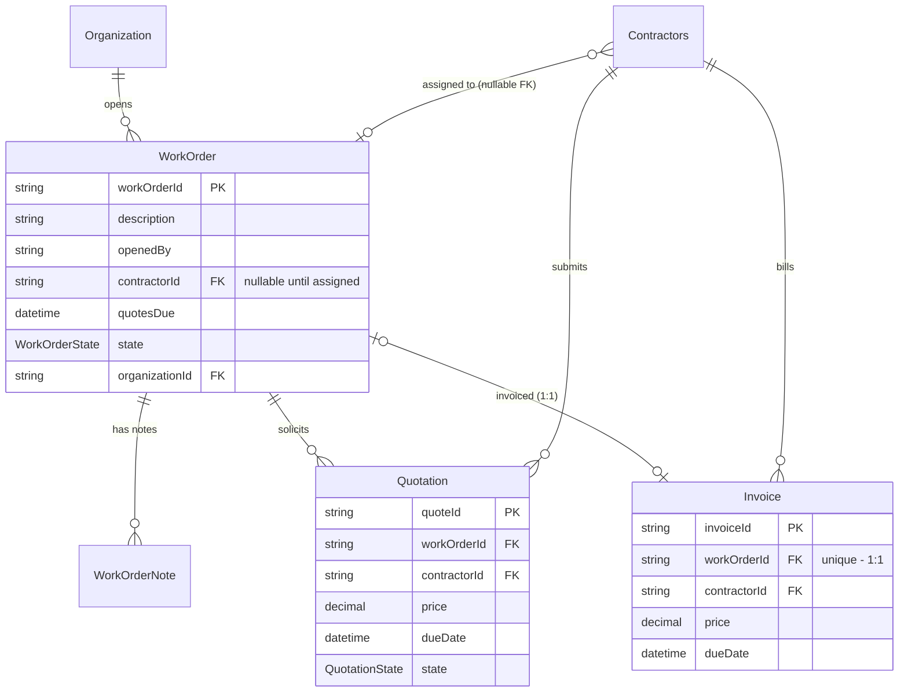
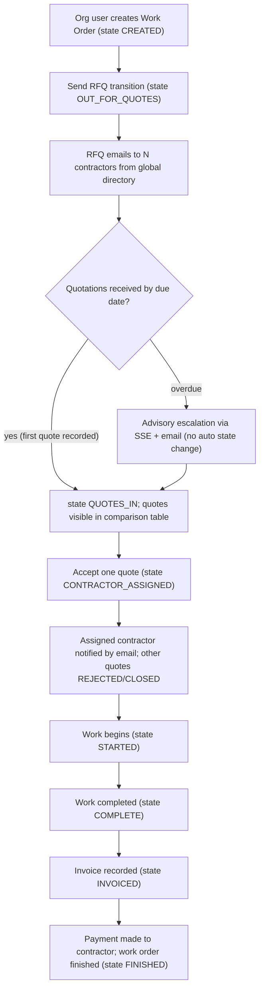
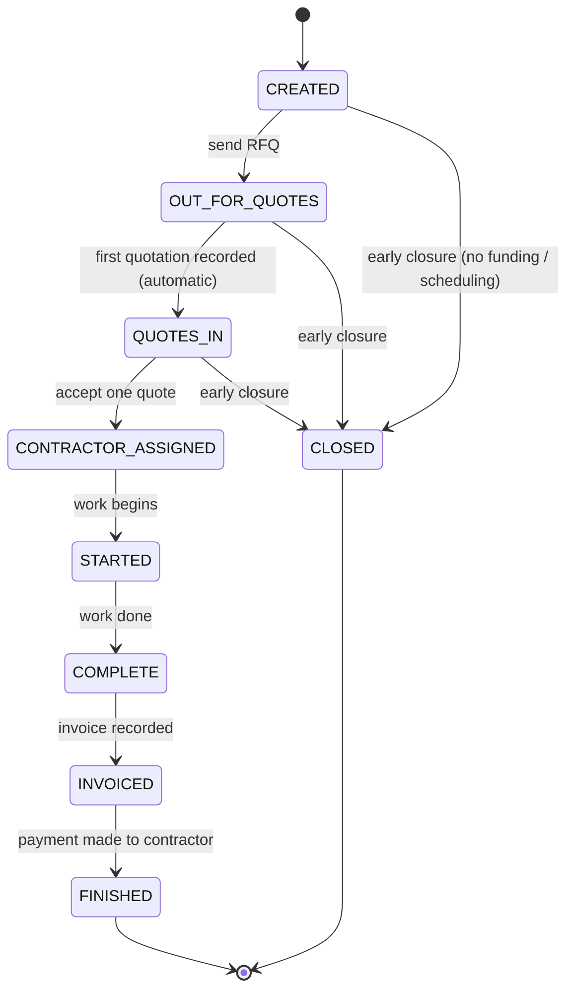
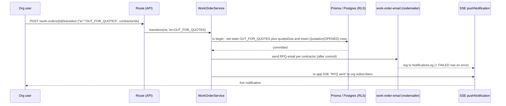

# Work Order Flow — Design Document

**Status:** Draft v1 (planning; no code written)
**Branch under planning:** `work-order-flow`
**Companion plan:** `.hermes/plans/2026-10-17_161133-work-order-flow.md` (multi-phase implementation plan)

> **One-line summary.** Add a tenant-scoped Work Order feature to the portal: an organization opens a work order, requests quotations by email from contractors in the global contractor directory, assigns a contractor, tracks the work through completion, and records the contractor's invoice.

## Table of Contents

- [Introduction](#introduction)
- [Motivation](#motivation)
- [Scope](#scope)
- [Current State](#current-state)
- [Assumptions and Decisions](#assumptions-and-decisions)
- [Data Model](#data-model)
  - [WorkOrder](#workorder)
  - [WorkOrderNote](#workordernote)
  - [Quotation](#quotation)
  - [Invoice](#invoice)
  - [Relationships](#relationships)
- [State Machine](#state-machine)
- [API Surface](#api-surface)
- [Services](#services)
- [Email Integration](#email-integration)
- [Scheduling (Quotation Deadline)](#scheduling-quotation-deadline)
- [Tenant Isolation and Security](#tenant-isolation-and-security)
- [Frontend Pages](#frontend-pages)
- [Phased Delivery Plan](#phased-delivery-plan)
- [Testing Strategy](#testing-strategy)
- [Risks and Mitigations](#risks-and-mitigations)
- [Open Questions — Resolved](#open-questions--resolved)
- [File and Dependency Impact](#file-and-dependency-impact)
- [Reference Material](#reference-material)

---

## Introduction

A **work order** is a record of any work to be carried out by an organization
(e.g., a block repair, plumbing job, or lift inspection). Today the portal can
store contractors (a global directory shared by all organizations) but has no
way to track a piece of work from "requested" through "paid". This document
designs the **Work Order Flow**: creating work orders, requesting quotations
from contractors, assigning the winning contractor, tracking completion, and
recording the final invoice.

## Motivation

- Organizations need an auditable, structured record of outsourced work.
- Quotation requests go to multiple contractors today with no trace of who was
  asked, what they quoted, or why a decision was made. This feature makes that
  process first-class and gives users a single place to see the state of every
  open job.
- The existing `Contractors` model (global directory) is the natural supplier
  pool; building on it avoids duplicating contractor data per tenant.

## Scope

**In scope**

1. Four new Prisma models: `WorkOrder`, `WorkOrderNote`, `Quotation`, `Invoice`.
2. **Four services, each full CRUD**: `WorkOrderService`, `WorkOrderNoteService`,
   `QuotationService`, `InvoiceService` (plus state-machine enforcement in
   WorkOrderService). All create/update/delete operations are gated to
   **super admins**; tenant users get **read-only access** scoped by their
   organization id (app layer + RLS).
3. REST endpoints: read paths under `/api/organizations/[orgId]/work-orders/**`
   (tenant membership + RLS); mutation verbs (`POST`/`PATCH`/`DELETE`) on the
   same resource paths gated `requireSuperAdmin` — the exact pattern used for
   the Contractors admin routes.
4. Email: RFQ to selected contractors, assignment and invoice-request
   notifications — plain nodemailer emails using the **same setup as the Google
   OIDC invite flow** (`lib/notifications/email.ts` → `sendEmail`, Property NI
   branding), **without a magic URL**. No verification tokens, no clickable
   workflow links: contractors respond to the email directly (by phone/reply);
   super admins key responses into the portal.
5. Scheduled deadline check: if no quotations arrive by the due date in time,
   raise a notification on the **admin dashboard** and to **super admins** via
   SSE; super admins follow up with contractors directly (manual). Hosted on
   the existing job-scheduler service (`services/job-scheduler-service.ts`,
   Bree-backed) — no new scheduling infrastructure.
6. Frontend: read-only tenant dashboard pages (work-order list + detail view);
   a **super-admin work-orders management page** (mirroring the Contractors
   admin UI) that drives creation, RFQ sent, quote entry, assignment, state
   transitions, and deletion.
7. RLS policy + app-layer tenant extension entries for the new tables. No RBAC
   catalog changes — write gating is `requireSuperAdmin` at the route boundary,
   read isolation is org-scope, matching how Contractors works today.

**Out of scope (explicitly)**

- Payment processing / accounts-payable integration — invoices are recorded,
  not paid, in v1.
- **Contractor-side portal/dashboard** — planned for a future version; until
  then contractors have no accounts and respond to the RFQ email directly. Super
  admins enter quotes on their behalf.
- e-Signature / contract document management.
- Re-opening `FINISHED` or `CLOSED` work orders (both terminal states).

## Current State

Relevant pre-existing assets this feature plugs into:

| Asset | Location | Relevance |
|---|---|---|
| `Contractors` model | `prisma/schema.prisma:790` | Global, RLS-exempt supplier directory (companyName, name, email, phone, type…). Work orders link to it **read-only** |
| Contractor CRUD | `services/contractor-service.ts`, `app/api/dashboard/admin/contractors/**` | Proof of the global-table + super-admin-write pattern; work-order code will *select* from this table, never write it |
| Tenant isolation, app layer | `lib/tenant-db.ts`, `lib/tenant-extension-core.ts` (`TENANT_SCOPED_MODELS`) | Every new org-scoped model must be added to this list (drift-guarded) |
| Tenant isolation, DB layer | `prisma/migrations/*_units_rls_policy/migration.sql`, `tests/isolation/database/policy-catalog.golden` | The RLS pattern + golden-file hash check to extend for the four new tables |
| Tenant route pattern | `app/api/organizations/[orgId]/calendar-events/route.ts` | `resolveTenantAccess` → `toTenantContext` → `withRLSContext` is the template for new routes |
| Service pattern | `services/unit-service.ts` (`requireAnyAdmin`, TENANT_ADMIN org checks, `normalizePagination`) | Template for `work-order-service.ts` |
| Email | `lib/notifications/email.ts` (nodemailer, Property NI brand) | Reuse transport + template helpers; add a neutral "work order" template variant |
| Scheduler | `services/job-scheduler-service.ts`, `JobDefinition`/`JobExecution` models | Host the quotation-deadline scan as a built-in handler job |
| Notifications | `lib/notification-push.ts` (SSE + `Notification` model) | In-app notifications for state changes (quotes received, deadline passed) |
| Tests | `tests/unit/`, `tests/integration/admin-contractors-api.test.ts`, `tests/isolation/**` | Patterns for service unit tests, route integration tests, and RLS golden file |

## Assumptions and Decisions

These translate the brief into concrete choices. Each was forced by an
ambiguity in the source spec — flagged here so a reader can object.

| # | Decision | Rationale / note |
|---|---|---|
| D1 | New models are **tenant-scoped** (`organizationId` + RLS). Only `Contractors` stays global. | The work order belongs to an organization; tenant isolation is a hard repo invariant (schema header, `tests/unit/tenant-db-hardening.test.ts`) |
| D2 | `WorkOrder.contractorId` is **nullable**. | A work order exists in `CREATED`/`OUT_FOR_QUOTES` states *before* any contractor is assigned. The brief's 1:M Contractor→WorkOrder relationship only materialises at assignment time |
| D3 | Field naming follows repo conventions: `@id @default(cuid())`, `createdAt`/`updatedAt DateTime @default(now())/@updatedAt`. | The brief uses `workOrderId`/`createdOn`; the repo standard (see `Units`, `Calendar`) is the safer default. Column names map 1:1 (e.g. `workOrderId` stays as the **relation column**, as in the brief) |
| D4 | `openedBy` stored as the user's email **string** *and* a nullable `openedById String?` FK to `User`. | Brief asks for email capture; the id preserves the actual actor if the user later changes email. Both set at creation |
| D5 | `WorkOrder.state` uses the brief's eight states plus **CLOSED** (early closure — Q1), **all transitions validated by a state machine** in the service (not free-form updates). See State Machine | Prevents illegal jumps (e.g. `CREATED → FINISHED`) and makes UI actions derivable from state |
| D6 | Invoice is 1:1 with WorkOrder (`workOrderId @unique`). No invoice state enum; **FINISHED is entered when payment of the invoice has been made** to the contractor (Q3). | Matches brief + user answer; v1 records an invoice, treats FINISHED as "paid and closed out" |
| D7 | RFQ emails are **plain notification emails** — the same `sendEmail` pipeline as the Google OIDC invite flow (`lib/notifications/email.ts`), **without a magic URL**. No verification tokens, no portal workflow links. Contractors respond by phone/reply; super admins key quotes in. | Contractor-side dashboard is future work (see Scope); v1 keeps zero contractor accounts and zero emailed URLs to audit |
| D8 | Quotation deadline default: **7 days** (brief), configurable at RFQ send time (`quotesDue`). A missed deadline with no quotations raises an admin-dashboard + super-admin notification; follow-up is manual (D9-deadline). | Brief's "a week by default" |
| D9 | **Access model:** create/update/delete of work orders, notes, quotes and invoices = super admins only (`requireSuperAdmin`, same gate as Contractor writes). Tenant users read their org's rows only — enforced twice: app-layer tenant extension + Postgres RLS on `organizationId`. | User decision; mirrors the existing Contractors pattern (global table, super-admin writes) while data stays per-tenant. No RBAC catalog change required in v1 |
| D10 | No new third-party dependencies. Reuse nodemailer, Bree job scheduler, Prisma. | Repo rule of thumb; keeps dependency surface flat |

## Data Model

Prisma shapes (final field list; naming per decision D3):

### WorkOrder

```prisma
enum WorkOrderState {
  CREATED
  OUT_FOR_QUOTES
  QUOTES_IN
  CONTRACTOR_ASSIGNED
  STARTED
  COMPLETE
  INVOICED
  FINISHED
  CLOSED           // early closure (no funding, scheduling conflict, …) — Q1
}

model WorkOrder {
  workOrderId   String         @id @default(cuid())
  description   String
  openedBy      String         // email of person who opened the work order (D4)
  openedById    String?        // User.id of the opener, for actor integrity
  contractorId  String?        // FK to Contractors; null until CONTRACTOR_ASSIGNED (D2)
  quotesDue     DateTime?      // set when RFQ is sent (D8); drives deadline job
  deadlineAlertAt DateTime?    // set when the overdue alert fired (idempotency)
  state         WorkOrderState @default(CREATED)

  organizationId String
  organization   Organization @relation(fields: [organizationId], references: [id], onDelete: Cascade)

  notes    WorkOrderNote[]
  quotes   Quotation[]
  invoice  Invoice?          // 1:1 (D6)

  createdAt DateTime @default(now())
  updatedAt DateTime @updatedAt

  contractor Contractors? @relation(fields: [contractorId], references: [contractorId])

  @@index([organizationId, state])
  @@index([organizationId, quotesDue])   // deadline job scans these
}
```

### WorkOrderNote

```prisma
model WorkOrderNote {
  workOrderNoteId String @id @default(cuid())
  workOrderId     String
  note            String

  createdById String?      // nullable: notes may be added in contractor context (D7)
  createdAt   DateTime @default(now())
  updatedAt   DateTime @updatedAt

  organizationId String
  organization   Organization @relation(fields: [organizationId], references: [id], onDelete: Cascade)

  workOrder WorkOrder @relation(fields: [workOrderId], references: [workOrderId], onDelete: Cascade)

  @@index([organizationId])
}
```

### Quotation

```prisma
enum QuotationState { OPENED ACCEPTED REJECTED CLOSED }

model Quotation {
  quoteId      String         @id @default(cuid())
  workOrderId  String
  contractorId String
  quoteLink    String?        // remote file link (null until the quote is received)
  description  String?        // breakdown of the quote
  price        Decimal?       @db.Decimal(12,2) — null until received
  dueDate      DateTime       // set from work order's quotesDue at RFQ send
  state        QuotationState @default(OPENED)

  createdAt DateTime @default(now())
  updatedAt DateTime @updatedAt

  organizationId String
  organization   Organization @relation(fields: [organizationId], references: [id], onDelete: Cascade)

  workOrder  WorkOrder  @relation(fields: [workOrderId], references: [workOrderId], onDelete: Cascade)
  contractor Contractors @relation(fields: [contractorId], references: [contractorId])

  @@unique([workOrderId, contractorId])   // one quote per contractor per work order
}
```

### Invoice

```prisma
model Invoice {
  invoiceId    String  @id @default(cuid())
  invoiceDate  DateTime
  workOrderId  String  @unique   // 1:1 with WorkOrder (D6)
  contractorId String
  invoiceLink  String?
  price        Decimal   @db.Decimal(12,2)
  dueDate      DateTime

  createdAt DateTime @default(now())
  updatedAt DateTime @updatedAt

  organizationId String
  organization   Organization @relation(fields: [organizationId], references: [id], onDelete: Cascade)

  workOrder  WorkOrder   @relation(fields: [workOrderId], references: [workOrderId])
  contractor Contractors @relation(fields: [contractorId], references: [contractorId])
}
```

### Relationships

1. `WorkOrder` 1:M `WorkOrderNote` (cascade on work-order delete)
2. `WorkOrder` 1:1 `Invoice` (`@unique` on `Invoice.workOrderId`)
3. `WorkOrder` 1:M `Quotation`
4. `Contractors` 1:M `WorkOrder` (nullable FK — populated at assignment)
5. `Contractors` 1:M `Quotation`
6. `Contractors` 1:M `Invoice`

All four new tables: org-scoped, cascade from `Organization`, indexed on
`organizationId` per the tenant-isolation repo invariant. `Contractors` gains
three back-relation fields (`workOrders Quotation[] invoices`) — additive only,
no behavioral change to its RLS-exempt status.

Entity-relationship view (`Contractors` is pre-existing and remains the only
global table; everything new is org-scoped):



## Workflow at a Glance

The end-to-end flow across the seven brief steps, including who does what:



## State Machine

Legal transitions (enforced in `WorkOrderService.transition()`):

```
CREATED ───────────────► OUT_FOR_QUOTES        (send RFQ → create Quotation rows + emails)
OUT_FOR_QUOTES ────────► QUOTES_IN             (first quotation recorded, automatic on quote create)
QUOTES_IN ─────────────► CONTRACTOR_ASSIGNED   (accept one Quotation; reject/close the rest)
CONTRACTOR_ASSIGNED ───► STARTED               (work begins)
STARTED ───────────────► COMPLETE              (work done)
COMPLETE ──────────────► INVOICED              (invoice recorded)
INVOICED ──────────────► FINISHED              (payment of the invoice made to contractor — Q3)

CREATED / OUT_FOR_QUOTES / QUOTES_IN ──► CLOSED  (early closure — no funding, scheduling conflict; Q1)
```

Rules:

- Transitions are **one hop only**; the service rejects anything else with a
  `ValidationError` (`Illegal transition OUT_FOR_QUOTES → STARTED`).
- Side effects per transition (all in one `$transaction`; emails apart as noted):
  - `→ OUT_FOR_QUOTES`: set `quotesDue`; create `Quotation(state=OPENED)` rows
    for each selected contractor; send RFQ emails (outside the tx — at-most-once,
    failures logged).
  - automatic `OUT_FOR_QUOTES → QUOTES_IN` when a quotation's price is filled.
  - `→ CONTRACTOR_ASSIGNED`: set `workOrder.contractorId`, set accepted quote to
    `ACCEPTED`, all other quotes `REJECTED`.
  - `→ INVOICED`: require an `Invoice` row already exists for the work order
    (created via invoice CRUD; validated unique per work order).
  - `→ FINISHED`: only when payment of that invoice has been made to the
    contractor (Q3) — super admin confirms payment in the transition call.
  - `→ CLOSED`: early closure allowed from any pre-assignment state (CREATED,
    OUT_FOR_QUOTES, QUOTES_IN); remaining OPENED quotes are set to `CLOSED` and
    no further transitions of the work order are possible. No notification email
    is sent (contractors were told by phone/email if applicable — v1 keeps it a
    record-only move).
- Notes may be added in any non-terminal state (terminal = FINISHED, CLOSED).
- Deadline semantics: advisory only — an overdue `quotesDue` never forces a
  transition, because not all invited contractors respond and the org works with
  the quotes that arrive (Q2 answer).

Same machine in state-diagram form:



## API Surface

Two route families, mirroring how Contractors (mutations, admin) and calendars
(reads, tenant) split today:

**Tenant reads** — authenticate → `resolveTenantAccess` → `withRLSContext(ctx, …)`;
rows are invisible across tenants by RLS + app-layer injection:

| Method | Path | Purpose |
|---|---|---|
| GET | `/api/organizations/[orgId]/work-orders` | List (paginate, filter by state/search) |
| GET | `/api/organizations/[orgId]/work-orders/[id]` | Detail incl. notes, quotes, invoice |
| GET | `/.../work-orders/[id]/notes` / `quotes` | Read children (also included in detail) |

**Super-admin mutations** — `requireSuperAdmin` at the route boundary (same gate
as Contractors admin routes), target identified by id; tenant context resolved
from the work order's own `organizationId` so RLS still applies:

| Method | Path | Purpose |
|---|---|---|
| POST | `/api/admin/work-orders` | Create in `CREATED`; body `{description, organizationId}` |
| PATCH/DELETE | `/api/admin/work-orders/[id]` | Update description / delete (children cascade) |
| POST | `/api/admin/work-orders/[id]/transition` | State hops: send RFQ `{contractorIds[], quotesDue?}`, assign `{quoteId}`, start/complete/invoice, finish `{paid: true}` (payment made — Q3), close (early closure, pre-assignment states only) |
| POST/PATCH/DELETE | `/api/admin/work-order-notes` (+`/[id]`) | Note CRUD (notes are super-admin-managed) |
| POST/PATCH/DELETE | `/api/admin/quotes` (+`/[id]`) | Quote CRUD: create OPENED rows (auto on RFQ), fill in `price`/`description`/`quoteLink` as quotes arrive, mark accepted/rejected/closed |
| POST/PATCH/DELETE | `/api/admin/invoices` (+`/[id]`) | Invoice CRUD; unique per work order (409 on duplicate) |

CSRF (`isSameSiteRequest`) and rate-limiting mirror existing routes.

Errors follow repo conventions: 401 unauth, 403 not super admin / no tenant
access, 404 not found, 409 illegal transition / invoice already exists,
422 validation.

## Services

Four services, each **full CRUD**, in the style of `contractor-service.ts`:

- `services/work-order-service.ts` — `create / getById / list / update / delete`
  + `transition(id, to, opts, ctx)` with the state-machine table (side effects:
  RFQ → quote rows + emails; accept → assignment + quote states; invoice hop →
  Invoice row).
- `services/work-order-note-service.ts` — note CRUD against a work order.
- `services/quote-service.ts` — quote CRUD against a work order + contractor;
  unique per (workOrderId, contractorId); filling a price auto-moves the work
  order `OUT_FOR_QUOTES → QUOTES_IN`.
- `services/invoice-service.ts` — invoice CRUD; enforces 1:1 per work order.

Cross-cutting rules for all four:

- **Write gate:** every create/update/delete method starts with
  `requireSuperAdmin(ctx)` (mirrors ContractorService). Delete checks
  referential integrity — deleting a WorkOrder cascades notes/quotes and the
  invoice; a quote row cannot be deleted after its work order is FINISHED (409).
- **Read gate:** reads accept any verified tenant context for their own org
  (RLS enforces the boundary) and super-admin platform contexts.
- Input validation mirrors the contractor service (inline validators, no new
  schema lib); Decimal prices non-negative.
- Logger calls on every state change; audit entries via `lib/audit-log.ts` for
  assign/invoice/delete events.

## Email Integration

New module `services/work-order-email.ts` sending through the **same pipeline
as the Google OIDC invite flow**: `sendEmail` from `lib/notifications/email.ts`
(nodemailer transport, Property NI branded template header). The only thing
stripped from the OIDC pattern is the magic URL — there are no verification
tokens and no emailed links; these are informational notices that contractors
act on by replying to the email or calling.

Messages:

1. **RFQ** (per contractor): subject "Property NI — Quotation request for work order {workOrderId}", body lists work-order reference number, full description, quotation due date, and the organization's contact details — telling the contractor to send their quotation by the due date.
2. **Assignment notice** (to winning contractor): work assigned + scope summary.
3. **Invoice request** (when work is COMPLETE): ask the contractor to issue
   their invoice for the completed work, with a suggested due date.

Sending contract mirrors `issueInviteLink` (T2 tolerance): failures are logged
(`logger.warn`) and recorded in `NotificationLog` (status FAILED) but never fail
the state transition — emails dispatch **after** the DB transaction commits.

## Scheduling (Quotation Deadline)

Reuse the job-scheduler service — no new scheduling infrastructure:

- Built-in handler key `workOrdersScanQuoteDeadlines`, registered in
  `lib/job-scheduler-engine.ts`'s trusted built-in set; job definition created
  for the platform organization with an hourly cron; approval gate handled by
  the existing job UI.
- Each run finds work orders with `state = OUT_FOR_QUOTES` (no quotes recorded
  yet) and `quotesDue <= now()`. For each: push an **admin-dashboard
  notification** (`Notification` model, scope ORG of the affected work order + a
  GLOBAL-scope alert visible to super admins, priority WARNING/JOB as per the
  admin log conventions) reading "Quotations overdue for work order {id} — no
  responses received by {date}". Super admins see it on the notifications page
  and SSE stream, then **follow up with contractors directly** (manual v1).
- Idempotency: a `deadlineAlertAt DateTime?` column on WorkOrder is set when
  the alert fires so repeated hourly runs don't re-notify; a separate reminder
  every N days is out of scope.

Sequence for the send-RFQ transition:



## Tenant Isolation and Security

Checklist per repo hard rules (any miss blocks merge):

- [ ] Add `WorkOrder`, `WorkOrderNote`, `Quotation`, `Invoice` to
      `TENANT_SCOPED_MODELS` in `lib/tenant-extension-core.ts:35`.
- [ ] New migration `YYYYMMDD…_add_work_orders`: tables + indexes + RLS enabled,
      default org-scoped policy (copy `rls_units_isolated` shape),
      `GRANT … TO nipp_app`, `ALTER DEFAULT PRIVILEGES` already covers grants.
- [ ] Update `tests/unit/tenant-db-hardening.test.ts` model list (drift guard).
- [ ] Regenerate `tests/isolation/database/policy-catalog.golden`
      (`npm run db:gen-policy-golden`) — CI hash-checks it.
- [ ] RLS e2e coverage: cross-tenant row invisibility for each of the 4 tables.
- [ ] No RBAC catalog changes (D9): mutations gate on `requireSuperAdmin`,
      reads on tenant membership — same split as Contractors today.
- [ ] `Contractors` table untouched behaviorally — work-order code may only
      SELECT from it; writes stay super-admin-only as today.
- [ ] Route auth: tenant reads via `resolveTenantAccess`; mutations via
      `requireSuperAdmin`. Mutation routes then run writes **inside a tenant RLS
      context pinned to the target row's own `organizationId`** (e.g.
      `withRLSContext(tenant ctx)`), so that RLS `WITH CHECK` admits the write
      and app-layer injection matches — a pure platform-admin context fails
      closed on write because its `app.current_org_id` GUC is unset.
- [ ] No secrets **and no workflow URLs** in emails/logs — RFQ mails are plain
      text notices (D7); admin routes never expose other tenants' rows because
      RLS keys on `app.current_org_id` even for super-admin queries.

## Frontend Pages

Split by access model (D9): **admin dashboard owns CRUD, tenant dashboard is
read-only**, mirroring the Contractors admin page vs tenant pages split.

**Admin dashboard — full CRUD** (`app/dashboard/admin/work-orders/…`, super-admin
gated like the existing contractors page):

1. `app/dashboard/admin/work-orders/page.tsx` — management list: state badge,
   organization selector, description, contractor, created date; filter by
   state/org; search; create-work-order dialog (org picker + description);
   delete with confirmation.
2. `app/dashboard/admin/work-orders/[id]/page.tsx` — management detail:
   - state header + transition action buttons derived from the state machine
     (send-RFQ dialog with contractor picker + due date, assign-contractor
     dialog showing the quote comparison table with prices, start / complete /
     record-invoice / finish-with-payment / close buttons)
   - notes panel (add/edit/delete via note CRUD)
   - quotes panel: enter/update prices and links as contractors respond; mark
     accepted/rejected
   - invoice card (price, dates, link) with create/edit when in COMPLETE.

**Tenant dashboard — read-only** (`app/dashboard/tenant/work-orders/…`):

1. `app/dashboard/tenant/work-orders/page.tsx` — list of the org's own work
   orders (RLS-scoped): state badge, description, contractor, dates; filter by
   state. No create/edit/delete controls.
2. `app/dashboard/tenant/work-orders/[id]/page.tsx` — read-only detail: state,
   notes timeline, quote comparison table, invoice card.

Both sides use the existing dashboard data-fetching module
(`@tanstack/react-query`); the admin pages invalidate on mutation, tenant pages
are render-only. Nav entries added to the admin layout menu and the tenant menu.

## Phased Delivery Plan

| Phase | Deliverable | Exit criteria |
|---|---|---|
| **P1 — Data layer** | Schema + migration (4 models, 2 enums incl. CLOSED), RLS policy, tenant extension list, hardening test, golden file | `npm run db:migrate` clean; `npm run test:unit`; isolation tests green locally |
| **P2 — Services + API** | Four full-CRUD services with state machine (`work-order-service.ts`, note/quote/invoice services), all admin + read routes from the tables above | Unit tests pass for every transition legal/illegal pair; integration route tests pass (401/403 gating, 409 conflicts) |
| **P3 — Email + scheduler** | RFQ/assignment/invoice-request emails (sendEmail pipeline, no URLs), NotificationLog rows, SSE pushes, deadline scan job with `deadlineAlertAt` idempotency | Manual send verification in dev env; deadline alert visible on admin dashboard via job dry-run through existing admin jobs UI |
| **P4 — Frontend** | Admin CRUD pages (list + management detail w/ transition dialogs) and read-only tenant pages | Build passes; manual walk-through of full happy path on both dashboards |
| **P5 — Hardening/docs** | RLS e2e rows, OpenAPI docs (`npm run docs:generate`), SECURITY.md Appendix B note (unchanged re Contractors), README pointers | `npm run test:all`, `npm run lint`, `npm run build`; doc review |

## Testing Strategy

- **Unit (`tests/unit/`):**
  - `work-order-service.test.ts`: state-machine matrix over all 9 states (legal
    and illegal pairs), create/update/delete validation, transition side effects
    (RFQ→quote rows, CLOSED closes open quotes, FINISHED requires paid invoice).
  - `work-order-note-service.test.ts`, `quote-service.test.ts` (unique per
    work-order+contractor, auto QUOTES_IN on price fill), `invoice-service.ts`
    uniqueness (1:1 per work order).
  - `work-order-email.test.ts`: plain-template render + mocked nodemailer send
    (asserts NO url in outgoing HTML/text).
  - deadline-scan handler test with clock injection (fires once; no re-fire when
    `deadlineAlertAt` already set).
- **Integration (`tests/integration/`):** route tests with the established
  Prisma/service mocking harness — auth (401/403), permission gating, transition
  endpoints incl. conflict cases (409).
- **Isolation:** new table rows hidden across tenants; hardening + golden-file
  checks (auto by CI once lists are extended).
- **E2E (manual v1):** full walk through the 7-step flow in dev with seeded
  contractors.

## Risks and Mitigations

| Risk | Impact | Mitigation |
|---|---|---|
| State-machine side effects diverge from transition (emails sent, state rolled back) | Contractor confusion | Emails dispatched **after** committed tx; failures logged + `NotificationLog` FAILED row; no retries in v1 |
| Quotation entries keyed by org users drift from actual contractor replies | Stale quotes | quoteLink field carries the source file; note per-quote recommended; UI shows "recorded at" timestamp |
| Deadline job duplicates SSE notifications on repeated runs | Noise | Idempotency: store `deadlineNotifiedAt` flag (new column) or check latest NotificationLog entry before firing |
| 1:1 invoice constraint fights re-invoicing (corrections) in v1 | Friction | Documented; correction = new note + delete/recreate by admin (admin escape hatch only); proper re-invoice flow is future work |
| Enum naming drift between Prisma and service constants (precedent: `CONTRACTOR_TYPES` duplication) | Validation bypass | Export const arrays from one shared module (P2 task); unit test asserting they match the Prisma enum |
| RFQ emails sent to wrong/stale contractor addresses | Privacy | Contractors.email sourced live from global directory at send time; per-send log with recipient list in `NotificationLog` |

## Open Questions — Resolved

All original open questions have been answered by the product owner; the
decision records now live in the State Machine and Assumptions sections.

1. **Cancellation:** RESOLVED — a `CLOSED` state is reachable from CREATED,
   OUT_FOR_QUOTES and QUOTES_IN (e.g. no funding, work scheduling conflicts).
2. **Deadline semantics:** RESOLVED — advisory only; not all invited
   contractors respond, so the org works with whatever quotes arrive. An overdue
   deadline notifies super admins for manual follow-up; it never forces a
   transition.
3. **FINISHED semantics:** RESOLVED — entered when payment of the invoice has
   been made to the contractor (super admin confirms payment).
4. **Multi-contractor work:** RESOLVED out for v1 — each work order is one major
   task; multi-contractor support reserved for a later version.
5. **Who mutates quotations/work orders/notes/invoices:** RESOLVED — any super
   admin can read/update/delete an existing work order (and its children);
   tenant users are read-only on their own org's rows.

## File and Dependency Impact

New files (expected):

- `prisma/migrations/<ts>_add_work_orders/migration.sql`
- `services/work-order-service.ts`, `services/work-order-note-service.ts`,
  `services/quote-service.ts`, `services/invoice-service.ts`,
  `services/work-order-email.ts`
- `app/api/admin/work-orders/route.ts`
- `app/api/admin/work-orders/[id]/route.ts` (PATCH/DELETE)
- `app/api/admin/work-orders/[id]/transition/route.ts`
- `app/api/admin/work-order-notes/route.ts` + `[id]/route.ts`
- `app/api/admin/quotes/route.ts` + `[id]/route.ts`
- `app/api/admin/invoices/route.ts` + `[id]/route.ts`
- Read routes: `app/api/organizations/[orgId]/work-orders/route.ts`,
  `…/work-orders/[id]/route.ts` (+ nested notes/quotes GETs)
- `app/dashboard/admin/work-orders/page.tsx`, `…/work-orders/[id]/page.tsx`
  (CRUD management UI) + client components
- `app/dashboard/tenant/work-orders/page.tsx`, `…/work-orders/[id]/page.tsx`
  (read-only tenant UI)
- `tests/unit/work-order-service.test.ts`, `tests/unit/work-order-note-
  service.test.ts`, `tests/unit/quote-service.test.ts`,
  `tests/unit/invoice-service.test.ts`, `tests/unit/work-order-email.test.ts`,
  `tests/integration/work-orders-api.test.ts`

Modified files (expected):

- `prisma/schema.prisma` (4 models + WorkOrderState & QuotationState enums,
  Organization back-relations, Contractors back-relations)
- `lib/tenant-extension-core.ts` (4 models into `TENANT_SCOPED_MODELS`)
- `tests/unit/tenant-db-hardening.test.ts`, `tests/isolation/database/policy-catalog.golden`
- `lib/job-scheduler-engine.ts` (deadline built-in handler + registration hook)
- admin dashboard layout nav + tenant dashboard nav, api-client module

No RBAC seed changes (D9 — no new permission keys). No new npm dependencies.

## Reference Material

- Source brief: `~/Desktop/work_order.txt`
- Contractor model docs: `prisma/schema.prisma` header + `SECURITY.md` Appendix B
- Tenant isolation deep-dive: `documents/rls-complete-implementation.md`,
  `ISOLATION_TEST_STRATEGY.md`
- Route pattern exemplar: `app/api/organizations/[orgId]/calendar-events/route.ts`
- Service exemplars: `services/contractor-service.ts`, `services/unit-service.ts`
- Scheduler design: `documents/feature-planning-and-development/job-scheduler-service-plan.md`

---

## Reader Self-Test (doc-coauthoring stage 3, applied by author)

Reader questions predicted and their answers from the doc alone (each answer is
verifiable from this document):

1. *"Does a work order belong to one organization?"* — Yes; all four new tables
   carry `organizationId` with RLS + app-layer scoping (Current State / Tenant
   Isolation sections).
2. *"Can contractors see their quotes in the portal right now?"* — No, explicitly
   out of scope for v1; they'll get a contractor dashboard in a future version.
   Until then they respond to the RFQ email and super admins key quotes in
   (Scope / Open Questions 5).
3. *"What happens if no quotes arrive by the deadline?"* — A notification appears
   on the admin dashboard and in super-admin SSE; super admins follow up with
   contractors manually. No automatic state change (Scheduling section, Q2).
4. *"Is a work order tied to a contractor from creation?"* — No, `contractorId`
   is nullable until assignment (Data Model D2, State Machine).
5. *"Who can create/edit/delete a work order?"* — Super admins only
   (`requireSuperAdmin` writes); tenant users read their org's rows via the
   tenant dashboard (API Surface / Services, decision D9).
6. *"Why does FINISHED matter — what triggers it?"* — Payment of the invoice
   having been made to the contractor; super admin confirms in the transition
   call (Decision D6, State Machine rules, Q3).

No contradictions found: state list matches across Data Model / State Machine /
API transitions / Flow diagrams; relationship section matches schema; out-of-
scope items consistent with the resolved Open Questions.
